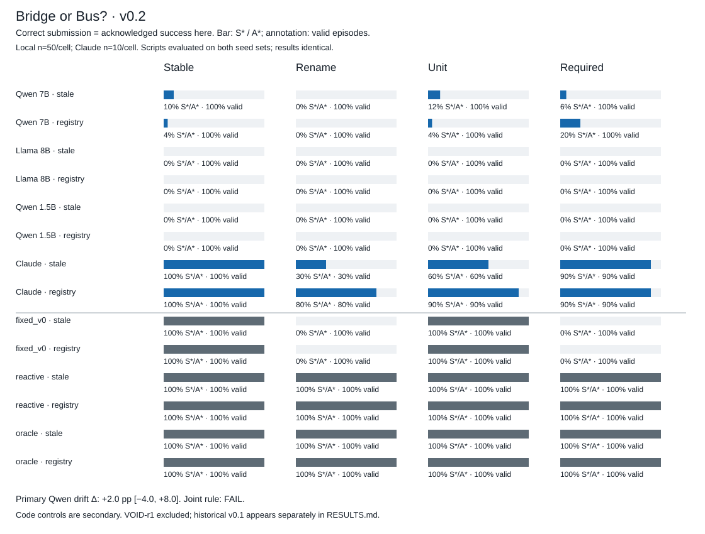

# Bridge or Bus? — reproducible v0.2 delivery

**Hypothesis:** Access to current tool descriptions improves successful completion and truthful acknowledgment after an API changes.

**Pre-registered predictions:** P1 failed for both models; P2 failed for both; P3 held for Qwen 7B and failed for Llama; P4 failed for both; P5 failed; P6 failed for all four actors.

**Headline:** The primary Qwen 7B effect was **+2.0 percentage points** (95% interval **−4.0 to +8.0**); the joint primary/co-primary rule **failed**. None of the three local models used `describe`. Claude's descriptive effect was **+26.7 points** [10.0, 43.3], with invalid actions preventing its technical gate from passing. All 1,280 planned episodes were attempted and their world outcomes are known; the study-wide technical completion criterion failed. Independent study acceptance remains UNKNOWN pending reviewer judgment.

Each entry below is **S* / A* / valid episodes, in percent**. S* is a correct accepted submission; A* also requires `submitted:true`. Valid means both a valid terminal action trajectory and a schema-valid report; these coincide episode by episode here. A valid episode may still fail the task. Each local cell has **50** assignments (seeds 0–49); each Claude cell has **10** (seeds 0–9). The primary is Qwen 7B over the three drift worlds; other actors and individual-world results are secondary.

| Actor | Arm | Stable | Rename | Unit | Required |
| --- | --- | --- | --- | --- | --- |
| Qwen 7B | stale | 10/10/100 | 0/0/100 | 12/12/100 | 6/6/100 |
| Qwen 7B | registry | 4/4/100 | 0/0/100 | 4/4/100 | 20/20/100 |
| Llama 8B | stale | 0/0/100 | 0/0/100 | 0/0/100 | 0/0/100 |
| Llama 8B | registry | 0/0/100 | 0/0/100 | 0/0/100 | 0/0/100 |
| Qwen 1.5B | stale | 0/0/100 | 0/0/100 | 0/0/100 | 0/0/100 |
| Qwen 1.5B | registry | 0/0/100 | 0/0/100 | 0/0/100 | 0/0/100 |
| Claude | stale | 100/100/100 | 30/30/30 | 60/60/60 | 90/90/90 |
| Claude | registry | 100/100/100 | 80/80/80 | 90/90/90 | 90/90/90 |



The frozen code policies were evaluated on **all the same 1,280 assignments per policy**, including the Claude seed subset. Their percentages are identical on seeds 0–49 and 0–9. These are secondary deterministic controls with scripted truthful reports, not additional model calls or evidence about language-model report reliability.

| Secondary code policy | Arm | Stable | Rename | Unit | Required |
| --- | --- | --- | --- | --- | --- |
| fixed_v0 | stale | 100/100/100 | 0/0/100 | 100/100/100 | 0/0/100 |
| fixed_v0 | registry | 100/100/100 | 0/0/100 | 100/100/100 | 0/0/100 |
| reactive | stale | 100/100/100 | 100/100/100 | 100/100/100 | 100/100/100 |
| reactive | registry | 100/100/100 | 100/100/100 | 100/100/100 | 100/100/100 |
| oracle | stale | 100/100/100 | 100/100/100 | 100/100/100 | 100/100/100 |
| oracle | registry | 100/100/100 | 100/100/100 | 100/100/100 | 100/100/100 |

The reactive script succeeds without descriptions by repairing from error messages; the oracle uses the known current contract and, in the registry arm, two description calls. Fixed-v0 succeeds in the unit world by submitting the retained lookup value. No random policy was registered or implemented.

## Read and reproduce

Prepared for Claude, the delegating reviewer. Root `RESULTS.md`, `PROJECT_STATE.md`, RUN files, protocol and analysis code are frozen historical inputs; current documents are here under `delivery/`. [RESULTS.md](RESULTS.md) contains every registered prediction, all 32 model cells, all paired intervals, code controls, v0.1 comparison, deviations, operational events, spend and limits. [cells.csv](cells.csv) and [baseline-results.json](baseline-results.json) provide machine-readable tables. [PROJECT_STATE.md](PROJECT_STATE.md) records the delivery state.

From a fresh clone of `Robin84Bran/research`, enter `bridge-or-bus/v0.2` and run:

```sh
python3 -B delivery/test_reproduce.py
python3 -B delivery/reproduce.py --fresh-clone --fixtures
```

The second command verifies the package, all four freeze digests/chain, the current source-bound freeze, r1/r2 preservation and r2 ledger prefix, and saved push provenance; audits all saved raw calls; rebuilds `build/reproduced-results.json`; compares it **byte for byte** with `build/results.json`; then rebuilds the unchanged synthetic analysis and fake-transport fixtures. It writes `build/reproduction-report.json`. It never collects or edits frozen code. Use a fresh copy per run, or choose new `--output` and `--report` paths, because reproduction outputs are create-once.

Python 3.9+ and its standard library are sufficient for these commands. No credentials, provider runtime, network or parent folder is needed. The existing Node executable is only needed for the optional full frozen test suite's toy-vector cross-language check. The original suite passed 213/213 before delivery; original saved evidence remains in `build/delivery-test-output.txt`.

`--fresh-clone` permits absence only of documented transient patterns: `__pycache__`, `.DS_Store`, `.git`, `*.lock`. Present files are still hash checked. Four empty preservation locks are listed, with original hashes, in [transient-files.json](transient-files.json). Without `--fresh-clone` the adapter requires them. Neither mode weakens raw data, manifest, prompt, schema or analysis hashes. Plain `bob.py verify/analyze` predates the post-freeze delivery namespace, so use the adapter for the published package. Registered scoring and bootstrap code remain the unchanged frozen modules.

The publication/copy filter removes **only** those transient patterns and retains original source, evidence, void evidence, ledgers, historical build outputs, current result and this delivery. [package-manifest.json](package-manifest.json) binds the retained package; the manifest itself and the derived rebuild proof are necessarily outside its self-hash inventory and are still included in the package. New reproduction outputs live under build/. [rebuild-proof.json](rebuild-proof.json) records the independently rebuilt result SHA-256, byte count, omission hashes, package verification and synthetic fixture pass. This demonstrates an actual separate filesystem COPY; no GitHub push, network clone, website release or reviewer acceptance is claimed here.

To regenerate presentation only (no bootstrap, no model calls):

```sh
python3 -B delivery/build_report.py
```

The report generator reads `build/results.json` and evaluates only the already-frozen deterministic code controls. `headline.svg` is a portable standalone figure, with source data in the CSV/JSON tables. Post hoc breakdowns and controls are secondary, with no changes to the primary. Unit-world lookup reuse and mg-derived submissions are observationally indistinguishable for models; exclusive counts remain null/UNKNOWN. Exhaustion after describe is zero in every registry cell. All 1,200 r1 local episodes are VOID-HARNESS and excluded; v0.1 is shown separately.

Accounted cumulative spend is **USD4.667178**, outstanding holds **USD0**; cash billing, hardware and energy remain UNKNOWN. One zero-cost subscription-limit refusal/resume is operational, not model behavior. Study-wide technical completion failed, and independent acceptance remains UNKNOWN. **Stop after v0.2; do not run collection commands.**
