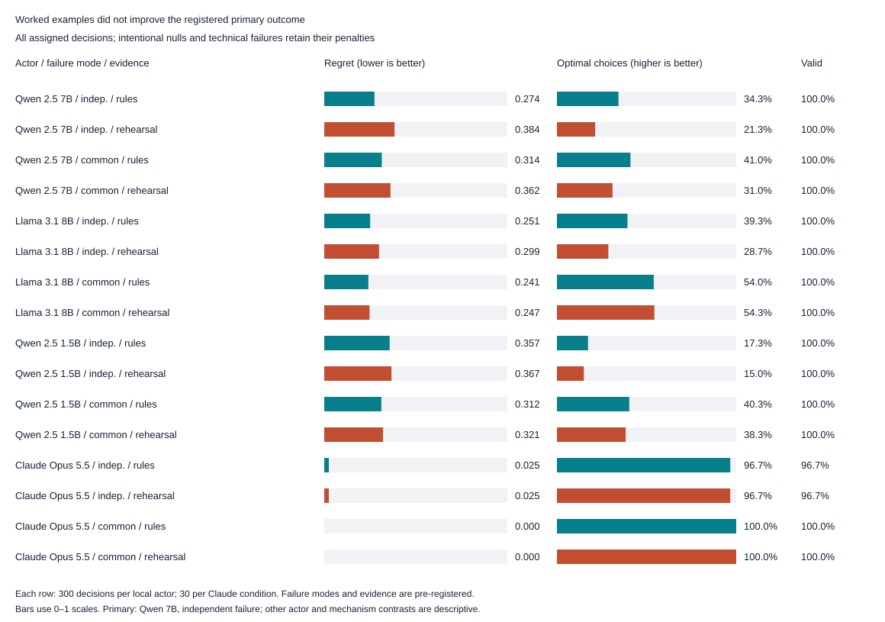

# One Door, Many Hands — final D3 results

**Hypothesis:** Adding failure-free worked examples of deliveries helps models choose fleets that maximize the chance of meeting a deadline, compared with complete written rules alone.

**Joint primary: FAIL.** Rehearsal increased Qwen 7B's mean expected deadline regret from 0.27420 to 0.38410 and reduced exact optimal choices from 103/300 (34.3%) to 64/300 (21.3%) under independent damage. Its paired D_R was −0.10990, 95% interval [−0.13904, −0.08071]; D_O was −13.0 percentage points [−20.33, −6.00]. The observed change was in the opposite direction to the prediction. All four actors completed their assigned episodes and passed the registered technical-validity gates.

**The rehearsal adds no information beyond the rules. A pass would mean models use worked examples better than complete written rules in this task.** This study measures fleet planning in a fixed one-wave simulator. It does not measure real multi-agent execution or resilience.

## Predictions, registered before responses

| ID | Prediction | Held / failed | Observed |
|---|---|---|---|
| P1 | Joint Qwen 7B improvement rule passes | Failed | D_R = −0.10990; D_O = −13.0 percentage points; rehearsal optimal 64/300 (21.3%) |
| P2 | Qwen independent door=1 rehearsal optimal ≥90% | Failed | 2/100 (2%); rules 14/100 (14%); difference −12 points |
| P3 | Qwen independent door=6 rules chooses 24 carriers ≥10% | Held | 36/100 (36%); 24 carriers cannot deliver target ≥7 through six admissions |
| P4 | Qwen common rehearsal optimal ≥90% | Failed | 93/300 (31%) |
| P5 | Llama and Claude each show positive D_R and D_O | Failed | Llama −0.04868 / −10.67 points; Claude 0 / 0; 660 assigned independent decisions combined |

## Comparisons a reader asks first

R* is mean expected deadline regret (lower is better); O* is the exact optimal-choice rate with abstentions and technical failures scored as misses; schema-valid includes explicit null. All three doors receive equal weight. These are absolute outcome levels underlying the primary paired contrast. Local actors each use 100 blocks; Claude uses the preselected ten-block subset, so this table does not establish an actor ranking. Every actor × failure mechanism × evidence condition appears below.

| Actor | Failure mode | Evidence | Assigned | Mean R* ↓ | Optimal O* ↑ | Schema-valid | Null | Technical |
|---|---|---|---|---|---|---|---|---|
| Qwen 2.5 7B | independent | rules | 300 | 0.2742 | 103/300 (34.3%) | 300/300 (100.0%) | 0 | 0 |
| Qwen 2.5 7B | independent | rehearsal | 300 | 0.3841 | 64/300 (21.3%) | 300/300 (100.0%) | 0 | 0 |
| Qwen 2.5 7B | common | rules | 300 | 0.3144 | 123/300 (41.0%) | 300/300 (100.0%) | 57 | 0 |
| Qwen 2.5 7B | common | rehearsal | 300 | 0.3618 | 93/300 (31.0%) | 300/300 (100.0%) | 30 | 0 |
| Llama 3.1 8B | independent | rules | 300 | 0.2507 | 118/300 (39.3%) | 300/300 (100.0%) | 0 | 0 |
| Llama 3.1 8B | independent | rehearsal | 300 | 0.2994 | 86/300 (28.7%) | 300/300 (100.0%) | 0 | 0 |
| Llama 3.1 8B | common | rules | 300 | 0.2410 | 162/300 (54.0%) | 300/300 (100.0%) | 0 | 0 |
| Llama 3.1 8B | common | rehearsal | 300 | 0.2473 | 163/300 (54.3%) | 300/300 (100.0%) | 0 | 0 |
| Qwen 2.5 1.5B | independent | rules | 300 | 0.3572 | 52/300 (17.3%) | 300/300 (100.0%) | 0 | 0 |
| Qwen 2.5 1.5B | independent | rehearsal | 300 | 0.3671 | 45/300 (15.0%) | 300/300 (100.0%) | 0 | 0 |
| Qwen 2.5 1.5B | common | rules | 300 | 0.3119 | 121/300 (40.3%) | 300/300 (100.0%) | 0 | 0 |
| Qwen 2.5 1.5B | common | rehearsal | 300 | 0.3211 | 115/300 (38.3%) | 300/300 (100.0%) | 0 | 0 |
| Claude Opus 5.5 | independent | rules | 30 | 0.0250 | 29/30 (96.7%) | 29/30 (96.7%) | 0 | 1 |
| Claude Opus 5.5 | independent | rehearsal | 30 | 0.0250 | 29/30 (96.7%) | 29/30 (96.7%) | 0 | 1 |
| Claude Opus 5.5 | common | rules | 30 | 0.0000 | 30/30 (100.0%) | 30/30 (100.0%) | 0 | 0 |
| Claude Opus 5.5 | common | rehearsal | 30 | 0.0000 | 30/30 (100.0%) | 30/30 (100.0%) | 0 | 0 |

Claude made 118 valid non-null choices, all exact optima. Both penalized episodes were the same independent door=24 block (71, target=8, failure=62%): rules hit an output limit and rehearsal was rejected by the provider's structured-output machinery. The assigned scores retain both failures. They do not establish that Claude chose a wrong fleet or lacked the task knowledge. Qwen 7B's 87 intentional nulls all occurred under common damage (57 rules, 30 rehearsal); they remain separate from technical failures.

## Code baselines on the identical seeds

These are secondary code policies, not model observations or replacements for the primary. Each entry is **R* / O* / schema-valid rate**, pooled over three doors. Rules and rehearsal contain the same world, so code-policy scores are identical across evidence arms. Each local-grid condition has 300 assignments; each Claude-grid condition has 30. Constant fleets, max expected work, minimum outage, exact oracle and all-null were frozen before collection. Heuristic ties select the first ascending fleet; exact-optimum scoring accepts every tie. Uniform random is a **post hoc**, exact expectation over the three legal fleets at each frozen cell, with no sampled random sequence, model calls, or extra seeds. All-null is a valid schema object with zero useful choices. Code policies have no inference token spend; compute, hardware and electricity costs were not measured.

### 100-block local grid

| Code policy | Independent rules | Independent rehearsal | Common rules | Common rehearsal |
|---|---|---|---|---|
| all_null | 0.631 / 0.0% / 100.0% | 0.631 / 0.0% / 100.0% | 0.530 / 0.0% / 100.0% | 0.530 / 0.0% / 100.0% |
| always1 | 0.101 / 56.0% / 100.0% | 0.101 / 56.0% / 100.0% | 0.000 / 100.0% / 100.0% | 0.000 / 100.0% / 100.0% |
| always24 | 0.427 / 19.7% / 100.0% | 0.427 / 19.7% / 100.0% | 0.353 / 33.3% / 100.0% | 0.353 / 33.3% / 100.0% |
| always6 | 0.228 / 24.3% / 100.0% | 0.228 / 24.3% / 100.0% | 0.177 / 66.7% / 100.0% | 0.177 / 66.7% / 100.0% |
| exact_oracle | 0.000 / 100.0% / 100.0% | 0.000 / 100.0% / 100.0% | 0.000 / 100.0% / 100.0% | 0.000 / 100.0% / 100.0% |
| max_expected_work | 0.101 / 56.0% / 100.0% | 0.101 / 56.0% / 100.0% | 0.000 / 100.0% / 100.0% | 0.000 / 100.0% / 100.0% |
| min_outage | 0.427 / 19.7% / 100.0% | 0.427 / 19.7% / 100.0% | 0.000 / 100.0% / 100.0% | 0.000 / 100.0% / 100.0% |
| uniform_random_POST_HOC | 0.252 / 33.3% / 100.0% | 0.252 / 33.3% / 100.0% | 0.177 / 66.7% / 100.0% | 0.177 / 66.7% / 100.0% |
### 10-block Claude grid

| Code policy | Independent rules | Independent rehearsal | Common rules | Common rehearsal |
|---|---|---|---|---|
| all_null | 0.624 / 0.0% / 100.0% | 0.624 / 0.0% / 100.0% | 0.530 / 0.0% / 100.0% | 0.530 / 0.0% / 100.0% |
| always1 | 0.094 / 60.0% / 100.0% | 0.094 / 60.0% / 100.0% | 0.000 / 100.0% / 100.0% | 0.000 / 100.0% / 100.0% |
| always24 | 0.430 / 16.7% / 100.0% | 0.430 / 16.7% / 100.0% | 0.353 / 33.3% / 100.0% | 0.353 / 33.3% / 100.0% |
| always6 | 0.226 / 23.3% / 100.0% | 0.226 / 23.3% / 100.0% | 0.177 / 66.7% / 100.0% | 0.177 / 66.7% / 100.0% |
| exact_oracle | 0.000 / 100.0% / 100.0% | 0.000 / 100.0% / 100.0% | 0.000 / 100.0% / 100.0% | 0.000 / 100.0% / 100.0% |
| max_expected_work | 0.094 / 60.0% / 100.0% | 0.094 / 60.0% / 100.0% | 0.000 / 100.0% / 100.0% | 0.000 / 100.0% / 100.0% |
| min_outage | 0.430 / 16.7% / 100.0% | 0.430 / 16.7% / 100.0% | 0.000 / 100.0% / 100.0% | 0.000 / 100.0% / 100.0% |
| uniform_random_POST_HOC | 0.250 / 33.3% / 100.0% | 0.250 / 33.3% / 100.0% | 0.177 / 66.7% / 100.0% | 0.177 / 66.7% / 100.0% |

Door-level baseline scores, including V*, are in [baseline-cells.csv](baseline-cells.csv). No oracle, rule engine or random policy was sent to a model.

## Joint rule and paired intervals

| Registered joint component | Observed | Outcome |
|---|---|---|
| All 600 primary decisions attempted | 600/600 | PASS |
| Schema-valid ≥95% in each primary cell | 100/100 in each of six cells | PASS |
| D_R ≥0.05 | -0.10990 | FAIL |
| D_R lower 95% bound >0 | -0.13904 | FAIL |
| D_O lower 95% bound >0 | -0.20333 | FAIL |
| Rehearsal optimal ≥75% | 64/300 = 21.3% | FAIL |
| Rehearsal null / all 600 primary ≤5% | 0/600 (also 0/300 rehearsal) | PASS |

| Actor / mode | Blocks / pairs | D_R [95% interval] | D_O [95% interval] | Rehearsal optimal |
|---|---|---|---|---|
| Claude Opus 5.5 / common | 10 / 30 | 0.00000 [0.00000, 0.00000] | 0.00000 [0.00000, 0.00000] | 100.0% |
| Claude Opus 5.5 / independent | 10 / 30 | 0.00000 [0.00000, 0.00000] | 0.00000 [0.00000, 0.00000] | 96.7% |
| Llama 3.1 8B / common | 100 / 300 | -0.00633 [-0.03887, 0.02627] | 0.00333 [-0.05667, 0.06333] | 54.3% |
| Llama 3.1 8B / independent | 100 / 300 | -0.04868 [-0.08470, -0.01192] | -0.10667 [-0.17333, -0.04000] | 28.7% |
| Qwen 2.5 1.5B / common | 100 / 300 | -0.00920 [-0.02000, 0.00120] | -0.02000 [-0.04000, -0.00333] | 38.3% |
| Qwen 2.5 1.5B / independent | 100 / 300 | -0.00995 [-0.03573, 0.01579] | -0.02333 [-0.05333, 0.00667] | 15.0% |
| Qwen 2.5 7B / common | 100 / 300 | -0.04740 [-0.07027, -0.02627] | -0.10000 [-0.14333, -0.06000] | 31.0% |
| Qwen 2.5 7B / independent | 100 / 300 | -0.10990 [-0.13904, -0.08071] | -0.13000 [-0.20333, -0.06000] | 21.3% |

Only Qwen 7B under independent damage is confirmatory. The other seven actor/mechanism contrasts are descriptive. Intervals reproduce the frozen paired-block percentile bootstrap: 10,000 resamples, seed 20261112, preserving repeated-block multiplicity and all three doors. They describe sensitivity over this fixed numeric grid conditional on one saved reply per prompt; they do not cover all tasks or full generation variance. Complete-valid-pair sensitivity retains all 300 Qwen independent pairs and gives identical primary point estimates and intervals. No post-result sample or alternative significance test was added.

Paired exact-choice discordance (0 means nonoptimal, null or technical miss; 1 means an exact optimum):

| Actor / mode | Wrong→wrong | Wrong→optimal | Optimal→wrong | Optimal→optimal |
|---|---|---|---|---|
| Claude Opus 5.5 / common | 0 | 0 | 0 | 30 |
| Claude Opus 5.5 / independent | 1 | 0 | 0 | 29 |
| Llama 3.1 8B / common | 112 | 26 | 25 | 137 |
| Llama 3.1 8B / independent | 144 | 38 | 70 | 48 |
| Qwen 2.5 1.5B / common | 178 | 1 | 7 | 114 |
| Qwen 2.5 1.5B / independent | 234 | 14 | 21 | 31 |
| Qwen 2.5 7B / common | 169 | 8 | 38 | 85 |
| Qwen 2.5 7B / independent | 162 | 35 | 74 | 29 |

The exact paired fleet choices are in [paired-choices.csv](paired-choices.csv), and full-precision bootstrap results remain in [analysis-final-d3.json](../collection/analysis-final-d3.json).

## Full model cells

All 48 actor × door × mechanism × evidence cells follow. R*, O* and V* use assigned denominators. Factual chosen-work and chosen-outage means use only schema-valid non-null choices; unavailable choices have null factual values in the saved analysis. Work is expected delivered units and outage means all carriers fail, not the probability of missing the deadline. No unstarted episode remains. [model-cells.csv](model-cells.csv) additionally includes tokens, seconds, cost, failure reasons and full precision.

| Actor | Door | Failure | Evidence | Assigned / attempted | R* | O* | V* | Valid | Null / technical | Choices 1 / 6 / 24 | E[work] chosen | P[outage] chosen |
|---|---|---|---|---|---|---|---|---|---|---|---|---|
| Claude Opus 5.5 | 1 | common | rehearsal | 10 / 10 | 0.00000 | 100.0% | 0.53000 | 10/10 | 0 / 0 | 10 / 0 / 0 | 12.72000 | 0.47 |
| Claude Opus 5.5 | 1 | common | rules | 10 / 10 | 0.00000 | 100.0% | 0.53000 | 10/10 | 0 / 0 | 10 / 0 / 0 | 12.72000 | 0.47 |
| Claude Opus 5.5 | 1 | independent | rehearsal | 10 / 10 | 0.00000 | 100.0% | 0.53000 | 10/10 | 0 / 0 | 10 / 0 / 0 | 12.72000 | 0.47 |
| Claude Opus 5.5 | 1 | independent | rules | 10 / 10 | 0.00000 | 100.0% | 0.53000 | 10/10 | 0 / 0 | 10 / 0 / 0 | 12.72000 | 0.47 |
| Claude Opus 5.5 | 24 | common | rehearsal | 10 / 10 | 0.00000 | 100.0% | 0.53000 | 10/10 | 0 / 0 | 10 / 0 / 0 | 12.72000 | 0.47 |
| Claude Opus 5.5 | 24 | common | rules | 10 / 10 | 0.00000 | 100.0% | 0.53000 | 10/10 | 0 / 0 | 9 / 0 / 1 | 12.72000 | 0.47 |
| Claude Opus 5.5 | 24 | independent | rehearsal | 10 / 10 | 0.07487 | 90.0% | 0.62241 | 9/10 | 0 / 1 | 4 / 1 / 4 | 13.12000 | 0.263958 |
| Claude Opus 5.5 | 24 | independent | rules | 10 / 10 | 0.07487 | 90.0% | 0.62241 | 9/10 | 0 / 1 | 4 / 1 / 4 | 13.12000 | 0.263958 |
| Claude Opus 5.5 | 6 | common | rehearsal | 10 / 10 | 0.00000 | 100.0% | 0.53000 | 10/10 | 0 / 0 | 6 / 4 / 0 | 12.72000 | 0.47 |
| Claude Opus 5.5 | 6 | common | rules | 10 / 10 | 0.00000 | 100.0% | 0.53000 | 10/10 | 0 / 0 | 10 / 0 / 0 | 12.72000 | 0.47 |
| Claude Opus 5.5 | 6 | independent | rehearsal | 10 / 10 | 0.00000 | 100.0% | 0.64533 | 10/10 | 0 / 0 | 4 / 6 / 0 | 12.72000 | 0.244113 |
| Claude Opus 5.5 | 6 | independent | rules | 10 / 10 | 0.00000 | 100.0% | 0.64533 | 10/10 | 0 / 0 | 4 / 6 / 0 | 12.72000 | 0.244113 |
| Llama 3.1 8B | 1 | common | rehearsal | 100 / 100 | 0.40920 | 25.0% | 0.12080 | 100/100 | 0 / 0 | 25 / 11 / 64 | 3.49320 | 0.47 |
| Llama 3.1 8B | 1 | common | rules | 100 / 100 | 0.39720 | 25.0% | 0.13280 | 100/100 | 0 / 0 | 25 / 11 / 64 | 3.78360 | 0.47 |
| Llama 3.1 8B | 1 | independent | rehearsal | 100 / 100 | 0.39460 | 26.0% | 0.13540 | 100/100 | 0 / 0 | 26 / 20 / 54 | 4.56642 | 0.130436 |
| Llama 3.1 8B | 1 | independent | rules | 100 / 100 | 0.33920 | 36.0% | 0.19080 | 100/100 | 0 / 0 | 36 / 21 / 43 | 5.82707 | 0.174776 |
| Llama 3.1 8B | 24 | common | rehearsal | 100 / 100 | 0.00000 | 100.0% | 0.53000 | 100/100 | 0 / 0 | 30 / 12 / 58 | 12.72000 | 0.47 |
| Llama 3.1 8B | 24 | common | rules | 100 / 100 | 0.00000 | 100.0% | 0.53000 | 100/100 | 0 / 0 | 25 / 12 / 63 | 12.72000 | 0.47 |
| Llama 3.1 8B | 24 | independent | rehearsal | 100 / 100 | 0.14058 | 39.0% | 0.56750 | 100/100 | 0 / 0 | 37 / 14 / 49 | 12.72000 | 0.190122 |
| Llama 3.1 8B | 24 | independent | rules | 100 / 100 | 0.10882 | 44.0% | 0.59926 | 100/100 | 0 / 0 | 32 / 22 / 46 | 12.72000 | 0.155245 |
| Llama 3.1 8B | 6 | common | rehearsal | 100 / 100 | 0.33280 | 38.0% | 0.19720 | 100/100 | 0 / 0 | 25 / 13 / 62 | 6.72960 | 0.47 |
| Llama 3.1 8B | 6 | common | rules | 100 / 100 | 0.32580 | 37.0% | 0.20420 | 100/100 | 0 / 0 | 28 / 9 / 63 | 6.85560 | 0.47 |
| Llama 3.1 8B | 6 | independent | rehearsal | 100 / 100 | 0.36298 | 21.0% | 0.29194 | 100/100 | 0 / 0 | 29 / 23 / 48 | 9.51244 | 0.141451 |
| Llama 3.1 8B | 6 | independent | rules | 100 / 100 | 0.30409 | 38.0% | 0.35084 | 100/100 | 0 / 0 | 38 / 22 / 40 | 9.92603 | 0.195327 |
| Qwen 2.5 1.5B | 1 | common | rehearsal | 100 / 100 | 0.52200 | 1.0% | 0.00800 | 100/100 | 0 / 0 | 1 / 17 / 82 | 1.00320 | 0.47 |
| Qwen 2.5 1.5B | 1 | common | rules | 100 / 100 | 0.53000 | 0.0% | 0.00000 | 100/100 | 0 / 0 | 0 / 23 / 77 | 0.92180 | 0.47 |
| Qwen 2.5 1.5B | 1 | independent | rehearsal | 100 / 100 | 0.50960 | 3.0% | 0.02040 | 100/100 | 0 / 0 | 3 / 30 / 67 | 2.32036 | 0.0194591 |
| Qwen 2.5 1.5B | 1 | independent | rules | 100 / 100 | 0.50900 | 3.0% | 0.02100 | 100/100 | 0 / 0 | 3 / 42 / 55 | 2.67716 | 0.0232519 |
| Qwen 2.5 1.5B | 24 | common | rehearsal | 100 / 100 | 0.00000 | 100.0% | 0.53000 | 100/100 | 0 / 0 | 3 / 20 / 77 | 12.72000 | 0.47 |
| Qwen 2.5 1.5B | 24 | common | rules | 100 / 100 | 0.00000 | 100.0% | 0.53000 | 100/100 | 0 / 0 | 1 / 24 / 75 | 12.72000 | 0.47 |
| Qwen 2.5 1.5B | 24 | independent | rehearsal | 100 / 100 | 0.12600 | 26.0% | 0.58208 | 100/100 | 0 / 0 | 6 / 41 / 53 | 12.72000 | 0.0322988 |
| Qwen 2.5 1.5B | 24 | independent | rules | 100 / 100 | 0.11028 | 31.0% | 0.59780 | 100/100 | 0 / 0 | 3 / 49 / 48 | 12.72000 | 0.0278867 |
| Qwen 2.5 1.5B | 6 | common | rehearsal | 100 / 100 | 0.44140 | 14.0% | 0.08860 | 100/100 | 0 / 0 | 1 / 13 / 86 | 4.77480 | 0.47 |
| Qwen 2.5 1.5B | 6 | common | rules | 100 / 100 | 0.40580 | 21.0% | 0.12420 | 100/100 | 0 / 0 | 1 / 20 / 79 | 5.41560 | 0.47 |
| Qwen 2.5 1.5B | 6 | independent | rehearsal | 100 / 100 | 0.46572 | 16.0% | 0.18920 | 100/100 | 0 / 0 | 4 / 27 / 69 | 8.13523 | 0.0226471 |
| Qwen 2.5 1.5B | 6 | independent | rules | 100 / 100 | 0.45218 | 18.0% | 0.20274 | 100/100 | 0 / 0 | 3 / 31 / 66 | 8.30016 | 0.0195147 |
| Qwen 2.5 7B | 1 | common | rehearsal | 100 / 100 | 0.53000 | 0.0% | 0.00000 | 100/100 | 8 / 0 | 0 / 2 / 90 | 0.58543 | 0.458913 |
| Qwen 2.5 7B | 1 | common | rules | 100 / 100 | 0.48760 | 8.0% | 0.04240 | 100/100 | 34 / 0 | 8 / 2 / 56 | 2.10303 | 0.433636 |
| Qwen 2.5 7B | 1 | independent | rehearsal | 100 / 100 | 0.52180 | 2.0% | 0.00820 | 100/100 | 0 / 0 | 2 / 14 / 84 | 1.57831 | 0.0164741 |
| Qwen 2.5 7B | 1 | independent | rules | 100 / 100 | 0.40620 | 28.0% | 0.12380 | 100/100 | 0 / 0 | 28 / 26 / 46 | 4.43403 | 0.165506 |
| Qwen 2.5 7B | 24 | common | rehearsal | 100 / 100 | 0.04840 | 89.0% | 0.48160 | 100/100 | 11 / 0 | 1 / 1 / 87 | 12.98697 | 0.458876 |
| Qwen 2.5 7B | 24 | common | rules | 100 / 100 | 0.04000 | 92.0% | 0.49000 | 100/100 | 8 / 0 | 23 / 3 / 66 | 12.78261 | 0.467391 |
| Qwen 2.5 7B | 24 | independent | rehearsal | 100 / 100 | 0.10227 | 52.0% | 0.60581 | 100/100 | 0 / 0 | 6 / 10 / 84 | 12.72000 | 0.0374935 |
| Qwen 2.5 7B | 24 | independent | rules | 100 / 100 | 0.11519 | 36.0% | 0.59289 | 100/100 | 0 / 0 | 38 / 27 / 35 | 12.72000 | 0.205188 |
| Qwen 2.5 7B | 6 | common | rehearsal | 100 / 100 | 0.50700 | 4.0% | 0.02300 | 100/100 | 11 / 0 | 2 / 2 / 85 | 3.73618 | 0.454831 |
| Qwen 2.5 7B | 6 | common | rules | 100 / 100 | 0.41560 | 23.0% | 0.11440 | 100/100 | 15 / 0 | 15 / 8 / 62 | 5.74871 | 0.445647 |
| Qwen 2.5 7B | 6 | independent | rehearsal | 100 / 100 | 0.52822 | 10.0% | 0.12671 | 100/100 | 0 / 0 | 11 / 15 / 74 | 7.45278 | 0.0641689 |
| Qwen 2.5 7B | 6 | independent | rules | 100 / 100 | 0.30120 | 39.0% | 0.35372 | 100/100 | 0 / 0 | 38 / 26 / 36 | 10.01588 | 0.213725 |

## Oracle and common-damage controls

| Failure / door / optimal fleet set | Cells on 100-block grid |
|---|---|
| common/door1/1 | 100 |
| common/door24/1,6,24 | 100 |
| common/door6/1,6 | 100 |
| independent/door1/1 | 100 |
| independent/door24/1 | 32 |
| independent/door24/24 | 59 |
| independent/door24/6 | 9 |
| independent/door6/1 | 36 |
| independent/door6/6 | 64 |

Under common damage every feasible fleet ties at success probability 1−p. Door=1 accepts only fleet 1 as feasible; door=6 accepts 1 and 6; door=24 accepts all three on this target grid. All 300 common cells therefore include fleet 1 in the optimum; 200 have ties. Independent cells have no ties. Claude's subset has 30 independent and 30 common world cells; its exact sets can be selected by blocks from [the frozen 600-cell rational oracle](../config/oracle.json). Identical values and ties apply in both evidence arms. Common-damage failures indicate objective or feasibility errors; they do not show hidden redundancy.

## Validity, failure modes and resources

| Actor | Assigned / attempted | Overall valid | Every cell gate | Technical gate |
|---|---|---|---|---|
| Claude Opus 5.5 | 120 / 120 | 98.3% | PASS | PASS |
| Llama 3.1 8B | 1200 / 1200 | 100.0% | PASS | PASS |
| Qwen 2.5 1.5B | 1200 / 1200 | 100.0% | PASS | PASS |
| Qwen 2.5 7B | 1200 / 1200 | 100.0% | PASS | PASS |

All local cells are 100% schema-valid. Claude is 118/120 (98.33%) valid overall; its two affected cells each have 9/10, meeting the frozen ≥90% per-cell and ≥95% overall rules. The local threshold is ≥95% per cell. Schema validity does not imply a useful decision. There were no local technical failures, no local transport failures and no unstarted decisions. The two Claude failures are retained as technical episode misses under the frozen scoring; output and schema limits do not constitute evidence about the model's preferred fleet.

| Actor / evidence | Calls | Fresh input | Cache create / read | Output incl. thinking | Terminal seconds | API-equiv. USD |
|---|---|---|---|---|---|---|
| Qwen 2.5 7B / rules | 600 | 164120 | 0 / 0 | 3905 | 341.681 | 0.000000 |
| Qwen 2.5 7B / rehearsal | 600 | 193120 | 0 / 0 | 4108 | 382.002 | 0.000000 |
| Llama 3.1 8B / rules | 600 | 161100 | 0 / 0 | 3783 | 122.331 | 0.000000 |
| Llama 3.1 8B / rehearsal | 600 | 188100 | 0 / 0 | 3959 | 156.684 | 0.000000 |
| Qwen 2.5 1.5B / rules | 600 | 164120 | 0 / 0 | 4000 | 51.544 | 0.000000 |
| Qwen 2.5 1.5B / rehearsal | 600 | 193120 | 0 / 0 | 4034 | 58.611 | 0.000000 |
| Claude Opus 5.5 / rules | 60 | 120 | 88816 / 0 | 12048 | 210.875 | 0.951974 |
| Claude Opus 5.5 / rehearsal | 60 | 120 | 92777 / 0 | 11521 | 204.757 | 0.973124 |

Settled API-equivalent spend is **USD1.925098**, open holds **USD0**, and the paid ledger has 246 events (123 reservations and 123 settlements: 120 generated episodes plus three operational nonstarts). The historical USD4/input-million and USD20/output-million planning basis and cache categories are documented in [cost-basis.json](../evidence/cost-basis.json); totals use independently decoded settled usage and reported cost, not that simple reservation alone. Thinking is already included in output and is never charged twice. Cash billed is **UNKNOWN** (`null`); these calls used subscription accounting. Local inference API spend is USD0; hardware, electricity, subscription allocation and opportunity costs are UNKNOWN.

Active collector time: local 1206.183s / 28,800s; Claude 520.816s / 7,200s. The table shows terminal-minus-start durations and excludes nonstart attempts; charged active time also includes preflight/collector activity. Waiting for quota resets is not generation latency. All calls are below the USD25 frontier envelope, USD39 project stop and USD40 absolute ceiling, with the USD1 protected reserve retained. No spending extension occurred. Frozen timeouts were 180s local and 300s Claude; generation controls were 192 local output tokens and 512 Claude accounted output tokens (576 was a padded reservation, not a scientific output cap). Rehearsal uses additional input; there is no equal-token or cost-adjusted superiority claim.

## Operational events and deviations

| Operational event | Episode / attempt | Finished UTC | Reset UTC | Cost |
|---|---|---|---|---|
| verified transport nonstart | claude-b84-d24-independent-rules | 2026-11-11T15:58:41.998225+00:00 | 2026-11-11T15:58:41.998225+00:00 | USD0 |
| usage-limit pause | claude-b84-d24-independent-rules@usage-resume-0001 | 2026-11-11T17:36:40.068766+00:00 | 2026-11-11T18:30:00+00:00 | USD0 |
| usage-limit pause | claude-b55-d24-independent-rehearsal | 2026-11-11T20:39:36.107634+00:00 | 2026-11-11T23:30:00+00:00 | USD0 |

The two zero-use usage-limit refusals and one verified pre-generation ENOTFOUND/DNS failure are operational nonstarts, not model behaviour or model technical failures. Their raw bytes, request hashes, zero settlements and timer charges are retained. Only the eventual generated reply at each assigned position enters the scientific score. Resume requests preserve the original bytes. Generated attempts were never resent. The accounting clearance also records one reservation overrun: USD0.022088 actual against USD0.021248 held, an excess of USD0.000840. It is an accounting event; the separately observed missing/length-limited payload retains its technical penalty. There are no later saved accounting-excess markers.

All applied amendments are preserved in [DEVIATIONS.md](../DEVIATIONS.md) and their immutable freezes:

- **r1 / A1 before collection:** preserve the standalone study and representation claim; correct episode-content versus integrity routing, first-call handling, schema/metadata validation, no-resend recovery and push checks. Prompts, scientific scores, schedule, settings and denominators stay fixed.
- **D1 and final recovery guard after the A1 push:** classify exact zero-use limits as nonstarts, retain identical pending requests and append-only attempt evidence, and isolate later fatal stops. The sealed D1 draft was not used for calls.
- **D2 after the saved DNS stop:** classify the exact complete zero-use ENOTFOUND envelope as a verified nonstart; repair generated-envelope routing and accept supported two-turn structured replies. The saved DNS episode was not a behavioural failure. Original STOPs, raw bytes and terminals remain intact.
- **D3 after the saved reservation excess:** settle measured cumulative usage for the narrow budget-stop envelope, separate reservation overruns from scientific scores, and enlarge future holds from prior measured maxima plus 10% without changing scientific output controls. All parent evidence remains bound.
- **Analysis invocation, post-collection:** the runbook's relative `--data collection` command stopped in provenance replay because an absolute `ROOT` was compared with a relative data path. It wrote no analysis and reached no bootstrap/statistics. The invocation was corrected to absolute root/data/output paths, without editing frozen code or prompts. Exactly one completed canonical scientific analysis was produced; the required independent copy rebuild is a verification replay, not new collection.
- **Post hoc presentation:** aggregate headline levels, baseline views on the fixed Claude subset, exact uniform-random expectations and the figure are labeled descriptive presentation. They do not change any registered endpoint, interval, pass rule or prediction.

## Integrity and reproduction

All six freezes verify through their exact current or archived bytes (65 original, 86 A1, 181 D1 draft, 192 D1 final, 218 D2, 245 D3 bound files). All three collection baselines and append-only prefixes verify. The original GitHub activity receipt records commit `f8f9486612d16140eb4f3e36314a6c01737efb65`, pushed 2026-11-11 10:58:59 UTC, before collection; later local deviations have their retained attestations. No new publication or push was performed for this delivery.

The root RESULTS.md, PROJECT_STATE.md and other Markdown inputs remain frozen historical records. Final RESULTS.md, README.md, the figure and presentation/reproduction tools are under **delivery/** to preserve the input set. See [README.md](README.md) for fresh-clone commands and [rebuild-verification.json](rebuild-verification.json) for copy/rebuild byte comparisons. The package excludes only `__pycache__`, `.DS_Store`, `.git` and `*.lock` paths. Removed files and saved hashes are listed in [package-snapshot.json](package-snapshot.json). None of those paths is frozen or baseline-bound, so the ordinary frozen verifier passes after removal; no relaxed fresh-clone mode, monkey-patch, recreated lock, or skipped evidence is needed. Frozen archives retain their original internal bytes.

## Interpretation and limits

The primary prediction failed plainly. These worked examples did not help Qwen 7B; they worsened both registered outcomes on this fixed grid. Llama also has negative independent point estimates; Qwen 1.5B's descriptive independent interval spans zero. Claude is at the valid-choice ceiling on ten preselected blocks, and equal penalized failure counts leave its evidence contrast exactly zero. A tie at this ceiling cannot establish that rehearsal is universally useless, and the smaller fixed Claude subset cannot support a model ranking.

The pattern is **consistent with** smaller models misusing the failure-free delivery representation, or with prompt length, attention or objective confusion. Those mechanisms were not tested. The rehearsal contains no new world facts or future-damage evidence. This experiment has one-shot choices, a one-wave bottleneck, fixed targets/failure probabilities, seeded local sampling and one saved generation per prompt. It does not test actual teams, queuing, retries, repairs, return trips or other tasks. Independent exact input-token completeness remains UNKNOWN without an independent expected tokenizer count; retained identity/context checks show no detected loss but do not prove completeness. Missing returned effort remains UNKNOWN where absent. The study relates to The Useful Core's feasibility theme but is a separate experiment.

Scientific failure and technical completion are separate: the joint scientific claim fails, all actor technical gates pass, and independent Claude delivery acceptance remains pending. No result-dependent collection, prompt change, endpoint change or new version was introduced.
