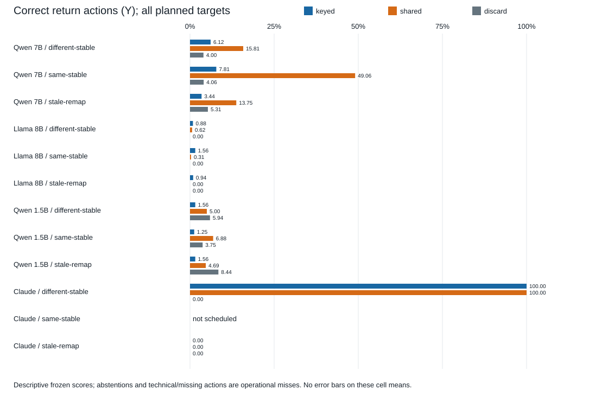

# The Portable Self v0.2

Hypothesis: Automatically routing a model’s own notes to the right console improves its later actions compared with letting it manage a shared notebook.

Predictions: **P1 failed; P2 failed; P3 held; P4 failed; P5 held; P6 failed; P7 failed. These are re-registered v0.2 predictions informed by the stopped v0.1 cohort.**

**The joint primary claim failed.** On distinct stable mappings, Qwen 7B scored **6.125% keyed versus 15.8125% shared** correct actions: ΔY = **−9.6875 percentage points**, 95% interval **[−13.1266, −6.3125]**. Complete-return performance was **0.75% versus 3.00%**, ΔF = **−2.25 points [−4.25, −0.50]**. All four joint conditions failed. Low technical validity also prevents the agreed full-study acceptance; this delivery does not assert ACCEPTED.

All 1,080 scheduled episodes were attempted and sealed: 1,020 local and 60 Claude. Whole-episode validity is 695/1,080 (64.35%); it measures eight compliant replies, not task correctness. Claude’s shared and keyed stable scores both reached 100%, so routing had no advantage there; both fell to zero after remapping.

Each entry below is **Y / F / valid-episode rate**. Y counts correct actions out of 16 planned; F counts fully correct four-action returns out of four planned. Abstentions and missing actions are operational misses; their factual correctness stays null. N is the number of seed blocks per arm. Every model/condition/arm is shown; Claude same-stable was never scheduled.

| Actor | Condition | N / arm | Keyed Y / F / valid | Shared Y / F / valid | Discard Y / F / valid |
| --- | --- | --- | --- | --- | --- |
| Qwen 7B | different-stable | 100 | 6.12% / 0.75% / 62.00% | 15.81% / 3.00% / 87.00% | 4.00% / 0.00% / 87.00% |
| Qwen 7B | same-stable | 20 | 7.81% / 1.25% / 70.00% | 49.06% / 32.50% / 100.00% | 4.06% / 0.00% / 90.00% |
| Qwen 7B | stale-remap | 20 | 3.44% / 0.00% / 60.00% | 13.75% / 1.25% / 90.00% | 5.31% / 0.00% / 90.00% |
| Llama 8B | different-stable | 100 | 0.88% / 0.00% / 33.00% | 0.62% / 0.00% / 62.00% | 0.00% / 0.00% / 37.00% |
| Llama 8B | same-stable | 20 | 1.56% / 0.00% / 35.00% | 0.31% / 0.00% / 70.00% | 0.00% / 0.00% / 10.00% |
| Llama 8B | stale-remap | 20 | 0.94% / 0.00% / 45.00% | 0.00% / 0.00% / 65.00% | 0.00% / 0.00% / 40.00% |
| Qwen 1.5B | different-stable | 20 | 1.56% / 0.00% / 55.00% | 5.00% / 1.25% / 70.00% | 5.94% / 1.25% / 65.00% |
| Qwen 1.5B | same-stable | 20 | 1.25% / 0.00% / 65.00% | 6.88% / 0.00% / 75.00% | 3.75% / 1.25% / 55.00% |
| Qwen 1.5B | stale-remap | 20 | 1.56% / 0.00% / 55.00% | 4.69% / 0.00% / 70.00% | 8.44% / 0.00% / 65.00% |
| Claude | different-stable | 10 | 100.00% / 100.00% / 100.00% | 100.00% / 100.00% / 100.00% | 0.00% / 0.00% / 90.00% |
| Claude | same-stable | 0 | not scheduled | not scheduled | not scheduled |
| Claude | stale-remap | 10 | 0.00% / 0.00% / 100.00% | 0.00% / 0.00% / 100.00% | 0.00% / 0.00% / 100.00% |



Secondary, frozen code-only references on **the same seeds as each actor** follow. They do not make model calls. “Executable” is 100% deterministic policy execution, not model schema validity. The uniform policy is a seeded sample (25% expected per action; 1/256 expected complete random return), not a fitted chance line. The last-console buffer uses only the last demonstration; keyed-ledger uses only each console’s demonstrations. Oracle alone sees remapped truth and is a ceiling. They are standalone policies, not extra memory arms.

| Matched actor seeds | Condition | Seeds | Uniform Y / F / executable | Last-console Y / F / executable | Keyed-ledger Y / F / executable | Oracle Y / F / executable |
| --- | --- | --- | --- | --- | --- | --- |
| Qwen 7B | different-stable | 0–99 | 25.56% / 0.25% / 100% | 41.06% / 25.00% / 100% | 100.00% / 100.00% / 100% | 100.00% / 100.00% / 100% |
| Qwen 7B | same-stable | 0–19 | 27.19% / 0.00% / 100% | 100.00% / 100.00% / 100% | 100.00% / 100.00% / 100% | 100.00% / 100.00% / 100% |
| Qwen 7B | stale-remap | 0–19 | 26.88% / 2.50% / 100% | 17.19% / 3.75% / 100% | 0.00% / 0.00% / 100% | 100.00% / 100.00% / 100% |
| Llama 8B | different-stable | 0–99 | 25.56% / 0.25% / 100% | 41.06% / 25.00% / 100% | 100.00% / 100.00% / 100% | 100.00% / 100.00% / 100% |
| Llama 8B | same-stable | 0–19 | 27.19% / 0.00% / 100% | 100.00% / 100.00% / 100% | 100.00% / 100.00% / 100% | 100.00% / 100.00% / 100% |
| Llama 8B | stale-remap | 0–19 | 26.88% / 2.50% / 100% | 17.19% / 3.75% / 100% | 0.00% / 0.00% / 100% | 100.00% / 100.00% / 100% |
| Qwen 1.5B | different-stable | 0–19 | 24.38% / 0.00% / 100% | 40.00% / 25.00% / 100% | 100.00% / 100.00% / 100% | 100.00% / 100.00% / 100% |
| Qwen 1.5B | same-stable | 0–19 | 27.19% / 0.00% / 100% | 100.00% / 100.00% / 100% | 100.00% / 100.00% / 100% | 100.00% / 100.00% / 100% |
| Qwen 1.5B | stale-remap | 0–19 | 26.88% / 2.50% / 100% | 17.19% / 3.75% / 100% | 0.00% / 0.00% / 100% | 100.00% / 100.00% / 100% |
| Claude | different-stable | 0–9 | 23.12% / 0.00% / 100% | 41.25% / 25.00% / 100% | 100.00% / 100.00% / 100% | 100.00% / 100.00% / 100% |
| Claude | stale-remap | 0–9 | 26.88% / 2.50% / 100% | 17.50% / 5.00% / 100% | 0.00% / 0.00% / 100% | 100.00% / 100.00% / 100% |

These comparisons concern a synthetic four-console task. They are consistent with useful persistent memory in Claude and stale-note use after remapping, but no semantic-memory or causal mediation mechanism was tested. Routing changes visible context as well as storage access; the prompt-token confound remains.

Read [RESULTS.md](RESULTS.md) for joint criteria, every prediction, full cells, all paired intervals with prompt tokens, operational events, v0.1, deviations, spend and limitations. The package is Python-standard-library-only and needs no model service, credential or network for reproduction.

From the v0.2 folder in a fresh GitHub clone:

```sh
python3 -B collection/delivery/reproduce.py --fresh-clone
python3 -B collection/delivery/reproduce.py --fresh-clone --output /private/tmp/portable-self-analysis-rebuilt.json
```

The output must be a new path. The frozen exact verifier needs an omitted empty lock, so fresh-clone mode supplies its hash-bound saved bytes only in a disposable validation view, then runs the original verifier and unchanged analysis against the real clone. [transient-files.json](transient-files.json) lists saved hashes; [rebuild-report.json](rebuild-report.json) records the independent copy and byte comparison. Only __pycache__, .DS_Store, .git and *.lock are excluded from the published package.

The source analysis ran once; the independent copy replay is verification only. The rebuild matched all 3,894,883 output bytes (SHA-256 `ce11027738d94086487471f5be7334c5c68fa1f669ddd2e939089c867384e6b9`); substantive tampering, omission and extra-input probes were rejected. Do not rerun collection. Three freezes and the raw evidence are immutable. Delivery files are under collection/delivery/ to preserve exact root inventory. The offline suite passed 138/139 tests: one historical STOP fixture fails against completed collection state; the exact failure is disclosed in RESULTS, not repaired in frozen code. The independent rebuild verifies actual collection integrity separately.

Accounted exposure: **USD4.775331**, held **USD0**; actual cash billing **UNKNOWN**. Full-study acceptance criteria are not met because technical validity is low. Work was delegated by Claude under the Claude/Codex agreement; independent reviewer acceptance and later publication remain separate steps.
