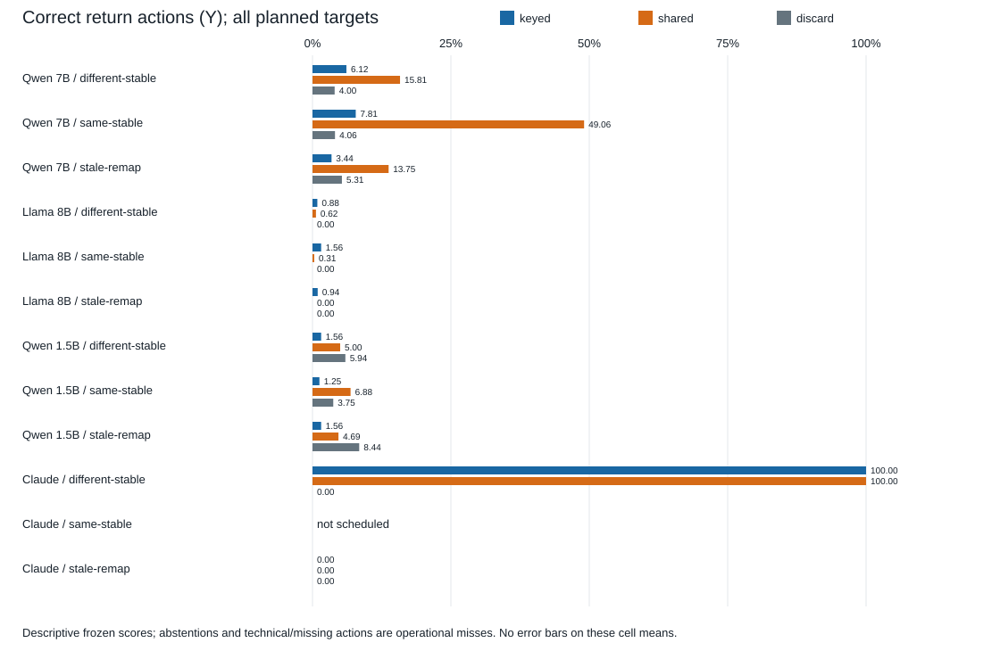

# The Portable Self v0.2 — results

Hypothesis: Automatically routing a model’s own notes to the right console improves its later actions compared with letting it manage a shared notebook.

Predictions: **P1 failed; P2 failed; P3 held; P4 failed; P5 held; P6 failed; P7 failed. These are re-registered v0.2 predictions informed by the stopped v0.1 cohort.**

**The joint primary claim failed.** On distinct stable mappings, Qwen 7B scored **6.125% keyed versus 15.8125% shared** correct actions: ΔY = **−9.6875 percentage points**, 95% interval **[−13.1266, −6.3125]**. Complete-return performance was **0.75% versus 3.00%**, ΔF = **−2.25 points [−4.25, −0.50]**. All four joint conditions failed. Low technical validity also prevents the agreed full-study acceptance; this delivery does not assert ACCEPTED.

All 1,080 scheduled episodes were attempted and sealed: 1,020 local and 60 Claude. Whole-episode validity is 695/1,080 (64.35%); it measures eight compliant replies, not task correctness. Claude’s shared and keyed stable scores both reached 100%, so routing had no advantage there; both fell to zero after remapping.

Each entry below is **Y / F / valid-episode rate**. Y counts correct actions out of 16 planned; F counts fully correct four-action returns out of four planned. Abstentions and missing actions are operational misses; their factual correctness stays null. N is the number of seed blocks per arm. Every model/condition/arm is shown; Claude same-stable was never scheduled.

| Actor | Condition | N / arm | Keyed Y / F / valid | Shared Y / F / valid | Discard Y / F / valid |
| --- | --- | --- | --- | --- | --- |
| Qwen 7B | different-stable | 100 | 6.12% / 0.75% / 62.00% | 15.81% / 3.00% / 87.00% | 4.00% / 0.00% / 87.00% |
| Qwen 7B | same-stable | 20 | 7.81% / 1.25% / 70.00% | 49.06% / 32.50% / 100.00% | 4.06% / 0.00% / 90.00% |
| Qwen 7B | stale-remap | 20 | 3.44% / 0.00% / 60.00% | 13.75% / 1.25% / 90.00% | 5.31% / 0.00% / 90.00% |
| Llama 8B | different-stable | 100 | 0.88% / 0.00% / 33.00% | 0.62% / 0.00% / 62.00% | 0.00% / 0.00% / 37.00% |
| Llama 8B | same-stable | 20 | 1.56% / 0.00% / 35.00% | 0.31% / 0.00% / 70.00% | 0.00% / 0.00% / 10.00% |
| Llama 8B | stale-remap | 20 | 0.94% / 0.00% / 45.00% | 0.00% / 0.00% / 65.00% | 0.00% / 0.00% / 40.00% |
| Qwen 1.5B | different-stable | 20 | 1.56% / 0.00% / 55.00% | 5.00% / 1.25% / 70.00% | 5.94% / 1.25% / 65.00% |
| Qwen 1.5B | same-stable | 20 | 1.25% / 0.00% / 65.00% | 6.88% / 0.00% / 75.00% | 3.75% / 1.25% / 55.00% |
| Qwen 1.5B | stale-remap | 20 | 1.56% / 0.00% / 55.00% | 4.69% / 0.00% / 70.00% | 8.44% / 0.00% / 65.00% |
| Claude | different-stable | 10 | 100.00% / 100.00% / 100.00% | 100.00% / 100.00% / 100.00% | 0.00% / 0.00% / 90.00% |
| Claude | same-stable | 0 | not scheduled | not scheduled | not scheduled |
| Claude | stale-remap | 10 | 0.00% / 0.00% / 100.00% | 0.00% / 0.00% / 100.00% | 0.00% / 0.00% / 100.00% |



Secondary, frozen code-only references on **the same seeds as each actor** follow. They do not make model calls. “Executable” is 100% deterministic policy execution, not model schema validity. The uniform policy is a seeded sample (25% expected per action; 1/256 expected complete random return), not a fitted chance line. The last-console buffer uses only the last demonstration; keyed-ledger uses only each console’s demonstrations. Oracle alone sees remapped truth and is a ceiling. They are standalone policies, not extra memory arms.

| Matched actor seeds | Condition | Seeds | Uniform Y / F / executable | Last-console Y / F / executable | Keyed-ledger Y / F / executable | Oracle Y / F / executable |
| --- | --- | --- | --- | --- | --- | --- |
| Qwen 7B | different-stable | 0–99 | 25.56% / 0.25% / 100% | 41.06% / 25.00% / 100% | 100.00% / 100.00% / 100% | 100.00% / 100.00% / 100% |
| Qwen 7B | same-stable | 0–19 | 27.19% / 0.00% / 100% | 100.00% / 100.00% / 100% | 100.00% / 100.00% / 100% | 100.00% / 100.00% / 100% |
| Qwen 7B | stale-remap | 0–19 | 26.88% / 2.50% / 100% | 17.19% / 3.75% / 100% | 0.00% / 0.00% / 100% | 100.00% / 100.00% / 100% |
| Llama 8B | different-stable | 0–99 | 25.56% / 0.25% / 100% | 41.06% / 25.00% / 100% | 100.00% / 100.00% / 100% | 100.00% / 100.00% / 100% |
| Llama 8B | same-stable | 0–19 | 27.19% / 0.00% / 100% | 100.00% / 100.00% / 100% | 100.00% / 100.00% / 100% | 100.00% / 100.00% / 100% |
| Llama 8B | stale-remap | 0–19 | 26.88% / 2.50% / 100% | 17.19% / 3.75% / 100% | 0.00% / 0.00% / 100% | 100.00% / 100.00% / 100% |
| Qwen 1.5B | different-stable | 0–19 | 24.38% / 0.00% / 100% | 40.00% / 25.00% / 100% | 100.00% / 100.00% / 100% | 100.00% / 100.00% / 100% |
| Qwen 1.5B | same-stable | 0–19 | 27.19% / 0.00% / 100% | 100.00% / 100.00% / 100% | 100.00% / 100.00% / 100% | 100.00% / 100.00% / 100% |
| Qwen 1.5B | stale-remap | 0–19 | 26.88% / 2.50% / 100% | 17.19% / 3.75% / 100% | 0.00% / 0.00% / 100% | 100.00% / 100.00% / 100% |
| Claude | different-stable | 0–9 | 23.12% / 0.00% / 100% | 41.25% / 25.00% / 100% | 100.00% / 100.00% / 100% | 100.00% / 100.00% / 100% |
| Claude | stale-remap | 0–9 | 26.88% / 2.50% / 100% | 17.50% / 5.00% / 100% | 0.00% / 0.00% / 100% | 100.00% / 100.00% / 100% |

These comparisons concern a synthetic four-console task. They are consistent with useful persistent memory in Claude and stale-note use after remapping, but no semantic-memory or causal mediation mechanism was tested. Routing changes visible context as well as storage access; the prompt-token confound remains.

## Joint primary test and predictions

The frozen analysis uses 100 Qwen 7B different-stable seed pairs, equal weights, 10,000 paired bootstrap replicates, Python RNG seed 20261112 and two-sided 95% percentile intervals with linear interpolation. Units are seed blocks, not individual actions. Intervals describe these generated tasks and saved first replies, not population-wide model rankings or real-world tasks. All secondary contrasts below are descriptive; no multiplicity correction or superiority promotion was added.

| Joint condition | Observed | Decision |
| --- | --- | --- |
| ΔY ≥10 points; lower bound >0 | -9.688 [-13.127, -6.312] | failed |
| ΔF >0; lower bound >0 | -2.250 [-4.250, -0.500] | failed |
| 200 attempted; ≥95 valid episodes in each arm | 200 attempted; keyed 62/100, shared 87/100 | failed |
| ≥95 complete pairs; complete-pair ΔY lower bound >0 | 53 pairs; -9.788 [-14.505, -5.425] | failed |

Complete-pair ΔF: -3.302 [-6.604, -0.472]; this predeclared sensitivity does not rescue the primary. Complete-pair prompt summaries (count/sum/mean/median/max/missing/unstarted): keyed **424/107446/253.41/256.00/265/0/0**, shared **424/124879/294.53/283.00/372/0/0**.

| ID | Pre-registered prediction | Observed evidence | Decision |
| --- | --- | --- | --- |
| P1 | Qwen 7B joint primary passes | All four conditions false | failed |
| P2 | Llama stable ΔY>0 and ΔF>0 | ΔY +0.250 points; ΔF 0 (tie fails) | failed |
| P3 | Stable keyed beats discard in Qwen 7B and Llama | ΔY +2.125 and +0.875 points | held |
| P4 | Same-stable advantage smaller, matched seeds 0–19 | Qwen: −41.250 vs −8.750 points (held); Llama: +1.250 vs +0.9375 (failed) | failed |
| P5 | Stale keyed Y below stable keyed Y, seeds 0–19 | Qwen: 3.4375% <4.6875%; Llama: 0.9375% <1.2500% | held |
| P6 | Claude stable keyed-minus-shared Y>0 | 100% −100%=0 (tie fails) | failed |
| P7 | ≥95% whole-episode validity in every cell | Only 6/33 cells meet ≥95%; 27 fail | failed |

P5 is evaluated using the frozen episode-level Y rule, despite its short “first-return” wording. No new first-return test was substituted. Full return-position data are in episodes.csv and the frozen JSON.

## Full cell tables

| Actor / condition / arm | N | Attempted | Valid | Y | F | Answered /16N | Answered-only accuracy | Explicit nulls | Known wrong | Technical/missing |
| --- | --- | --- | --- | --- | --- | --- | --- | --- | --- | --- |
| claude/different-stable/discard | 10 | 10 | 9 | 0.00% | 0.00% | 0 | UNKNOWN | 144 | 0 | 16 |
| claude/different-stable/keyed | 10 | 10 | 10 | 100.00% | 100.00% | 160 | 100.00% | 0 | 0 | 0 |
| claude/different-stable/shared | 10 | 10 | 10 | 100.00% | 100.00% | 160 | 100.00% | 0 | 0 | 0 |
| claude/stale-remap/discard | 10 | 10 | 10 | 0.00% | 0.00% | 0 | UNKNOWN | 160 | 0 | 0 |
| claude/stale-remap/keyed | 10 | 10 | 10 | 0.00% | 0.00% | 160 | 0.00% | 0 | 160 | 0 |
| claude/stale-remap/shared | 10 | 10 | 10 | 0.00% | 0.00% | 160 | 0.00% | 0 | 160 | 0 |
| llama8b/different-stable/discard | 100 | 100 | 37 | 0.00% | 0.00% | 0 | UNKNOWN | 592 | 0 | 1008 |
| llama8b/different-stable/keyed | 100 | 100 | 33 | 0.88% | 0.00% | 52 | 26.92% | 476 | 38 | 1072 |
| llama8b/different-stable/shared | 100 | 100 | 62 | 0.62% | 0.00% | 38 | 26.32% | 954 | 28 | 608 |
| llama8b/same-stable/discard | 20 | 20 | 2 | 0.00% | 0.00% | 0 | UNKNOWN | 32 | 0 | 288 |
| llama8b/same-stable/keyed | 20 | 20 | 7 | 1.56% | 0.00% | 14 | 35.71% | 98 | 9 | 208 |
| llama8b/same-stable/shared | 20 | 20 | 14 | 0.31% | 0.00% | 10 | 10.00% | 214 | 9 | 96 |
| llama8b/stale-remap/discard | 20 | 20 | 8 | 0.00% | 0.00% | 0 | UNKNOWN | 128 | 0 | 192 |
| llama8b/stale-remap/keyed | 20 | 20 | 9 | 0.94% | 0.00% | 15 | 20.00% | 129 | 12 | 176 |
| llama8b/stale-remap/shared | 20 | 20 | 13 | 0.00% | 0.00% | 3 | 0.00% | 205 | 3 | 112 |
| qwen1b/different-stable/discard | 20 | 20 | 13 | 5.94% | 1.25% | 80 | 23.75% | 128 | 61 | 112 |
| qwen1b/different-stable/keyed | 20 | 20 | 11 | 1.56% | 0.00% | 24 | 20.83% | 152 | 19 | 144 |
| qwen1b/different-stable/shared | 20 | 20 | 14 | 5.00% | 1.25% | 56 | 28.57% | 168 | 40 | 96 |
| qwen1b/same-stable/discard | 20 | 20 | 11 | 3.75% | 1.25% | 44 | 27.27% | 132 | 32 | 144 |
| qwen1b/same-stable/keyed | 20 | 20 | 13 | 1.25% | 0.00% | 20 | 20.00% | 188 | 16 | 112 |
| qwen1b/same-stable/shared | 20 | 20 | 15 | 6.88% | 0.00% | 72 | 30.56% | 168 | 50 | 80 |
| qwen1b/stale-remap/discard | 20 | 20 | 13 | 8.44% | 0.00% | 80 | 33.75% | 128 | 53 | 112 |
| qwen1b/stale-remap/keyed | 20 | 20 | 11 | 1.56% | 0.00% | 24 | 20.83% | 152 | 19 | 144 |
| qwen1b/stale-remap/shared | 20 | 20 | 14 | 4.69% | 0.00% | 56 | 26.79% | 168 | 41 | 96 |
| qwen7b/different-stable/discard | 100 | 100 | 87 | 4.00% | 0.00% | 313 | 20.45% | 1079 | 249 | 208 |
| qwen7b/different-stable/keyed | 100 | 100 | 62 | 6.12% | 0.75% | 288 | 34.03% | 704 | 190 | 608 |
| qwen7b/different-stable/shared | 100 | 100 | 87 | 15.81% | 3.00% | 826 | 30.63% | 566 | 573 | 208 |
| qwen7b/same-stable/discard | 20 | 20 | 18 | 4.06% | 0.00% | 49 | 26.53% | 239 | 36 | 32 |
| qwen7b/same-stable/keyed | 20 | 20 | 14 | 7.81% | 1.25% | 73 | 34.25% | 151 | 48 | 96 |
| qwen7b/same-stable/shared | 20 | 20 | 20 | 49.06% | 32.50% | 212 | 74.06% | 108 | 55 | 0 |
| qwen7b/stale-remap/discard | 20 | 20 | 18 | 5.31% | 0.00% | 52 | 32.69% | 236 | 35 | 32 |
| qwen7b/stale-remap/keyed | 20 | 20 | 12 | 3.44% | 0.00% | 51 | 21.57% | 141 | 40 | 128 |
| qwen7b/stale-remap/shared | 20 | 20 | 18 | 13.75% | 1.25% | 157 | 28.03% | 131 | 113 | 32 |

Answered-only accuracy is conditional and cannot replace Y or F. Null factual values were not converted to known failures. Across 17,280 targets: 1,160 correct, 2,089 known wrong, 7,871 explicit abstentions and 6,160 technical/missing.

| Actor / condition / arm | Input count/sum/mean/median/max/missing/unstarted | Output tokens | Call wall seconds (known only) | Accounted model-call USD |
| --- | --- | --- | --- | --- |
| claude/different-stable/discard | 73/108560/1487.12/1506/1517/0/7 | 12191 | 263.449473 | 0.744436 |
| claude/different-stable/keyed | 80/118967/1487.09/1486.50/1505/0/0 | 9340 | 243.428390 | 0.770782 |
| claude/different-stable/shared | 80/126248/1578.10/1593.50/1670/0/0 | 10138 | 245.725068 | 0.863124 |
| claude/stale-remap/discard | 80/120618/1507.72/1507.50/1516/0/0 | 13447 | 288.077361 | 0.819728 |
| claude/stale-remap/keyed | 80/118989/1487.36/1486.00/1516/0/0 | 9417 | 241.515853 | 0.729501 |
| claude/stale-remap/shared | 80/126025/1575.31/1592.50/1615/0/0 | 10470 | 249.170786 | 0.847760 |
| llama8b/different-stable/discard | 439/109349/249.09/253/257/0/361 | 15314 | 419.712072 | 0.000000 |
| llama8b/different-stable/keyed | 429/100263/233.71/235/253/0/371 | 11913 | 351.196520 | 0.000000 |
| llama8b/different-stable/shared | 580/149287/257.39/256.00/286/0/220 | 16097 | 478.579917 | 0.000000 |
| llama8b/same-stable/discard | 57/14340/251.58/253/257/0/103 | 3404 | 83.444287 | 0.000000 |
| llama8b/same-stable/keyed | 88/20543/233.44/235.00/239/0/72 | 1986 | 58.800310 | 0.000000 |
| llama8b/same-stable/shared | 127/32426/255.32/254/282/0/33 | 2897 | 88.167449 | 0.000000 |
| llama8b/stale-remap/discard | 87/21611/248.40/253/256/0/73 | 3228 | 82.643867 | 0.000000 |
| llama8b/stale-remap/keyed | 97/22609/233.08/235/244/0/63 | 2186 | 70.565657 | 0.000000 |
| llama8b/stale-remap/shared | 116/29602/255.19/254.00/277/0/44 | 2923 | 91.148009 | 0.000000 |
| qwen1b/different-stable/discard | 120/32440/270.33/274.50/277/0/40 | 3072 | 50.375212 | 0.000000 |
| qwen1b/different-stable/keyed | 110/27956/254.15/257.00/268/0/50 | 2877 | 42.035661 | 0.000000 |
| qwen1b/different-stable/shared | 122/33419/273.93/276.00/291/1/37 | 2717 | 44.801265 | 0.000000 |
| qwen1b/same-stable/discard | 109/29502/270.66/275/277/0/51 | 2849 | 43.515930 | 0.000000 |
| qwen1b/same-stable/keyed | 121/30722/253.90/256/259/0/39 | 3078 | 49.686244 | 0.000000 |
| qwen1b/same-stable/shared | 127/34700/273.23/275/285/0/33 | 2501 | 43.048441 | 0.000000 |
| qwen1b/stale-remap/discard | 120/32440/270.33/274.50/277/0/40 | 3072 | 52.478500 | 0.000000 |
| qwen1b/stale-remap/keyed | 110/27956/254.15/257.00/268/0/50 | 2877 | 44.585898 | 0.000000 |
| qwen1b/stale-remap/shared | 122/33419/273.93/276.00/291/1/37 | 2717 | 46.199588 | 0.000000 |
| qwen7b/different-stable/discard | 717/193259/269.54/274/277/0/83 | 12120 | 195.841797 | 0.000000 |
| qwen7b/different-stable/keyed | 572/145244/253.92/257.00/265/2/226 | 12881 | 184.681381 | 0.000000 |
| qwen7b/different-stable/shared | 717/211324/294.73/289/372/0/83 | 12447 | 213.524320 | 0.000000 |
| qwen7b/same-stable/discard | 151/40727/269.72/274/277/0/9 | 2407 | 38.358184 | 0.000000 |
| qwen7b/same-stable/keyed | 123/31273/254.25/257/266/1/36 | 2368 | 36.054890 | 0.000000 |
| qwen7b/same-stable/shared | 160/48135/300.84/297.00/360/0/0 | 2662 | 45.563779 | 0.000000 |
| qwen7b/stale-remap/discard | 149/40170/269.60/273/277/0/11 | 2489 | 40.444994 | 0.000000 |
| qwen7b/stale-remap/keyed | 113/28774/254.64/257/265/0/47 | 2786 | 39.147051 | 0.000000 |
| qwen7b/stale-remap/shared | 150/44257/295.05/288.50/368/0/10 | 2718 | 45.463466 | 0.000000 |

## Every frozen contrast, with prompt context

All effects and interval bounds below are **percentage points**. The input summaries beside each effect are **count / sum / mean / median / maximum / missing-usage calls / unstarted calls**. Prompt sums exclude unavailable usage; missing values are not zeros. Left/right correspond to the contrast name. Stale-minus-stable uses the paired intersection of seeds (0–19 local, 0–9 Claude), not the full stable denominator. P4 uses stable seeds 0–19 as specified above.

| Frozen contrast | Pairs | Complete pairs | ΔY [95% interval] | ΔF [95% interval] | Left input summary | Right input summary |
| --- | --- | --- | --- | --- | --- | --- |
| claude/different-stable/keyed-discard | 10 | 9 | +100.000 [+100.000, +100.000] | +100.000 [+100.000, +100.000] | 80/118967/1487.09/1486.50/1505/0/0 | 73/108560/1487.12/1506/1517/0/7 |
| claude/different-stable/keyed-shared | 10 | 10 | +0.000 [+0.000, +0.000] | +0.000 [+0.000, +0.000] | 80/118967/1487.09/1486.50/1505/0/0 | 80/126248/1578.10/1593.50/1670/0/0 |
| claude/different-stable/shared-discard | 10 | 9 | +100.000 [+100.000, +100.000] | +100.000 [+100.000, +100.000] | 80/126248/1578.10/1593.50/1670/0/0 | 73/108560/1487.12/1506/1517/0/7 |
| claude/stale-minus-stable/discard | 10 | 9 | +0.000 [+0.000, +0.000] | +0.000 [+0.000, +0.000] | 80/120618/1507.72/1507.50/1516/0/0 | 73/108560/1487.12/1506/1517/0/7 |
| claude/stale-minus-stable/keyed | 10 | 10 | -100.000 [-100.000, -100.000] | -100.000 [-100.000, -100.000] | 80/118989/1487.36/1486.00/1516/0/0 | 80/118967/1487.09/1486.50/1505/0/0 |
| claude/stale-minus-stable/shared | 10 | 10 | -100.000 [-100.000, -100.000] | -100.000 [-100.000, -100.000] | 80/126025/1575.31/1592.50/1615/0/0 | 80/126248/1578.10/1593.50/1670/0/0 |
| claude/stale-remap/keyed-discard | 10 | 10 | +0.000 [+0.000, +0.000] | +0.000 [+0.000, +0.000] | 80/118989/1487.36/1486.00/1516/0/0 | 80/120618/1507.72/1507.50/1516/0/0 |
| claude/stale-remap/keyed-shared | 10 | 10 | +0.000 [+0.000, +0.000] | +0.000 [+0.000, +0.000] | 80/118989/1487.36/1486.00/1516/0/0 | 80/126025/1575.31/1592.50/1615/0/0 |
| claude/stale-remap/shared-discard | 10 | 10 | +0.000 [+0.000, +0.000] | +0.000 [+0.000, +0.000] | 80/126025/1575.31/1592.50/1615/0/0 | 80/120618/1507.72/1507.50/1516/0/0 |
| llama8b/different-stable/keyed-discard | 100 | 11 | +0.875 [+0.312, +1.562] | +0.000 [+0.000, +0.000] | 429/100263/233.71/235/253/0/371 | 439/109349/249.09/253/257/0/361 |
| llama8b/different-stable/keyed-shared | 100 | 22 | +0.250 [-0.500, +1.062] | +0.000 [+0.000, +0.000] | 429/100263/233.71/235/253/0/371 | 580/149287/257.39/256.00/286/0/220 |
| llama8b/different-stable/shared-discard | 100 | 26 | +0.625 [+0.188, +1.188] | +0.000 [+0.000, +0.000] | 580/149287/257.39/256.00/286/0/220 | 439/109349/249.09/253/257/0/361 |
| llama8b/same-stable/keyed-discard | 20 | 2 | +1.562 [+0.000, +3.750] | +0.000 [+0.000, +0.000] | 88/20543/233.44/235.00/239/0/72 | 57/14340/251.58/253/257/0/103 |
| llama8b/same-stable/keyed-shared | 20 | 5 | +1.250 [-0.625, +3.750] | +0.000 [+0.000, +0.000] | 88/20543/233.44/235.00/239/0/72 | 127/32426/255.32/254/282/0/33 |
| llama8b/same-stable/shared-discard | 20 | 2 | +0.312 [+0.000, +0.938] | +0.000 [+0.000, +0.000] | 127/32426/255.32/254/282/0/33 | 57/14340/251.58/253/257/0/103 |
| llama8b/stale-minus-stable/discard | 20 | 8 | +0.000 [+0.000, +0.000] | +0.000 [+0.000, +0.000] | 87/21611/248.40/253/256/0/73 | 87/21611/248.40/253/256/0/73 |
| llama8b/stale-minus-stable/keyed | 20 | 9 | -0.312 [-2.812, +1.875] | +0.000 [+0.000, +0.000] | 97/22609/233.08/235/244/0/63 | 97/22609/233.08/235/244/0/63 |
| llama8b/stale-minus-stable/shared | 20 | 13 | -0.312 [-0.938, +0.000] | +0.000 [+0.000, +0.000] | 116/29602/255.19/254.00/277/0/44 | 116/29602/255.19/254.00/277/0/44 |
| llama8b/stale-remap/keyed-discard | 20 | 5 | +0.938 [+0.000, +2.500] | +0.000 [+0.000, +0.000] | 97/22609/233.08/235/244/0/63 | 87/21611/248.40/253/256/0/73 |
| llama8b/stale-remap/keyed-shared | 20 | 7 | +0.938 [+0.000, +2.500] | +0.000 [+0.000, +0.000] | 97/22609/233.08/235/244/0/63 | 116/29602/255.19/254.00/277/0/44 |
| llama8b/stale-remap/shared-discard | 20 | 8 | +0.000 [+0.000, +0.000] | +0.000 [+0.000, +0.000] | 116/29602/255.19/254.00/277/0/44 | 87/21611/248.40/253/256/0/73 |
| qwen1b/different-stable/keyed-discard | 20 | 9 | -4.375 [-9.375, +0.625] | -1.250 [-3.750, +0.000] | 110/27956/254.15/257.00/268/0/50 | 120/32440/270.33/274.50/277/0/40 |
| qwen1b/different-stable/keyed-shared | 20 | 8 | -3.438 [-7.187, +0.312] | -1.250 [-3.750, +0.000] | 110/27956/254.15/257.00/268/0/50 | 122/33419/273.93/276.00/291/1/37 |
| qwen1b/different-stable/shared-discard | 20 | 11 | -0.938 [-6.562, +4.375] | +0.000 [-3.750, +3.750] | 122/33419/273.93/276.00/291/1/37 | 120/32440/270.33/274.50/277/0/40 |
| qwen1b/same-stable/keyed-discard | 20 | 9 | -2.500 [-7.187, +0.938] | -1.250 [-3.750, +0.000] | 121/30722/253.90/256/259/0/39 | 109/29502/270.66/275/277/0/51 |
| qwen1b/same-stable/keyed-shared | 20 | 9 | -5.625 [-9.062, -2.500] | +0.000 [+0.000, +0.000] | 121/30722/253.90/256/259/0/39 | 127/34700/273.23/275/285/0/33 |
| qwen1b/same-stable/shared-discard | 20 | 10 | +3.125 [-3.125, +8.438] | -1.250 [-3.750, +0.000] | 127/34700/273.23/275/285/0/33 | 109/29502/270.66/275/277/0/51 |
| qwen1b/stale-minus-stable/discard | 20 | 13 | +2.500 [-0.625, +5.938] | -1.250 [-3.750, +0.000] | 120/32440/270.33/274.50/277/0/40 | 120/32440/270.33/274.50/277/0/40 |
| qwen1b/stale-minus-stable/keyed | 20 | 11 | +0.000 [-1.250, +1.250] | +0.000 [+0.000, +0.000] | 110/27956/254.15/257.00/268/0/50 | 110/27956/254.15/257.00/268/0/50 |
| qwen1b/stale-minus-stable/shared | 20 | 14 | -0.312 [-4.062, +3.125] | -1.250 [-3.750, +0.000] | 122/33419/273.93/276.00/291/1/37 | 122/33419/273.93/276.00/291/1/37 |
| qwen1b/stale-remap/keyed-discard | 20 | 9 | -6.875 [-13.125, -1.250] | +0.000 [+0.000, +0.000] | 110/27956/254.15/257.00/268/0/50 | 120/32440/270.33/274.50/277/0/40 |
| qwen1b/stale-remap/keyed-shared | 20 | 8 | -3.125 [-5.938, -0.938] | +0.000 [+0.000, +0.000] | 110/27956/254.15/257.00/268/0/50 | 122/33419/273.93/276.00/291/1/37 |
| qwen1b/stale-remap/shared-discard | 20 | 11 | -3.750 [-10.625, +2.500] | +0.000 [+0.000, +0.000] | 122/33419/273.93/276.00/291/1/37 | 120/32440/270.33/274.50/277/0/40 |
| qwen7b/different-stable/keyed-discard | 100 | 54 | +2.125 [+0.250, +4.000] | +0.750 [+0.000, +1.750] | 572/145244/253.92/257.00/265/2/226 | 717/193259/269.54/274/277/0/83 |
| qwen7b/different-stable/keyed-shared | 100 | 53 | -9.688 [-13.127, -6.312] | -2.250 [-4.250, -0.500] | 572/145244/253.92/257.00/265/2/226 | 717/211324/294.73/289/372/0/83 |
| qwen7b/different-stable/shared-discard | 100 | 82 | +11.812 [+9.188, +14.625] | +3.000 [+1.500, +4.750] | 717/211324/294.73/289/372/0/83 | 717/193259/269.54/274/277/0/83 |
| qwen7b/same-stable/keyed-discard | 20 | 13 | +3.750 [+0.000, +8.125] | +1.250 [+0.000, +3.750] | 123/31273/254.25/257/266/1/36 | 151/40727/269.72/274/277/0/9 |
| qwen7b/same-stable/keyed-shared | 20 | 14 | -41.250 [-54.375, -28.125] | -31.250 [-45.000, -18.750] | 123/31273/254.25/257/266/1/36 | 160/48135/300.84/297.00/360/0/0 |
| qwen7b/same-stable/shared-discard | 20 | 18 | +45.000 [+31.875, +58.125] | +32.500 [+18.750, +46.250] | 160/48135/300.84/297.00/360/0/0 | 151/40727/269.72/274/277/0/9 |
| qwen7b/stale-minus-stable/discard | 20 | 18 | +2.500 [+0.000, +5.312] | +0.000 [+0.000, +0.000] | 149/40170/269.60/273/277/0/11 | 149/40170/269.60/273/277/0/11 |
| qwen7b/stale-minus-stable/keyed | 20 | 12 | -1.250 [-5.000, +2.500] | +0.000 [+0.000, +0.000] | 113/28774/254.64/257/265/0/47 | 113/28774/254.64/257/265/0/47 |
| qwen7b/stale-minus-stable/shared | 20 | 18 | +0.312 [-5.312, +6.250] | +0.000 [+0.000, +0.000] | 150/44257/295.05/288.50/368/0/10 | 150/44257/295.05/288.50/368/0/10 |
| qwen7b/stale-remap/keyed-discard | 20 | 10 | -1.875 [-6.562, +2.500] | +0.000 [+0.000, +0.000] | 113/28774/254.64/257/265/0/47 | 149/40170/269.60/273/277/0/11 |
| qwen7b/stale-remap/keyed-shared | 20 | 11 | -10.312 [-16.250, -4.375] | -1.250 [-3.750, +0.000] | 113/28774/254.64/257/265/0/47 | 150/44257/295.05/288.50/368/0/10 |
| qwen7b/stale-remap/shared-discard | 20 | 16 | +8.438 [+1.875, +14.688] | +1.250 [+0.000, +3.750] | 150/44257/295.05/288.50/368/0/10 | 149/40170/269.60/273/277/0/11 |

## Interface outcomes and operational events

| Saved replay diagnosis | Episodes | Classification |
| --- | --- | --- |
| completed output-length stop | 215 | operational; retain fixed scoring denominator |
| invalid note | 102 | generated schema/content failure; episode-local |
| local transport incomplete: done/usage | 5 | operational; retain fixed scoring denominator |
| write to inaccessible slot | 54 | generated schema/content failure; episode-local |
| invalid write keys/slot | 4 | generated schema/content failure; episode-local |
| invalid inner JSON: Extra data: line 1 column 59 (char 58) | 1 | generated schema/content failure; episode-local |
| invalid inner JSON: Extra data: line 1 column 64 (char 63) | 2 | generated schema/content failure; episode-local |
| invalid inner JSON: Extra data: line 1 column 409 (char 408) | 1 | generated schema/content failure; episode-local |
| definite pre-generation API DNS failure; terminal, no retry | 1 | operational; retain fixed scoring denominator |

There are **164 generated schema/content failures**, **215 completed output-length stops**, **five local transport-incomplete events**, and **one pre-generation DNS terminal**. Length caps, DNS and usage limits are operational events, not observations of model behavior. The frozen denominator still includes affected opportunities; no alternative denominator replaces the primary. The older terminal’s saved “identity mismatch” is retained, with its HARNESS BUG correction reported by replay.

One exact 429 subscription refusal had zero usage and cost: it was a **definite non-start**, paused until reset, then continued with identical request bytes. It is additional to the 6,411 scored call starts (5,938 local, 473 Claude); there were 6,412 durable starts including that refusal. Claude’s 473 scored starts include one DNS non-generation, leaving 472 generated Claude calls. No collection was rerun during analysis or delivery.

The saved STOP was cleared once through the recorded harness correction; its original bytes and journal prefixes remain. All 1,080 terminals are sealed, all call settlements and time holds are resolved, the current ledger is unblocked, and no episode is pending or operationally paused. These facts do not cure low validity.

## Versions, deviations and exposure

The original **v0.1 outcome-informed stop** is a separate, failed interface cohort: the reviewer saw 287 episodes; disk retained 288 terminals (282 invalid control; six invalid action keys/length) and one partial with four valid writes and one unanswered durable return start. Timing of the extra terminal is UNKNOWN. Of 1,080 planned episodes, 289 were attempted, 791 never started; none is wholly technically valid. All 289 saved Y/F values are zero operationally, and all their return facts remain null. The full planned cohort contains 17,280 unavailable factual targets; no model effect is inferred. There was no saved paid exposure, and one unsettled local-time hold remains in v0.1 (1,077.466577334 charged seconds including its conservative hold). Do not pool versions or retry the partial. Read-only verification matched all 14,894 preserved v0.1 file hashes and both original/A1 freeze hashes ([receipt](v01-verification.json)). The immutable stopped-cohort inventory and hashes are bundled under evidence/v01-*.json; raw parent v0.1 files are a separate historical package, not required to reproduce v0.2.

| v0.1 actor / condition / arm | Planned | Attempted | Terminal | Partial | Unstarted | Operational Y / F / valid (planned) |
| --- | --- | --- | --- | --- | --- | --- |
| claude/different-stable/discard | 10 | 0 | 0 | 0 | 10 | 0% / 0% / 0% |
| claude/different-stable/keyed | 10 | 0 | 0 | 0 | 10 | 0% / 0% / 0% |
| claude/different-stable/shared | 10 | 0 | 0 | 0 | 10 | 0% / 0% / 0% |
| claude/stale-remap/discard | 10 | 0 | 0 | 0 | 10 | 0% / 0% / 0% |
| claude/stale-remap/keyed | 10 | 0 | 0 | 0 | 10 | 0% / 0% / 0% |
| claude/stale-remap/shared | 10 | 0 | 0 | 0 | 10 | 0% / 0% / 0% |
| llama8b/different-stable/discard | 100 | 0 | 0 | 0 | 100 | 0% / 0% / 0% |
| llama8b/different-stable/keyed | 100 | 0 | 0 | 0 | 100 | 0% / 0% / 0% |
| llama8b/different-stable/shared | 100 | 0 | 0 | 0 | 100 | 0% / 0% / 0% |
| llama8b/same-stable/discard | 20 | 0 | 0 | 0 | 20 | 0% / 0% / 0% |
| llama8b/same-stable/keyed | 20 | 0 | 0 | 0 | 20 | 0% / 0% / 0% |
| llama8b/same-stable/shared | 20 | 0 | 0 | 0 | 20 | 0% / 0% / 0% |
| llama8b/stale-remap/discard | 20 | 0 | 0 | 0 | 20 | 0% / 0% / 0% |
| llama8b/stale-remap/keyed | 20 | 0 | 0 | 0 | 20 | 0% / 0% / 0% |
| llama8b/stale-remap/shared | 20 | 0 | 0 | 0 | 20 | 0% / 0% / 0% |
| qwen1b/different-stable/discard | 20 | 0 | 0 | 0 | 20 | 0% / 0% / 0% |
| qwen1b/different-stable/keyed | 20 | 0 | 0 | 0 | 20 | 0% / 0% / 0% |
| qwen1b/different-stable/shared | 20 | 0 | 0 | 0 | 20 | 0% / 0% / 0% |
| qwen1b/same-stable/discard | 20 | 0 | 0 | 0 | 20 | 0% / 0% / 0% |
| qwen1b/same-stable/keyed | 20 | 0 | 0 | 0 | 20 | 0% / 0% / 0% |
| qwen1b/same-stable/shared | 20 | 0 | 0 | 0 | 20 | 0% / 0% / 0% |
| qwen1b/stale-remap/discard | 20 | 0 | 0 | 0 | 20 | 0% / 0% / 0% |
| qwen1b/stale-remap/keyed | 20 | 0 | 0 | 0 | 20 | 0% / 0% / 0% |
| qwen1b/stale-remap/shared | 20 | 0 | 0 | 0 | 20 | 0% / 0% / 0% |
| qwen7b/different-stable/discard | 100 | 70 | 69 | 1 | 30 | 0% / 0% / 0% |
| qwen7b/different-stable/keyed | 100 | 74 | 74 | 0 | 26 | 0% / 0% / 0% |
| qwen7b/different-stable/shared | 100 | 62 | 62 | 0 | 38 | 0% / 0% / 0% |
| qwen7b/same-stable/discard | 20 | 15 | 15 | 0 | 5 | 0% / 0% / 0% |
| qwen7b/same-stable/keyed | 20 | 12 | 12 | 0 | 8 | 0% / 0% / 0% |
| qwen7b/same-stable/shared | 20 | 14 | 14 | 0 | 6 | 0% / 0% / 0% |
| qwen7b/stale-remap/discard | 20 | 16 | 16 | 0 | 4 | 0% / 0% / 0% |
| qwen7b/stale-remap/keyed | 20 | 14 | 14 | 0 | 6 | 0% / 0% / 0% |
| qwen7b/stale-remap/shared | 20 | 12 | 12 | 0 | 8 | 0% / 0% / 0% |

v0.2 changed only provider-side phase-specific JSON Schema decoding, with exposure and unchanged P1–P7 re-registered before its calls. It was not a blind follow-up. Two reviewed operational deviations followed: the exact-zero 429 pause/resend rule (freeze-usage-limit.json), and the pre-generation DNS/envelope diagnosis/STOP correction (freeze-claude-envelope.json). Both preserve predecessor source, freezes, push receipts and scientific fields. The original DNS episode was never replayed or replaced. See revisions/usage-limit/DEVIATION.md and revisions/claude-envelope/DEVIATION.md. Their saved scientific comparisons matched at all 1,080 scheduled positions at the time of each correction; they are historical diagnostics, not additional analysis runs in this delivery.

## Spend and limits

| Actor | Scored starts | Known input tokens | Known output tokens | Missing usage calls | Accounted USD |
| --- | --- | --- | --- | --- | --- |
| Qwen 7B | 2855 | 783163 | 52878 | 3 | 0.000000 |
| Llama 8B | 2020 | 500030 | 59948 | 0 | 0.000000 |
| Qwen 1.5B | 1063 | 282554 | 25760 | 2 | 0.000000 |
| Claude | 473 | 719407 | 65003 | 0 | 4.775331 |

Total accounted spend/exposure is **USD 4.775331**, held **USD 0.000000**, no unsettled calls. v0.1 saved paid exposure is zero, so recorded programme exposure is the same. This is conservative API-equivalent accounting (USD4/million complete input categories, USD20/million output, larger reported CLI cost controls separately for each call), **not a cash invoice**. The raw CLI cost sum is USD4.3031008 and the aggregate token-basis sum is USD4.177688; the ledger takes the larger basis call by call, with micro-dollar rounding, so its total can exceed both aggregate sums. Actual cash payment and current authoritative provider prices are **UNKNOWN (null)**. Local model-call accounting is zero; hardware, energy, subscription and opportunity costs were not priced.

Planning reserve: USD10.690560 plus USD1 protected reserve = USD11.690560. Spend is below the USD25 frontier envelope, USD39 programme stop and USD40 outer line. Local active time **2980.577147625s / 86,400s**, Claude **1565.656074959s / 10,800s**, both zero unsettled time holds. The separate retained v0.1 conservative time charge remains disclosed above; even cumulatively local charged time is below 24 hours. Per-call caps were 180s local / 420s Claude; output settings were local num_predict 192 / Claude requested 512, which are not claimed aggregate output guarantees. Operational cap events are tabulated, not hidden as behavioral failures.

## Reproduction and verification

Analysis was invoked once in the source folder with the latest RUN command: `python3 -B ps.py analyze --output collection/analysis-claude-envelope.json`. Output SHA-256: `ce11027738d94086487471f5be7334c5c68fa1f669ddd2e939089c867384e6b9`. Analysis code, prompts, all three freezes and collection evidence were left unchanged. `python3 -B ps.py verify` passed before and after delivery; its active hash is `eeacae1853e959be9bc8ccf2a70abdac7eb2b0b6ab487c16d5950652acf6341d`. The lineage check reconstructs both predecessor generations from saved source bytes and checks their parents, plus the original scientific baseline. Push-gate verification checks all three saved GitHub activity receipts and every saved start against its proper freeze/push generation, without contacting GitHub.

The frozen offline suite ran once: **138 passed, one failed, zero errors** (139 total), with network/subprocess execution denied. See [the exact log](../post-analysis-offline-check.log). The failing `RealClearanceTests.test_full_saved_collection_clearance_is_idempotent_and_never_replays_terminal` tries to reconstruct the historical STOP using the current completed collection and then asserts a blocked ledger; later collection evidence makes that pre-clearance fixture assumption stale. This is a test/fixture compatibility failure, not a silently waived successful check. The frozen test and harness were not edited; no full-suite green claim is made. The actual frozen analysis, collection seals, accounting, receipt lineage and independent rebuild are checked separately.

New delivery documents live in **collection/delivery/** because the exact freeze inventories forbid new root inputs. This location was already excluded by the original freezer. The publication package excludes **only** `__pycache__`, `.DS_Store`, `.git` and `*.lock`; no provider envelopes, prefix anchors, fixtures, deviations, offline evidence or failed logs are omitted. One bound transient, `offline/dry-run/collector.lock`, is an empty lock with SHA-256 `e3b0c44298fc1c149afbf4c8996fb92427ae41e4649b934ca495991b7852b855`; the unbound collection lock has the same hash. Both are listed with exact saved bytes in transient-files.json.

The fresh-clone adapter validates the exact substantive inventory, then copies the frozen inputs to a private temporary validation view and reconstructs only the saved empty transient lock there. The **unmodified original verifier** checks that view, including all three freezes and preserved ancestors. Nothing is restored into the clone or omitted from substantive verification. The adapter substitutes this certified verification function for push_gate’s call in memory only, then invokes the unchanged frozen analyze() directly on the clone’s saved collection. There is no fake-data mode, changed prompt, altered denominator or edited analysis. Network and subprocesses are denied.

From a fresh clone, from the v0.2 folder:

```sh
python3 -B collection/delivery/reproduce.py --fresh-clone
python3 -B collection/delivery/reproduce.py --fresh-clone --output /private/tmp/portable-self-analysis-rebuilt.json
```

Choose a new output path; outputs are create-once. The independent rebuild was executed in a full COPY with exactly the publication exclusions removed: **3,894,883 output bytes matched exactly**, SHA-256 `ce11027738d94086487471f5be7334c5c68fa1f669ddd2e939089c867384e6b9`. The initial copy matched all **51,040 substantive files**. Modified, missing and extra substantive-input probes were each rejected and restored. See rebuild-report.json for the copy inventory, output digest and guard checks. Reproduction is a verification replay in that copy, not a rerun of collection or the source analysis invocation.

## Detailed evidence and limits

- [Frozen replay JSON](../analysis-claude-envelope.json): all 1,080 rows, per-target facts, raw note text, slot choices/retention, literal-map fidelity flags, returns, parsed errors, token usage, elapsed times, accounting, contrasts and prediction decisions.
- [episodes.csv](episodes.csv), [facts.csv](facts.csv), [calls.csv](calls.csv), [notes.csv](notes.csv): flat exports of those exact saved fields for inspection; no new scores.
- [baseline-seeds.csv](baseline-seeds.csv): pre-frozen code policies on each actor’s exact planned seed set, with per-return hits. Zero model-call spend; CPU time unpriced.
- [freeze-verification.json](freeze-verification.json), [rebuild-report.json](rebuild-report.json), [transient-files.json](transient-files.json): verification and packaging receipts.
- [QUESTIONS-post-analysis.md](QUESTIONS-post-analysis.md): explicitly post hoc questions, not new predictions or permission for more calls.

All presentation aggregates and plots are post-analysis descriptive views of the frozen JSON or the pre-frozen baseline table. No new statistical test, semantic note judge or post hoc exclusion was introduced. Literal-map fidelity is defined only by the frozen exact four-pair matcher; other encodings remain UNKNOWN. Stable Claude saturation does not demonstrate keyed/shared equivalence; ten seed blocks cannot rank frontier models. Differing technical validity, abstentions, strict storage constraints and context size limit mechanism attribution. The schema follow-up does not erase the stopped v0.1 failure. Claude’s independent empirical review remains required; no further cohort, v0.3, tuning, publication or acceptance is claimed here.
