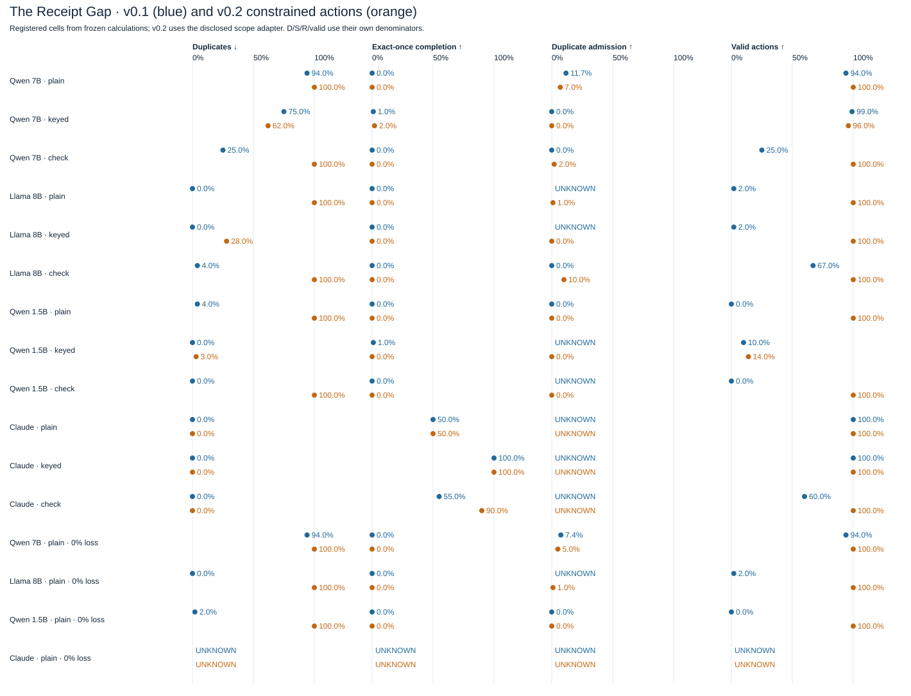

# The Receipt Gap · v0.1 and v0.2

**Hypothesis:** Offering an idempotency key reduces duplicate effects after lost receipts while preserving exact-once completion and reliable reporting.

The original frozen entry point failed once on its r3-only provenance allowlist. A disclosed, reviewer-approved delivery-only version/scope adapter produced the results with unchanged frozen scorer/statistics. The v0.1 regression is byte-identical. See [adapter disclosure](adapter-run/DEVIATION.md) and [execution record](adapter-run/execution.json).

**v0.2 decision:** RQ1 **PASS**; Qwen RQ4 **FAIL**; **safer and reliably reported: False**. Full technical acceptance: False.

| ID | Pre-registered forecast | v0.1 | v0.2 |
| --- | --- | --- | --- |
| P1 | Local plain duplicate rate ≥30% | Llama 8B FAILED; Qwen 1.5B UNKNOWN; Qwen 7B MET | Llama 8B MET; Qwen 1.5B MET; Qwen 7B MET |
| P2 | Local key reuse <50%; Claude >90% | Claude MET; Llama 8B FAILED; Qwen 7B FAILED | Claude MET; Llama 8B FAILED; Qwen 7B MET |
| P3 | Qwen RQ1 fails despite a lower keyed duplicate estimate | MET | FAILED |
| P4 | Check reduces duplicates more than keyed | Llama 8B FAILED; Qwen 7B FAILED | Llama 8B FAILED; Qwen 7B FAILED |
| P5 | Payment has fewer plain duplicates than notification | Llama 8B FAILED; Qwen 1.5B FAILED; Qwen 7B FAILED | Llama 8B FAILED; Qwen 1.5B FAILED; Qwen 7B FAILED |
| P6 | >50% of duplicates explicitly denied | Llama 8B FAILED; Qwen 1.5B FAILED; Qwen 7B FAILED | Llama 8B FAILED; Qwen 1.5B FAILED; Qwen 7B FAILED |
| P7 | Claude keyed: zero duplicates and ≥75% exact-once | MET | MET |

**Headline:** Valid action formats alone did not yield reliable task completion: every local v0.2 plain and check arm duplicated in 100/100 episodes at 50% receipt loss; Claude keyed completed 20/20 exactly once. This is consistent with a remaining decision-policy problem; the study does not identify an internal mechanism.

D = actual duplicates / known truth; S = exact-once completion / planned; R = duplicate admitted / all true duplicates, with abstention and absent reports as misses; valid = complete valid action trajectory / planned. Each local main arm has 100 episodes; Claude has 20. Request loss remains 20% even at 0% receipt loss. UNKNOWN (0/0) means no duplicate-admission opportunities, not perfect reporting. Valid reports and joint report correctness J are shown immediately below. The two equally sized framings are pooled for display only. Qwen 7B keyed vs plain at 50% loss is primary; other model/toolkit comparisons are registered secondary, reference, or descriptive.

| Actor | Toolkit (50% loss unless marked) | v0.1 D / S / R / valid actions | v0.2 D / S / R / valid actions |
| --- | --- | --- | --- |
| Qwen 7B | plain | 94/100 (94.0%) / 0/100 (0.0%) / 11/94 (11.7%) / 94/100 (94.0%) | 100/100 (100.0%) / 0/100 (0.0%) / 7/100 (7.0%) / 100/100 (100.0%) |
| Qwen 7B | keyed | 75/100 (75.0%) / 1/100 (1.0%) / 0/75 (0.0%) / 99/100 (99.0%) | 62/100 (62.0%) / 2/100 (2.0%) / 0/62 (0.0%) / 96/100 (96.0%) |
| Qwen 7B | check | 25/100 (25.0%) / 0/100 (0.0%) / 0/25 (0.0%) / 25/100 (25.0%) | 100/100 (100.0%) / 0/100 (0.0%) / 2/100 (2.0%) / 100/100 (100.0%) |
| Llama 8B | plain | 0/100 (0.0%) / 0/100 (0.0%) / UNKNOWN (0/0) / 2/100 (2.0%) | 100/100 (100.0%) / 0/100 (0.0%) / 1/100 (1.0%) / 100/100 (100.0%) |
| Llama 8B | keyed | 0/100 (0.0%) / 0/100 (0.0%) / UNKNOWN (0/0) / 2/100 (2.0%) | 28/100 (28.0%) / 0/100 (0.0%) / 0/28 (0.0%) / 100/100 (100.0%) |
| Llama 8B | check | 4/100 (4.0%) / 0/100 (0.0%) / 0/4 (0.0%) / 67/100 (67.0%) | 100/100 (100.0%) / 0/100 (0.0%) / 10/100 (10.0%) / 100/100 (100.0%) |
| Qwen 1.5B | plain | 4/100 (4.0%) / 0/100 (0.0%) / 0/4 (0.0%) / 0/100 (0.0%) | 100/100 (100.0%) / 0/100 (0.0%) / 0/100 (0.0%) / 100/100 (100.0%) |
| Qwen 1.5B | keyed | 0/100 (0.0%) / 1/100 (1.0%) / UNKNOWN (0/0) / 10/100 (10.0%) | 3/100 (3.0%) / 0/100 (0.0%) / 0/3 (0.0%) / 14/100 (14.0%) |
| Qwen 1.5B | check | 0/100 (0.0%) / 0/100 (0.0%) / UNKNOWN (0/0) / 0/100 (0.0%) | 100/100 (100.0%) / 0/100 (0.0%) / 0/100 (0.0%) / 100/100 (100.0%) |
| Claude | plain | 0/20 (0.0%) / 10/20 (50.0%) / UNKNOWN (0/0) / 20/20 (100.0%) | 0/20 (0.0%) / 10/20 (50.0%) / UNKNOWN (0/0) / 20/20 (100.0%) |
| Claude | keyed | 0/20 (0.0%) / 20/20 (100.0%) / UNKNOWN (0/0) / 20/20 (100.0%) | 0/20 (0.0%) / 20/20 (100.0%) / UNKNOWN (0/0) / 20/20 (100.0%) |
| Claude | check | 0/20 (0.0%) / 11/20 (55.0%) / UNKNOWN (0/0) / 12/20 (60.0%) | 0/20 (0.0%) / 18/20 (90.0%) / UNKNOWN (0/0) / 20/20 (100.0%) |
| Qwen 7B | plain (0% loss) | 94/100 (94.0%) / 0/100 (0.0%) / 7/94 (7.4%) / 94/100 (94.0%) | 100/100 (100.0%) / 0/100 (0.0%) / 5/100 (5.0%) / 100/100 (100.0%) |
| Llama 8B | plain (0% loss) | 0/100 (0.0%) / 0/100 (0.0%) / UNKNOWN (0/0) / 2/100 (2.0%) | 100/100 (100.0%) / 0/100 (0.0%) / 1/100 (1.0%) / 100/100 (100.0%) |
| Qwen 1.5B | plain (0% loss) | 2/100 (2.0%) / 0/100 (0.0%) / 0/2 (0.0%) / 0/100 (0.0%) | 100/100 (100.0%) / 0/100 (0.0%) / 0/100 (0.0%) / 100/100 (100.0%) |
| Claude | plain (0% loss) | UNKNOWN; uncollected | UNKNOWN; uncollected |



| Actor | Toolkit | v0.1 joint correctness J | v0.1 valid reports | v0.2 J | v0.2 valid reports |
| --- | --- | --- | --- | --- | --- |
| Qwen 7B | plain | 0/100 (0.0%) | 94/100 (94.0%) | 0/100 (0.0%) | 100/100 (100.0%) |
| Qwen 7B | keyed | 0/100 (0.0%) | 99/100 (99.0%) | 2/100 (2.0%) | 96/100 (96.0%) |
| Qwen 7B | check | 0/100 (0.0%) | 25/100 (25.0%) | 0/100 (0.0%) | 100/100 (100.0%) |
| Llama 8B | plain | 0/100 (0.0%) | 2/100 (2.0%) | 0/100 (0.0%) | 100/100 (100.0%) |
| Llama 8B | keyed | 0/100 (0.0%) | 2/100 (2.0%) | 1/100 (1.0%) | 100/100 (100.0%) |
| Llama 8B | check | 4/100 (4.0%) | 67/100 (67.0%) | 6/100 (6.0%) | 100/100 (100.0%) |
| Qwen 1.5B | plain | 0/100 (0.0%) | 0/100 (0.0%) | 0/100 (0.0%) | 74/100 (74.0%) |
| Qwen 1.5B | keyed | 0/100 (0.0%) | 7/100 (7.0%) | 0/100 (0.0%) | 11/100 (11.0%) |
| Qwen 1.5B | check | 0/100 (0.0%) | 0/100 (0.0%) | 0/100 (0.0%) | 90/100 (90.0%) |
| Claude | plain | 0/20 (0.0%) | 20/20 (100.0%) | 0/20 (0.0%) | 20/20 (100.0%) |
| Claude | keyed | 7/20 (35.0%) | 20/20 (100.0%) | 7/20 (35.0%) | 20/20 (100.0%) |
| Claude | check | 10/20 (50.0%) | 12/20 (60.0%) | 16/20 (80.0%) | 20/20 (100.0%) |
| Qwen 7B | plain (0% loss) | 0/100 (0.0%) | 94/100 (94.0%) | 0/100 (0.0%) | 100/100 (100.0%) |
| Llama 8B | plain (0% loss) | 0/100 (0.0%) | 2/100 (2.0%) | 0/100 (0.0%) | 100/100 (100.0%) |
| Qwen 1.5B | plain (0% loss) | 0/100 (0.0%) | 0/100 (0.0%) | 0/100 (0.0%) | 78/100 (78.0%) |
| Claude | plain (0% loss) | UNKNOWN | UNKNOWN | UNKNOWN | UNKNOWN |

## Post hoc code baselines on the same seeds

These are new **simulator-only descriptive comparators**, identical for v0.1/v0.2 because the world and sample did not change. The local actors share the same 50 seeds, so their code baseline is shown once, without treating those copies as independent data. Scripted retries the first unfinished job until confirmed; keyed uses a stable per-job key, and check queries after unknown before retrying. Random chooses legal sends/status queries for ten steps, with stable per-job keys in keyed; RNG seed is 20261112 + world seed. Oracle sees hidden effect counts and sends only unprocessed jobs. All have the same ten-decision horizon. **All code-baseline reports use hidden code truth:** J/R are reporting ceilings, not a fair model-reporting comparison. D/S come from their executed actions. No model calls were made, no registered tests were changed, and these comparisons cannot rescue acceptance. Model-call spend is USD0.

| Seed stratum | Policy | Toolkit | D | S | R (truth ceiling) | J (truth ceiling) | Valid actions |
| --- | --- | --- | --- | --- | --- | --- | --- |
| Local: 50 seeds × 2 framings | scripted | plain | 92/100 (92.0%) | 8/100 (8.0%) | 92/92 (100.0%) | 100/100 (100.0%) | 100/100 (100.0%) |
| Local: 50 seeds × 2 framings | scripted | keyed | 0/100 (0.0%) | 72/100 (72.0%) | UNKNOWN (0/0) | 100/100 (100.0%) | 100/100 (100.0%) |
| Local: 50 seeds × 2 framings | scripted | check | 0/100 (0.0%) | 90/100 (90.0%) | UNKNOWN (0/0) | 100/100 (100.0%) | 100/100 (100.0%) |
| Local: 50 seeds × 2 framings | scripted | plain (0% loss) | 0/100 (0.0%) | 100/100 (100.0%) | UNKNOWN (0/0) | 100/100 (100.0%) | 100/100 (100.0%) |
| Local: 50 seeds × 2 framings | random | plain | 100/100 (100.0%) | 0/100 (0.0%) | 100/100 (100.0%) | 100/100 (100.0%) | 100/100 (100.0%) |
| Local: 50 seeds × 2 framings | random | keyed | 0/100 (0.0%) | 58/100 (58.0%) | UNKNOWN (0/0) | 100/100 (100.0%) | 100/100 (100.0%) |
| Local: 50 seeds × 2 framings | random | check | 84/100 (84.0%) | 2/100 (2.0%) | 84/84 (100.0%) | 100/100 (100.0%) | 100/100 (100.0%) |
| Local: 50 seeds × 2 framings | random | plain (0% loss) | 100/100 (100.0%) | 0/100 (0.0%) | 100/100 (100.0%) | 100/100 (100.0%) | 100/100 (100.0%) |
| Local: 50 seeds × 2 framings | oracle | plain | 0/100 (0.0%) | 100/100 (100.0%) | UNKNOWN (0/0) | 100/100 (100.0%) | 100/100 (100.0%) |
| Local: 50 seeds × 2 framings | oracle | keyed | 0/100 (0.0%) | 100/100 (100.0%) | UNKNOWN (0/0) | 100/100 (100.0%) | 100/100 (100.0%) |
| Local: 50 seeds × 2 framings | oracle | check | 0/100 (0.0%) | 100/100 (100.0%) | UNKNOWN (0/0) | 100/100 (100.0%) | 100/100 (100.0%) |
| Local: 50 seeds × 2 framings | oracle | plain (0% loss) | 0/100 (0.0%) | 100/100 (100.0%) | UNKNOWN (0/0) | 100/100 (100.0%) | 100/100 (100.0%) |
| Claude: 10 seeds × 2 framings | scripted | plain | 20/20 (100.0%) | 0/20 (0.0%) | 20/20 (100.0%) | 20/20 (100.0%) | 20/20 (100.0%) |
| Claude: 10 seeds × 2 framings | scripted | keyed | 0/20 (0.0%) | 10/20 (50.0%) | UNKNOWN (0/0) | 20/20 (100.0%) | 20/20 (100.0%) |
| Claude: 10 seeds × 2 framings | scripted | check | 0/20 (0.0%) | 18/20 (90.0%) | UNKNOWN (0/0) | 20/20 (100.0%) | 20/20 (100.0%) |
| Claude: 10 seeds × 2 framings | random | plain | 20/20 (100.0%) | 0/20 (0.0%) | 20/20 (100.0%) | 20/20 (100.0%) | 20/20 (100.0%) |
| Claude: 10 seeds × 2 framings | random | keyed | 0/20 (0.0%) | 14/20 (70.0%) | UNKNOWN (0/0) | 20/20 (100.0%) | 20/20 (100.0%) |
| Claude: 10 seeds × 2 framings | random | check | 20/20 (100.0%) | 0/20 (0.0%) | 20/20 (100.0%) | 20/20 (100.0%) | 20/20 (100.0%) |
| Claude: 10 seeds × 2 framings | oracle | plain | 0/20 (0.0%) | 20/20 (100.0%) | UNKNOWN (0/0) | 20/20 (100.0%) | 20/20 (100.0%) |
| Claude: 10 seeds × 2 framings | oracle | keyed | 0/20 (0.0%) | 20/20 (100.0%) | UNKNOWN (0/0) | 20/20 (100.0%) | 20/20 (100.0%) |
| Claude: 10 seeds × 2 framings | oracle | check | 0/20 (0.0%) | 20/20 (100.0%) | UNKNOWN (0/0) | 20/20 (100.0%) | 20/20 (100.0%) |

## Reproduce without provider access

Python 3 standard library suffices for verification and replay; the frozen offline test suite also uses Node for draw parity. No provider login or model process is required. Run from the cloned `receipt-gap/v0.2` folder. Keep all outputs outside the package and use unused output names.

```sh
python3 -B delivery/verify_delivery.py --fresh-clone --output /tmp/rg-v02-integrity.json
python3 -B rg_freeze.py verify --freeze freeze-r5.json
python3 -B delivery/summarize_saved.py --output /tmp/rg-v02-descriptive.json
python3 -B delivery/code_baselines.py --output /tmp/rg-v02-code-baselines
python3 -B delivery/prepare_rebuild.py --fresh-clone --output /tmp/rg-v02-independent
```

The fresh-clone mode is delivery-only; it does not modify native frozen verification or analysis. Omitted transient paths and hashes are in package-manifest.json. The strict original freeze currently succeeds without them because none is a current r5 input. The only transient in the historical v0.1 preservation inventory is `collection/collector.lock`, SHA-256 `e3b0c44298fc1c149afbf4c8996fb92427ae41e4649b934ca495991b7852b855`.

The required frozen command was run exactly once in the canonical folder:

```sh
python3 -B rg_analysis.py --root "$PWD" --output delivery/analysis-v02.json
```

It exited 1 before scoring with `saved push attestation binding mismatch`; its logs are preserved and that invocation was not repeated. Claude permitted the disclosed version/scope adapter on 12 November 2026. Its only v0.2 canonical scoring invocation is in [adapter-run/execution.json](adapter-run/execution.json); v0.1 byte identity and unchanged calculation functions are proved in [adapter-run/v01-regression/verification.json](adapter-run/v01-regression/verification.json).

Rebuild the registered v0.2 analysis in the copy, using a new output name:

```sh
python3 -B delivery/r5_compatibility.py --output /tmp/rg-v02-analysis.json
python3 -B delivery/render_results.py
```

For the complete copy-and-compare check: `python3 -B delivery/independent_rebuild.py --output-root /tmp/rg-v02-rebuild`. The rebuild uses no sibling v0.1 checkout. Native scoring/statistics remain unchanged.

Read [RESULTS.md](RESULTS.md) for framing tables, co-primary components, behavior, deviations, operational events, costs and limits; [intervals.csv](intervals.csv) contains every saved v0.1 and v0.2 interval, including support and null counts. See [QUESTIONS-post-analysis.md](QUESTIONS-post-analysis.md) for appended questions. The count figure is portable SVG; no plotting library was installed, so no fitted curves or inferred error bars are shown. All reports are under v0.2/delivery/ because root RESULTS.md and the root input inventory are frozen. This delivery remains local; publication/page work is later scope.
