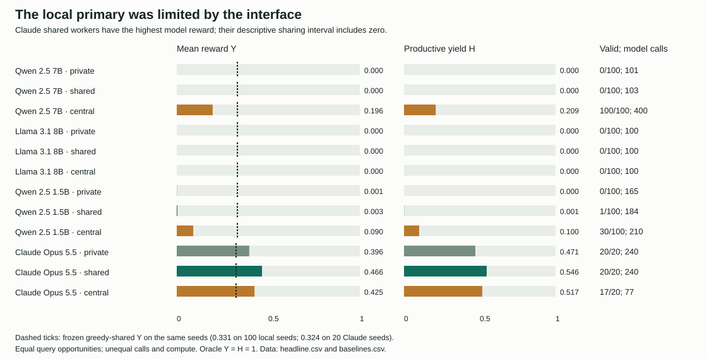

# Three Rules, One Lunch — empirical delivery

**Hypothesis:** Workers earn more when they can read one another's faithful observations.

**Result:** The registered Qwen 7B joint criterion was not met: neither worker arm completed a valid episode. The primary is interface-limited and cannot establish whether sharing improves search. Claude's shared workers earned more than private workers by 0.069713 Y over 20 seeds, with descriptive 95% interval [−0.000365, 0.137209]. P1/P2/P4/P5/P7 failed; P3/P6 held, with the limitations stated in [RESULTS.md](RESULTS.md).

| Actor | Regime | Mean Y | Productive H | Post-relocation Y | Valid episodes | Y / greedy-shared |
| --- | --- | --- | --- | --- | --- | --- |
| Qwen 2.5 7B | private | 0.0000 | 0.0000 | 0.0000 | 0/100 (0.0%) | 0.000 |
| Qwen 2.5 7B | shared | 0.0000 | 0.0000 | 0.0000 | 0/100 (0.0%) | 0.000 |
| Qwen 2.5 7B | central | 0.1963 | 0.2092 | 0.1612 | 100/100 (100.0%) | 0.592 |
| Llama 3.1 8B | private | 0.0000 | 0.0000 | 0.0000 | 0/100 (0.0%) | 0.000 |
| Llama 3.1 8B | shared | 0.0000 | 0.0000 | 0.0000 | 0/100 (0.0%) | 0.000 |
| Llama 3.1 8B | central | 0.0000 | 0.0000 | 0.0000 | 0/100 (0.0%) | 0.000 |
| Qwen 2.5 1.5B | private | 0.0010 | 0.0000 | 0.0000 | 0/100 (0.0%) | 0.003 |
| Qwen 2.5 1.5B | shared | 0.0035 | 0.0008 | 0.0030 | 1/100 (1.0%) | 0.010 |
| Qwen 2.5 1.5B | central | 0.0901 | 0.1000 | 0.0725 | 30/100 (30.0%) | 0.272 |
| Claude Opus 5.5 | private | 0.3960 | 0.4708 | 0.3774 | 20/20 (100.0%) | 1.222 |
| Claude Opus 5.5 | shared | 0.4657 | 0.5458 | 0.4445 | 20/20 (100.0%) | 1.437 |
| Claude Opus 5.5 | central | 0.4248 | 0.5167 | 0.3983 | 17/20 (85.0%) | 1.311 |

| Seeds | Frozen code policy (secondary) | Mean Y | Productive H | Post-relocation Y | Valid episodes | Y / greedy-shared |
| --- | --- | --- | --- | --- | --- | --- |
| 0–99 | greedy-shared | 0.3314 | 0.3667 | 0.2389 | 100/100 (100%) | 1.000 |
| 0–99 | greedy-private | 0.3108 | 0.3333 | 0.3162 | 100/100 (100%) | 0.938 |
| 0–99 | random | 0.3015 | 0.3308 | 0.2957 | 100/100 (100%) | 0.910 |
| 0–99 | full-information oracle | 1.0000 | 1.0000 | 1.0000 | 100/100 (100%) | 3.018 |
| 0–19 | greedy-shared | 0.3241 | 0.3708 | 0.1833 | 20/20 (100%) | 1.000 |
| 0–19 | greedy-private | 0.3164 | 0.3667 | 0.3087 | 20/20 (100%) | 0.976 |
| 0–19 | random | 0.2612 | 0.2625 | 0.2277 | 20/20 (100%) | 0.806 |
| 0–19 | full-information oracle | 1.0000 | 1.0000 | 1.0000 | 20/20 (100%) | 3.086 |

Y is mean reward per scheduled query / 1,000; H is the proportion earning ≥500, with abstention/failure as misses. Post-Y uses rounds 3–4. Local models use seeds 0–99 and Claude seeds 0–19. Code baselines are secondary, make no model calls and have guaranteed code validity; the oracle has privileged full information. All comparisons use the same seeds within each cohort.



Read [RESULTS.md](RESULTS.md) for all predictions, paired intervals, phase/round metrics, stale exploitation, failures, deviations D1–D5, usage, spend and all twenty frontier seed rows. Exact descriptive tables: [model-metrics.csv](model-metrics.csv), [baselines.csv](baselines.csv), [round-metrics.csv](round-metrics.csv), [stale-exploitation.csv](stale-exploitation.csv), [resources.csv](resources.csv), [terminal-reasons.csv](terminal-reasons.csv). Frozen final outputs live in [../analysis-first/](../analysis-first/).

All 960 episodes were attempted and have effective terminals (900 local + 60 Claude), with 188 valid episodes. Local requests used JSON mode rather than exact-schema constrained decoding; the resulting interface failures dominate local outcomes. Claude has 57/60 valid episodes, with one preserved harness loss and two generated max-token failures. One zero-use subscription-limit refusal is a separate operational non-start, resumed only through the approved identical-request disposition. No collection was rerun.

Settled model accounting is **USD7.089251**, with no open holds or unsettled calls; cash billing remains UNKNOWN. Local hardware/time is not priced. No model call, Git mutation, push or web publication occurred in this delivery task.

The frozen final analysis ran once at its inherited RUN.md output path. A separate source/evidence copy and fresh process reproduced all five output files **byte for byte**; [byte-identity.json](../rebuild-final/byte-identity.json) gives their hashes. All 10,056 preserved files were unchanged. This builder rebuild does not substitute for Claude's independent fresh-clone scientific review. [preflight.json](preflight.json) and [provenance.json](provenance.json) retain offline verification evidence.

To verify frozen inputs, from the project root:

```sh
python3 -B trl_freeze.py verify
```

To rebuild into a new directory without collection or network access:

```sh
python3 -B build/delivery/rebuild.py --out build/rebuild-review-NEW
```

This report is under `build/delivery/` because root README.md and state files are frozen, and the exact-input verifier rejects new files outside excluded directories. Preserve the frozen root documents; they describe historical build state, superseded operationally by RUN-d1 through RUN-d5 and the attribution errata. Claude should explicitly carry `build/delivery/` and `build/analysis-first/` into the review package; do not assume excluded build files are automatically published. Delivery decisions follow the Claude/Codex agreement under [semi_autonomous.md](../../../semi_autonomous.md). Next step: Claude's independent review, including the local-schema limitation and acceptance judgment. This delivery makes no acceptance or live-page claim.
