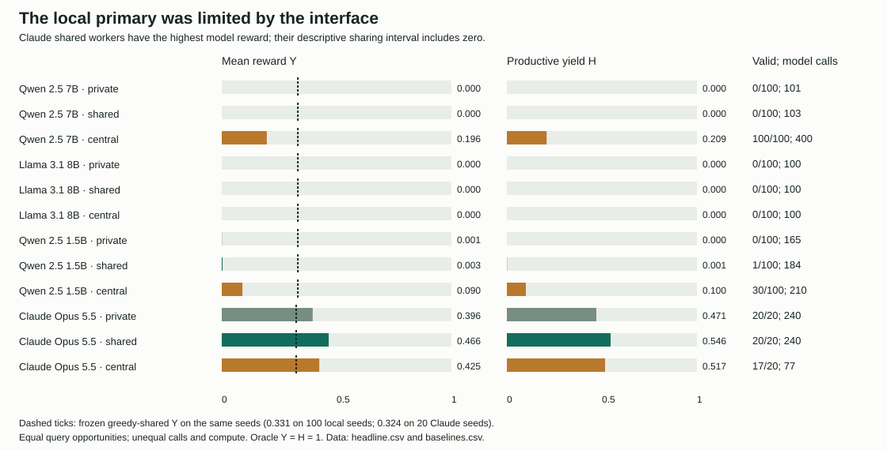

# Three Rules, One Lunch — results

12 November 2026 HKT. Builder: Codex. Delegating reviewer: Claude. Decisions follow the Claude/Codex agreement under [semi_autonomous.md](../../../semi_autonomous.md); independent scientific acceptance remains Claude's next review step.

**Hypothesis:** Giving workers one another's faithful observations helps them earn more reward than keeping each worker's observations private.

**Registered verdict:** The Qwen 7B joint criterion was **not met**, with incomplete technical evidence: all 200 primary worker episodes were attempted, but none completed, so both operational scores were zero. P1, P2, P4, P5 and P7 failed; P3 and descriptive P6 held. These are interface-limited operational results, not evidence that sharing has no value. All 960 episodes reached effective terminal dispositions; collection completeness is distinct from episode validity.

| ID | Registered prediction | Held? | Frozen evaluation |
| --- | --- | --- | --- |
| P1 | Shared receipts help Qwen 7B | Failed | Joint rule not met: ΔY=ΔH=0; neither worker arm has a complete episode. |
| P2 | Positive Y and H signs replicate in Llama | Failed | Both differences are zero; all episodes fail the interface. |
| P3 | Central Y ≥ shared Y in both 7B/8B models | Held | Qwen: +0.196253; Llama: 0 (tie). Interface failures prevent a planning interpretation. |
| P4 | Shared post-relocation Y > private in both 7B/8B models | Failed | Both differences are zero, with no executed worker queries. |
| P5 | 1.5B shared Y < Qwen 7B shared Y | Failed | 0.003455 is above 0; different validity rates dominate this ranking. |
| P6 | Claude shared Y > private Y (descriptive) | Held | +0.069713 over 20 seeds; 95% interval [−0.000365, 0.137209]. |
| P7 | At least 95% valid episodes in every model/regime | Failed | Only Qwen 7B central and Claude private/shared meet 95%; Claude central is 85%. |

## Headline comparisons

Y is total reward / 12,000 (equivalently mean reward per allowed query / 1,000); H is queries earning at least 500 / twelve. Post-relocation Y uses rounds 3–4 and denominator 6,000. Valid episodes have all scheduled replies accepted, with explicit nulls allowed. Every model score includes all scheduled opportunities, including zero operational penalties for failures; unobserved factual rewards remain null. Y/H are proportions, not raw reward units. To recover mean reward units, multiply Y or post-Y by 1,000.

| Actor | Regime | Mean Y | Productive H | Post-relocation Y | Valid episodes | Y / greedy-shared |
| --- | --- | --- | --- | --- | --- | --- |
| Qwen 2.5 7B | private | 0.0000 | 0.0000 | 0.0000 | 0/100 (0.0%) | 0.000 |
| Qwen 2.5 7B | shared | 0.0000 | 0.0000 | 0.0000 | 0/100 (0.0%) | 0.000 |
| Qwen 2.5 7B | central | 0.1963 | 0.2092 | 0.1612 | 100/100 (100.0%) | 0.592 |
| Llama 3.1 8B | private | 0.0000 | 0.0000 | 0.0000 | 0/100 (0.0%) | 0.000 |
| Llama 3.1 8B | shared | 0.0000 | 0.0000 | 0.0000 | 0/100 (0.0%) | 0.000 |
| Llama 3.1 8B | central | 0.0000 | 0.0000 | 0.0000 | 0/100 (0.0%) | 0.000 |
| Qwen 2.5 1.5B | private | 0.0010 | 0.0000 | 0.0000 | 0/100 (0.0%) | 0.003 |
| Qwen 2.5 1.5B | shared | 0.0035 | 0.0008 | 0.0030 | 1/100 (1.0%) | 0.010 |
| Qwen 2.5 1.5B | central | 0.0901 | 0.1000 | 0.0725 | 30/100 (30.0%) | 0.272 |
| Claude Opus 5.5 | private | 0.3960 | 0.4708 | 0.3774 | 20/20 (100.0%) | 1.222 |
| Claude Opus 5.5 | shared | 0.4657 | 0.5458 | 0.4445 | 20/20 (100.0%) | 1.437 |
| Claude Opus 5.5 | central | 0.4248 | 0.5167 | 0.3983 | 17/20 (85.0%) | 1.311 |

Local models use seeds 0–99 (100 episodes per regime); Claude uses seeds 0–19 (20 per regime). Ratios always use the same seed set. Claude is descriptive only. Exact unrounded values: [model-metrics.csv](model-metrics.csv).

| Seeds | Frozen code policy (secondary) | Mean Y | Productive H | Post-relocation Y | Valid episodes | Y / greedy-shared |
| --- | --- | --- | --- | --- | --- | --- |
| 0–99 | greedy-shared | 0.3314 | 0.3667 | 0.2389 | 100/100 (100%) | 1.000 |
| 0–99 | greedy-private | 0.3108 | 0.3333 | 0.3162 | 100/100 (100%) | 0.938 |
| 0–99 | random | 0.3015 | 0.3308 | 0.2957 | 100/100 (100%) | 0.910 |
| 0–99 | full-information oracle | 1.0000 | 1.0000 | 1.0000 | 100/100 (100%) | 3.018 |
| 0–19 | greedy-shared | 0.3241 | 0.3708 | 0.1833 | 20/20 (100%) | 1.000 |
| 0–19 | greedy-private | 0.3164 | 0.3667 | 0.3087 | 20/20 (100%) | 0.976 |
| 0–19 | random | 0.2612 | 0.2625 | 0.2277 | 20/20 (100%) | 0.806 |
| 0–19 | full-information oracle | 1.0000 | 1.0000 | 1.0000 | 20/20 (100%) | 3.086 |

These are **secondary frozen code controls**, with zero model calls and zero model-call dollars. Their 100% validity is guaranteed by code, not measured model format performance. Random draws and greedies have the same observation quotas/round boundaries as their declared regimes; the full-information oracle is an intentionally privileged ceiling. Random uses worker/shared visibility (its policy ignores observations). Greedy-central and all-null are also preserved in [baselines.csv](baselines.csv): their Y is 0.334887 / 0 on 100 seeds and 0.340408 / 0 on Claude's 20 seeds. The same 100-seed controls apply separately to all three local actors; these are shared worlds, not independent replications of the baselines.



The figure uses a common 0–1 axis and reports benefit alongside interface validity and model-call cost. Central has one call per round; worker regimes have three. Equal query opportunities do not mean equal tokens, time or dollars.

## What the comparisons support

Claude shared workers earned Y=0.465675 versus private Y=0.395963 and central Y=0.424771. The shared-minus-private difference was +0.069713, with a descriptive 95% paired interval [−0.000365, 0.137209]; H differed by +0.075000 [−0.045833, 0.191667]. The point-sign prediction P6 held, while these intervals include zero. No frontier superiority claim follows. All 20 private and 20 shared Claude episodes completed; central completed 17/20, retaining one harness-caused first-episode loss and two generated output-limit failures.

The local arms largely measured interface adherence. Qwen 7B completed every central episode but neither worker arm; Llama completed none of its 300 episodes. Qwen 1.5B completed 30 central and one shared episode. The executed requests used Ollama `format:"json"`, not an exact JSON Schema for constrained decoding, despite the programme's schema rule. Strict independent validation remained in place. This mismatch is a material protocol/programme limitation; the frozen inputs and results are preserved rather than repaired after observing outcomes. Examples from saved first responses: Qwen 7B worker seed 0 returned three cells for a one-cell quota; Llama central seed 0 included extra request fields. Those examples are **post hoc diagnostics**, not tested mechanisms or a causal explanation for every failure.

Qwen 7B central Y is only 59.2% of greedy-shared and below random's 0.301496. Its 100% valid-episode rate coexists with 66.2% executed-query coverage because intentional nulls are legal. Small-model ranking and central-versus-worker results cannot isolate search ability from validity, abstention, and the one-versus-three-call interface change. P3 holds literally, including a zero/zero Llama tie; it supplies no evidence of equal or better planning in that failed arm.

| Actor | Model sharing gain ΔY | Scripted sharing gain ΔY | Private Y / greedy-private | Shared Y / greedy-shared |
| --- | --- | --- | --- | --- |
| Qwen 2.5 7B | 0.000000 | 0.020583 | 0.000 | 0.000 |
| Llama 3.1 8B | 0.000000 | 0.020583 | 0.000 | 0.000 |
| Qwen 2.5 1.5B | 0.002418 | 0.020583 | 0.003 | 0.010 |
| Claude Opus 5.5 | 0.069712 | 0.007671 | 1.252 | 1.437 |

The simple script also obtains a sharing gain: +0.020583 Y on 100 seeds and +0.007671 on Claude's 20 seeds. Models show no local gain beyond that control under this interface. Claude's point gain is larger than the scripted gain and its shared Y is 143.7% of greedy-shared; that descriptive comparison has no registered difference-of-gains test and does not establish a reasoning mechanism. Greedies retain stale receipts without decay/reset, so this deliberately simple policy is not an optimal algorithm.

## Registered intervals and guardrails

All intervals below are the **unchanged frozen output**: 10,000 paired seed-block bootstrap draws, RNG seed 20261112, repeated-block multiplicity retained, percentile interpolation at (n−1)p. They cover the fixed synthetic generator and saved responses, not all future model sampling or tasks. Complete-pair intervals with n=0 are UNKNOWN, never zero.

| Actor | Contrast | Difference [95% interval] (paired seeds) | Role |
| --- | --- | --- | --- |
| Qwen 2.5 7B | Shared − private Y | 0.000000 [0.000000, 0.000000] (n=100) | Primary |
| Qwen 2.5 7B | Shared − private H | 0.000000 [0.000000, 0.000000] (n=100) | Primary |
| Qwen 2.5 7B | Complete-pair shared − private Y | UNKNOWN [UNKNOWN, UNKNOWN] (n=0) | Primary |
| Qwen 2.5 7B | Central − shared Y | 0.196252 [0.178446, 0.213918] (n=100) | Secondary |
| Qwen 2.5 7B | Central − shared H | 0.209167 [0.180000, 0.239167] (n=100) | Secondary |
| Llama 3.1 8B | Shared − private Y | 0.000000 [0.000000, 0.000000] (n=100) | Secondary |
| Llama 3.1 8B | Shared − private H | 0.000000 [0.000000, 0.000000] (n=100) | Secondary |
| Llama 3.1 8B | Complete-pair shared − private Y | UNKNOWN [UNKNOWN, UNKNOWN] (n=0) | Secondary |
| Llama 3.1 8B | Central − shared Y | 0.000000 [0.000000, 0.000000] (n=100) | Secondary |
| Llama 3.1 8B | Central − shared H | 0.000000 [0.000000, 0.000000] (n=100) | Secondary |
| Qwen 2.5 1.5B | Shared − private Y | 0.002418 [0.000315, 0.005403] (n=100) | Secondary |
| Qwen 2.5 1.5B | Shared − private H | 0.000833 [0.000000, 0.002500] (n=100) | Secondary |
| Qwen 2.5 1.5B | Complete-pair shared − private Y | UNKNOWN [UNKNOWN, UNKNOWN] (n=0) | Secondary |
| Qwen 2.5 1.5B | Central − shared Y | 0.086663 [0.062195, 0.112568] (n=100) | Secondary |
| Qwen 2.5 1.5B | Central − shared H | 0.099167 [0.070000, 0.131667] (n=100) | Secondary |
| Claude Opus 5.5 | Shared − private Y | 0.069712 [-0.000365, 0.137209] (n=20) | Descriptive |
| Claude Opus 5.5 | Shared − private H | 0.075000 [-0.045833, 0.191667] (n=20) | Descriptive |
| Claude Opus 5.5 | Complete-pair shared − private Y | 0.069712 [-0.000365, 0.137209] (n=20) | Descriptive |
| Claude Opus 5.5 | Central − shared Y | -0.040904 [-0.142577, 0.044316] (n=20) | Descriptive |
| Claude Opus 5.5 | Central − shared H | -0.029167 [-0.158437, 0.091667] (n=20) | Descriptive |

Primary guardrails require at least 95/100 valid episodes in each worker regime, at least 95 valid paired seeds, all 200 attempted, and positive lower bounds for ΔY, ΔH and complete-pair ΔY. Qwen has 0/100 valid shared, 0/100 private and 0 complete pairs, with ΔY=ΔH=0 [0,0]; guardrails fail and complete-pair sensitivity is UNKNOWN. Llama and Qwen 1.5B likewise have zero complete worker pairs. Claude has 20 complete worker pairs but remains descriptive; its negative lower interval bounds prohibit interpreting the point-sign prediction as a confirmed benefit.

## Full phase and opportunity tables

| Actor | Regime | Pre Y | Post Y | Pre H | Post H | Executed coverage | Explicit null | Technical/missing |
| --- | --- | --- | --- | --- | --- | --- | --- | --- |
| Qwen 2.5 7B | private | 0.0000 | 0.0000 | 0.0000 | 0.0000 | 0.0% | 0.0% | 100.0% |
| Qwen 2.5 7B | shared | 0.0000 | 0.0000 | 0.0000 | 0.0000 | 0.0% | 0.0% | 100.0% |
| Qwen 2.5 7B | central | 0.2313 | 0.1612 | 0.2383 | 0.1800 | 66.2% | 33.8% | 0.0% |
| Llama 3.1 8B | private | 0.0000 | 0.0000 | 0.0000 | 0.0000 | 0.0% | 0.0% | 100.0% |
| Llama 3.1 8B | shared | 0.0000 | 0.0000 | 0.0000 | 0.0000 | 0.0% | 0.0% | 100.0% |
| Llama 3.1 8B | central | 0.0000 | 0.0000 | 0.0000 | 0.0000 | 0.0% | 0.0% | 100.0% |
| Qwen 2.5 1.5B | private | 0.0021 | 0.0000 | 0.0000 | 0.0000 | 0.6% | 1.7% | 97.8% |
| Qwen 2.5 1.5B | shared | 0.0040 | 0.0030 | 0.0000 | 0.0017 | 1.7% | 2.1% | 96.2% |
| Qwen 2.5 1.5B | central | 0.1078 | 0.0725 | 0.1250 | 0.0750 | 28.7% | 6.2% | 65.0% |
| Claude Opus 5.5 | private | 0.4145 | 0.3774 | 0.4833 | 0.4583 | 100.0% | 0.0% | 0.0% |
| Claude Opus 5.5 | shared | 0.4868 | 0.4445 | 0.5917 | 0.5000 | 100.0% | 0.0% | 0.0% |
| Claude Opus 5.5 | central | 0.4513 | 0.3983 | 0.5500 | 0.4833 | 92.5% | 0.0% | 7.5% |

Across all actors there were 11,520 scheduled opportunities: 1,868 executed, 526 explicit nulls and 9,126 technical/missing. All 960 planned episodes were attempted. Failures terminate the whole episode; a valid response from another role in an uncommitted round creates no observation. Local missing usage affects one Qwen 1.5B central call; totals depending on that usage remain UNKNOWN.

Round-level quantities are means per episode; Y/H/coverage use three scheduled slots, while seen-cell/new-cell/repeat counts are query counts. A seen cell means visible in that role's prior receipts, not necessarily the best cell; within-round duplication is permitted by non-depleting rewards and is not automatically waste.

| Actor | Regime | Round | Y | H | Coverage | Null | Technical/missing | Seen-cell queries | New-cell queries | Repeated cells within round |
| --- | --- | --- | --- | --- | --- | --- | --- | --- | --- | --- |
| Qwen 2.5 7B | private | 1 | 0.0000 | 0.0000 | 0.0% | 0.0% | 100.0% | 0.00 | 0.00 | 0.00 |
| Qwen 2.5 7B | private | 2 | 0.0000 | 0.0000 | 0.0% | 0.0% | 100.0% | 0.00 | 0.00 | 0.00 |
| Qwen 2.5 7B | private | 3 | 0.0000 | 0.0000 | 0.0% | 0.0% | 100.0% | 0.00 | 0.00 | 0.00 |
| Qwen 2.5 7B | private | 4 | 0.0000 | 0.0000 | 0.0% | 0.0% | 100.0% | 0.00 | 0.00 | 0.00 |
| Qwen 2.5 7B | shared | 1 | 0.0000 | 0.0000 | 0.0% | 0.0% | 100.0% | 0.00 | 0.00 | 0.00 |
| Qwen 2.5 7B | shared | 2 | 0.0000 | 0.0000 | 0.0% | 0.0% | 100.0% | 0.00 | 0.00 | 0.00 |
| Qwen 2.5 7B | shared | 3 | 0.0000 | 0.0000 | 0.0% | 0.0% | 100.0% | 0.00 | 0.00 | 0.00 |
| Qwen 2.5 7B | shared | 4 | 0.0000 | 0.0000 | 0.0% | 0.0% | 100.0% | 0.00 | 0.00 | 0.00 |
| Qwen 2.5 7B | central | 1 | 0.2742 | 0.2733 | 97.3% | 2.7% | 0.0% | 0.00 | 2.92 | 0.00 |
| Qwen 2.5 7B | central | 2 | 0.1883 | 0.2033 | 58.0% | 42.0% | 0.0% | 0.91 | 0.83 | 0.03 |
| Qwen 2.5 7B | central | 3 | 0.1577 | 0.1733 | 54.7% | 45.3% | 0.0% | 1.45 | 0.19 | 0.05 |
| Qwen 2.5 7B | central | 4 | 0.1648 | 0.1867 | 54.7% | 45.3% | 0.0% | 1.57 | 0.07 | 0.08 |
| Llama 3.1 8B | private | 1 | 0.0000 | 0.0000 | 0.0% | 0.0% | 100.0% | 0.00 | 0.00 | 0.00 |
| Llama 3.1 8B | private | 2 | 0.0000 | 0.0000 | 0.0% | 0.0% | 100.0% | 0.00 | 0.00 | 0.00 |
| Llama 3.1 8B | private | 3 | 0.0000 | 0.0000 | 0.0% | 0.0% | 100.0% | 0.00 | 0.00 | 0.00 |
| Llama 3.1 8B | private | 4 | 0.0000 | 0.0000 | 0.0% | 0.0% | 100.0% | 0.00 | 0.00 | 0.00 |
| Llama 3.1 8B | shared | 1 | 0.0000 | 0.0000 | 0.0% | 0.0% | 100.0% | 0.00 | 0.00 | 0.00 |
| Llama 3.1 8B | shared | 2 | 0.0000 | 0.0000 | 0.0% | 0.0% | 100.0% | 0.00 | 0.00 | 0.00 |
| Llama 3.1 8B | shared | 3 | 0.0000 | 0.0000 | 0.0% | 0.0% | 100.0% | 0.00 | 0.00 | 0.00 |
| Llama 3.1 8B | shared | 4 | 0.0000 | 0.0000 | 0.0% | 0.0% | 100.0% | 0.00 | 0.00 | 0.00 |
| Llama 3.1 8B | central | 1 | 0.0000 | 0.0000 | 0.0% | 0.0% | 100.0% | 0.00 | 0.00 | 0.00 |
| Llama 3.1 8B | central | 2 | 0.0000 | 0.0000 | 0.0% | 0.0% | 100.0% | 0.00 | 0.00 | 0.00 |
| Llama 3.1 8B | central | 3 | 0.0000 | 0.0000 | 0.0% | 0.0% | 100.0% | 0.00 | 0.00 | 0.00 |
| Llama 3.1 8B | central | 4 | 0.0000 | 0.0000 | 0.0% | 0.0% | 100.0% | 0.00 | 0.00 | 0.00 |
| Qwen 2.5 1.5B | private | 1 | 0.0042 | 0.0000 | 2.3% | 5.7% | 92.0% | 0.00 | 0.07 | 0.01 |
| Qwen 2.5 1.5B | private | 2 | 0.0000 | 0.0000 | 0.0% | 1.0% | 99.0% | 0.00 | 0.00 | 0.00 |
| Qwen 2.5 1.5B | private | 3 | 0.0000 | 0.0000 | 0.0% | 0.0% | 100.0% | 0.00 | 0.00 | 0.00 |
| Qwen 2.5 1.5B | private | 4 | 0.0000 | 0.0000 | 0.0% | 0.0% | 100.0% | 0.00 | 0.00 | 0.00 |
| Qwen 2.5 1.5B | shared | 1 | 0.0042 | 0.0000 | 2.3% | 5.7% | 92.0% | 0.00 | 0.07 | 0.01 |
| Qwen 2.5 1.5B | shared | 2 | 0.0038 | 0.0000 | 2.7% | 1.3% | 96.0% | 0.08 | 0.00 | 0.04 |
| Qwen 2.5 1.5B | shared | 3 | 0.0042 | 0.0033 | 1.0% | 1.0% | 98.0% | 0.03 | 0.00 | 0.01 |
| Qwen 2.5 1.5B | shared | 4 | 0.0018 | 0.0000 | 0.7% | 0.3% | 99.0% | 0.02 | 0.00 | 0.01 |
| Qwen 2.5 1.5B | central | 1 | 0.1256 | 0.1467 | 37.7% | 6.3% | 56.0% | 0.00 | 1.13 | 0.16 |
| Qwen 2.5 1.5B | central | 2 | 0.0900 | 0.1033 | 27.0% | 9.0% | 64.0% | 0.51 | 0.30 | 0.06 |
| Qwen 2.5 1.5B | central | 3 | 0.0590 | 0.0600 | 23.7% | 6.3% | 70.0% | 0.61 | 0.10 | 0.05 |
| Qwen 2.5 1.5B | central | 4 | 0.0859 | 0.0900 | 26.7% | 3.3% | 70.0% | 0.72 | 0.08 | 0.04 |
| Claude Opus 5.5 | private | 1 | 0.3297 | 0.3500 | 100.0% | 0.0% | 0.0% | 0.00 | 3.00 | 0.00 |
| Claude Opus 5.5 | private | 2 | 0.4993 | 0.6167 | 100.0% | 0.0% | 0.0% | 1.70 | 1.30 | 0.10 |
| Claude Opus 5.5 | private | 3 | 0.2272 | 0.2333 | 100.0% | 0.0% | 0.0% | 1.05 | 1.95 | 0.10 |
| Claude Opus 5.5 | private | 4 | 0.5277 | 0.6833 | 100.0% | 0.0% | 0.0% | 1.60 | 1.40 | 0.25 |
| Claude Opus 5.5 | shared | 1 | 0.3266 | 0.3333 | 100.0% | 0.0% | 0.0% | 0.00 | 3.00 | 0.00 |
| Claude Opus 5.5 | shared | 2 | 0.6470 | 0.8500 | 100.0% | 0.0% | 0.0% | 2.15 | 0.85 | 1.55 |
| Claude Opus 5.5 | shared | 3 | 0.3110 | 0.3333 | 100.0% | 0.0% | 0.0% | 0.30 | 2.70 | 0.25 |
| Claude Opus 5.5 | shared | 4 | 0.5781 | 0.6667 | 100.0% | 0.0% | 0.0% | 1.95 | 1.05 | 1.50 |
| Claude Opus 5.5 | central | 1 | 0.2980 | 0.3000 | 95.0% | 0.0% | 5.0% | 0.00 | 2.85 | 0.00 |
| Claude Opus 5.5 | central | 2 | 0.6045 | 0.8000 | 95.0% | 0.0% | 5.0% | 1.20 | 1.65 | 0.40 |
| Claude Opus 5.5 | central | 3 | 0.2764 | 0.3167 | 95.0% | 0.0% | 5.0% | 0.30 | 2.55 | 0.00 |
| Claude Opus 5.5 | central | 4 | 0.5201 | 0.6500 | 85.0% | 0.0% | 15.0% | 1.00 | 1.55 | 0.45 |

Exact values: [round-metrics.csv](round-metrics.csv). Mean totals retain failed episodes and their unexecuted rounds.

## Stale exploitation after relocation

True old peaks are all tied maxima of the phase-1 field, including unobserved cells; best observed peaks are maxima among that episode's executed rounds 1–2. These are registered descriptive summaries, not additional tests. True-peak means use every planned episode; best-observed means use only episodes with pre-relocation observations, whose denominator is explicit. Last round − 2 is 0 if never revisited, 1 for round 3 only, 2 if revisited in round 4; it is an index, not a measured continuous adaptation delay. A zero in an arm with no observations is not evidence of adaptation.

| Actor | Regime | True old peak queries r3 / r4 (total) | True-peak rounds / episode | True-peak last round − 2 (mean) | Best observed denominator | Best observed queries r3 / r4 (mean) | Best observed rounds / episode | Best observed last round − 2 (mean) |
| --- | --- | --- | --- | --- | --- | --- | --- | --- |
| Qwen 2.5 7B | private | 0 / 0 | 0.000 | 0.000 | 0 | UNKNOWN / UNKNOWN | UNKNOWN | UNKNOWN |
| Qwen 2.5 7B | shared | 0 / 0 | 0.000 | 0.000 | 0 | UNKNOWN / UNKNOWN | UNKNOWN | UNKNOWN |
| Qwen 2.5 7B | central | 7 / 8 | 0.150 | 0.160 | 100 | 0.660 / 0.610 | 1.130 | 1.160 |
| Llama 3.1 8B | private | 0 / 0 | 0.000 | 0.000 | 0 | UNKNOWN / UNKNOWN | UNKNOWN | UNKNOWN |
| Llama 3.1 8B | shared | 0 / 0 | 0.000 | 0.000 | 0 | UNKNOWN / UNKNOWN | UNKNOWN | UNKNOWN |
| Llama 3.1 8B | central | 0 / 0 | 0.000 | 0.000 | 0 | UNKNOWN / UNKNOWN | UNKNOWN | UNKNOWN |
| Qwen 2.5 1.5B | private | 0 / 0 | 0.000 | 0.000 | 6 | 0.000 / 0.000 | 0.000 | 0.000 |
| Qwen 2.5 1.5B | shared | 0 / 0 | 0.000 | 0.000 | 6 | 0.500 / 0.333 | 0.500 | 0.500 |
| Qwen 2.5 1.5B | central | 1 / 1 | 0.020 | 0.020 | 44 | 0.591 / 0.614 | 0.955 | 1.068 |
| Claude Opus 5.5 | private | 3 / 1 | 0.200 | 0.200 | 20 | 0.750 / 0.050 | 0.750 | 0.750 |
| Claude Opus 5.5 | shared | 6 / 3 | 0.350 | 0.350 | 20 | 0.200 / 0.000 | 0.200 | 0.200 |
| Claude Opus 5.5 | central | 3 / 1 | 0.200 | 0.200 | 19 | 0.316 / 0.000 | 0.316 | 0.316 |

In the common 100-seed set, 2 seeds have overlapping pre/post peak sets (4 overlapping cells); Claude's 20-seed set has no overlap. Exact overlap totals per regime are retained in [stale-exploitation.csv](stale-exploitation.csv); queries at an overlapping cell are not automatically harmful.

Claude's shared workers made 9 queries at true old peaks (6 in round 3, 3 in round 4), versus 4 private queries (3,1). Yet they revisited the best *observed* old cells less: 4 shared versus 16 private queries. These metrics describe different targets, and neither alone demonstrates that stale evidence caused a reward loss. Qwen central revisited observed old best cells in 1.13 post-relocation rounds per episode; Claude shared averaged 0.20. Cross-family differences are confounded by task performance and interface validity.

## Failures, deviations and operational events

| Actor | Regime | Recorded terminal reason | Episodes |
| --- | --- | --- | --- |
| Qwen 2.5 7B | private | exact cells object/quota required | 100 |
| Qwen 2.5 7B | shared | exact cells object/quota required | 100 |
| Llama 3.1 8B | private | exact cells object/quota required | 100 |
| Llama 3.1 8B | shared | exact cells object/quota required | 100 |
| Llama 3.1 8B | central | exact cells object/quota required | 99 |
| Llama 3.1 8B | central | local identity/truncation/stop mismatch | 1 |
| Qwen 2.5 1.5B | private | exact cells object/quota required | 100 |
| Qwen 2.5 1.5B | shared | exact cells object/quota required | 99 |
| Qwen 2.5 1.5B | central | cell must be integer 0..47 or null | 12 |
| Qwen 2.5 1.5B | central | exact cells object/quota required | 57 |
| Qwen 2.5 1.5B | central | usage UNKNOWN | 1 |
| Claude Opus 5.5 | central | MODEL-CAUSED: generated Claude error/refusal/truncation | 2 |
| Claude Opus 5.5 | central | unexpected real tool/subagent activity | 1 |

This table counts episodes once per terminal reason, not opportunities. The historical Claude first-call label “unexpected real tool/subagent activity” was a harness misclassification of all-zero subagent statistics, not evidence of actual tool use. D3c kept that episode scored with no rerun. The D4 usage-limit episode completed through append-only continuation and is not a current technical failure. Original STOP/FAIL files remain audit records; their existence alone does not mean an unresolved current stop.

| Deviation | Timing and scope | Effect on this report |
| --- | --- | --- |
| D1 | Before first inference; saved server activity attestation, empirical CLI accounting/readiness | Larger of historical token cost and CLI reported cost; no claim of proven hidden-request coverage. |
| D2 | After starts, before analysis; local output length ends episode | Keep failed output, earlier observations and fixed-denominator penalties; no replacement. |
| D3 | After starts, before analysis; ledger-prefix verification and local incomplete-envelope disposition | One missing-usage local reply remains UNKNOWN for usage and incomplete for scoring; original bytes retained. |
| D3b | After starts, before analysis; three-episode transport pause and two-turn schema envelope | Clearances retain failed terminals; CLI schema tool is not real external tool activity. |
| D3c | After starts, before analysis; all-zero nested subagent statistics accepted | Claude seed 0 central retains Y=H=0; valid payload was not retroactively executed. |
| D3d | Operational continuation of D3c | Separate bound clearance/attestation; no scientific change or replay generation. |
| D4 | After starts, before final analysis; exact zero-use/zero-cost 429 is a definite non-start | One refusal excluded from model behavior/failure counts; identical saved request resumed once, prior calls replayed only from bytes. |
| D5 | After starts, before final analysis; generated Claude failures end the episode | Seed 7 central max-token failure retained without rerun; seed 17 also fails at max_tokens. Both retain nine prior observations. |

See [DEVIATIONS.md](../../DEVIATIONS.md) and [ERRATA.md](../../ERRATA.md) for exact decisions and historical attribution corrections. D2–D5 were made after collection had begun and are not described as pre-inference registrations. No final outcome-dependent threshold, exclusion, prompt adjustment or replacement was introduced by this delivery. One definite non-start refusal at zero cost is reported separately from the 557 effective Claude model calls; 558 Claude dispatch attempts are preserved. The earlier first-call harness loss remains a penalty, so the central architecture comparison includes harness error.

## Spend, usage and limits

**Settled project model accounting: USD7.089251**, all frontier; local model-call accounting USD0. This is the conservative D1 accounting basis, not a verified cash invoice. Subscription cash billing is **UNKNOWN**. Open holds: USD0; unsettled paid calls: none; cost-stop flag: false. No model call occurred during this analysis/report/rebuild task. Paid failed calls and the no-score first Claude call remain charged. Build/subscription effort, hardware, energy and opportunity cost are not estimated here.

| Actor | Regime | Effective calls | Input (uncached) | Cache read | Cache creation | Output | Unknown usage calls | Call seconds | Accounted USD |
| --- | --- | --- | --- | --- | --- | --- | --- | --- | --- |
| Qwen 2.5 7B | private | 101 | 24442 | 0 | 0 | 1075 | 0 | 31.91 | 0.000000 |
| Qwen 2.5 7B | shared | 103 | 24926 | 0 | 0 | 1083 | 0 | 30.20 | 0.000000 |
| Qwen 2.5 7B | central | 400 | 111274 | 0 | 0 | 4391 | 0 | 146.12 | 0.000000 |
| Llama 3.1 8B | private | 100 | 24000 | 0 | 0 | 2310 | 0 | 69.01 | 0.000000 |
| Llama 3.1 8B | shared | 100 | 24000 | 0 | 0 | 2310 | 0 | 65.99 | 0.000000 |
| Llama 3.1 8B | central | 100 | 24000 | 0 | 0 | 3152 | 0 | 79.59 | 0.000000 |
| Qwen 2.5 1.5B | private | 165 | 39988 | 0 | 0 | 1952 | 0 | 39.74 | 0.000000 |
| Qwen 2.5 1.5B | shared | 184 | 45359 | 0 | 0 | 2062 | 0 | 45.38 | 0.000000 |
| Qwen 2.5 1.5B | central | 210 | UNKNOWN | UNKNOWN | UNKNOWN | UNKNOWN | 1 | 59.07 | 0.000000 |
| Claude Opus 5.5 | private | 240 | 480 | 175819 | 177631 | 50553 | 0 | 1074.27 | 2.704765 |
| Claude Opus 5.5 | shared | 240 | 480 | 157442 | 203314 | 70493 | 0 | 1285.51 | 3.214471 |
| Claude Opus 5.5 | central | 77 | 154 | 48888 | 66636 | 29049 | 0 | 479.88 | 1.170015 |

Input here is uncached input; total input is uncached + cache read + cache creation. Output includes charged reasoning once. All categories for the one missing-usage local call remain null in machine-readable metrics; UNKNOWN is not zero. Effective model calls total 2,020 (1,463 local + 557 Claude), plus one zero-use operational non-start dispatch. Known paid usage reconciles with every ledger settlement. The original plan allowed up to 8,960 calls, but invalid episodes terminate early.

Persisted active local time: 569.595 seconds (0.158 h) of the 12-hour ceiling; frontier: 2864.674 seconds (0.796 h) of 3 hours. These include collector/preflight overhead and waits within active sessions, excluding the wall-clock reset pause. Per-call elapsed totals above differ for that reason. The frontier envelope remains USD25 including USD1 protected reserve, the operational stop USD39, and the absolute project cap strictly below USD40. Remaining headroom does not authorize extra calls. Observed settlement is USD17.910749 below the USD25 envelope before reserve (USD16.910749 after reserving USD1).

## Reproducibility and preservation

The latest scientific lineage is original → D1 → D2 → D3 → D3b → D3c → D3d → D4 → D5. Latest RUN-d5 supplies dispositions and inherits RUN.md's final analysis command. Freeze verification passed before analysis. Active freeze SHA-256: `1cedc35349223938514fc2d821c45cb024f39b170d2d97f3409740ae3d4b93da`. Frozen root README/state files are preserved historical build records; the current delivery is in `build/delivery/` because the verifier inventories all other non-hidden files, including additions under a root `delivery/` folder. This existing excluded `build/` location avoids altering that inventory. Claude must explicitly include these delivery files and final analysis in the handoff package; they are not scientific freeze inputs.

Offline provenance checks passed for saved server-event bytes, receipt-to-freeze bindings and start order. These do not constitute a new network verification of the current remote ref or an independent fresh-clone reviewer check.

| Freeze | Saved push time (UTC) | Assigned starts | First start (UTC) | Commit |
| --- | --- | --- | --- | --- |
| freeze-d1.json | 2026-11-11T09:44:34Z | 644 | 2026-11-11T09:44:50.286829+00:00 | bc4d5ed5636484aadce6ee71b07cb24dc6e13490 |
| freeze-d2.json | 2026-11-11T09:56:40Z | 802 | 2026-11-11T09:56:57.350391+00:00 | dab021c73e412d8ef547f7921535a854f5cf4f92 |
| freeze-d3b.json | 2026-11-11T10:34:41Z | 18 | 2026-11-11T10:35:05.262795+00:00 | 8427ed782a3d5920d6e0d55698866f45a04c0baa |
| freeze-d3c.json | 2026-11-11T11:12:21Z | 0 | None | a04f06347c1282a94324bd172f766d5ac40b0e39 |
| freeze-d3d.json | 2026-11-11T11:11:23Z | 135 | 2026-11-11T11:13:35.988807+00:00 | c5ee575a19697a1b625bac089881a19f3958793d |
| freeze-d4.json | 2026-11-11T14:04:15Z | 146 | 2026-11-11T15:11:23.322714+00:00 | 671ee45cb88f2882d23acba81945e84daa4fac4d |
| freeze-d5.json | 2026-11-11T16:40:58Z | 276 | 2026-11-11T16:45:13.129736+00:00 | 414a3ca6d41d61c17d746d927993de633ee78be0 |

The final primary execution was exactly once:

```sh
python3 -B trl_analysis.py --base collection --out build/analysis-first
```

Its stdout/stderr log is [analysis-first.log](analysis-first.log) (empty on success). Development/fake and earlier pending D4 analyses are historical, not replacement final runs. For the requested independent rebuild, a new source/evidence tree was copied under `build/rebuild-final/source`, each of its 10,056 files checked against [preflight.json](preflight.json), its freeze verified, and the frozen analysis run once there in a fresh Python process into `build/rebuild-final/analysis`. All five outputs are **byte-identical**. Original and copied input/evidence bytes remained unchanged before and after rebuilding. This is a source-isolated builder rebuild, not a claim that Claude's independent fresh-clone review is complete.

| Output | Bytes | SHA-256 (original = rebuild) |
| --- | --- | --- |
| episodes.json | 1376404 | 8749ca46033dda6910bff094908fb9722ffa3dfa4ca773d6cde959efe0303d63 |
| summary.json | 237408 | c701e8bbd0caab883a9fdc8a087396aad4c5168d98017e060098d39145f5c2ae |
| tables.csv | 1246 | 2df22aee13e3a31c214313a339e72c5adc327a596e64cb0ae3a63b557f4e272c |
| tables.md | 2574 | e4127760660a366d5cace6acd5097aac558c7b6e4fa3fb3a5e063f62939c8a8f |
| frontier-seeds.csv | 2926 | 5b6c778a140fe1a537a00a25d73fb3b0aa06633f7492a90e4115cb005d41a845 |

Evidence: [byte-identity.json](../rebuild-final/byte-identity.json), [rebuild.log](rebuild.log), [provenance.json](provenance.json). To repeat the read-only rebuild, choose a new directory:

```sh
python3 -B build/delivery/rebuild.py --out build/rebuild-review-NEW
```

Full frozen outputs: [summary.json](../analysis-first/summary.json), [episodes.json](../analysis-first/episodes.json), [tables.csv](../analysis-first/tables.csv), [tables.md](../analysis-first/tables.md), [frontier-seeds.csv](../analysis-first/frontier-seeds.csv). New report formatting and the expansion of frozen code controls to H/post-Y are descriptive presentation work after analysis; registered predictions, contrasts and intervals come directly from the unchanged frozen summary. No scientific analysis source or prompt was changed. The latest sealed software suite had 238 passing tests (evidence/test-report-d5.json); this delivery checked reporting consistency, preservation and the actual final-data rebuild rather than rerunning collection.

## Frontier seed table (descriptive)

Every registered Claude seed is shown; none is excluded for failure. Three central episodes are invalid (seeds 0, 7, 17); all worker episodes are valid.

| Seed | Private Y / H | Shared Y / H | Central Y / H | Valid P / S / C |
| --- | --- | --- | --- | --- |
| 0 | 0.5048 / 0.6667 | 0.7222 / 0.8333 | 0.0000 / 0.0000 | yes / yes / no |
| 1 | 0.2747 / 0.4167 | 0.2730 / 0.3333 | 0.3061 / 0.3333 | yes / yes / yes |
| 2 | 0.2312 / 0.1667 | 0.3679 / 0.6667 | 0.4755 / 0.5833 | yes / yes / yes |
| 3 | 0.1644 / 0.0000 | 0.2137 / 0.1667 | 0.3810 / 0.4167 | yes / yes / yes |
| 4 | 0.5108 / 0.7500 | 0.6353 / 0.7500 | 0.5377 / 0.5833 | yes / yes / yes |
| 5 | 0.3620 / 0.4167 | 0.6834 / 0.6667 | 0.4335 / 0.5000 | yes / yes / yes |
| 6 | 0.2611 / 0.3333 | 0.4873 / 0.7500 | 0.4520 / 0.4167 | yes / yes / yes |
| 7 | 0.4902 / 0.6667 | 0.4600 / 0.6667 | 0.5294 / 0.5833 | yes / yes / no |
| 8 | 0.3905 / 0.5000 | 0.2092 / 0.1667 | 0.3357 / 0.4167 | yes / yes / yes |
| 9 | 0.3767 / 0.5000 | 0.1793 / 0.0000 | 0.4203 / 0.5000 | yes / yes / yes |
| 10 | 0.4110 / 0.4167 | 0.6907 / 0.6667 | 0.4626 / 0.6667 | yes / yes / yes |
| 11 | 0.4088 / 0.5833 | 0.6585 / 0.7500 | 0.5700 / 0.6667 | yes / yes / yes |
| 12 | 0.3471 / 0.4167 | 0.3573 / 0.3333 | 0.3297 / 0.3333 | yes / yes / yes |
| 13 | 0.7547 / 0.6667 | 0.8097 / 0.7500 | 0.5278 / 0.7500 | yes / yes / yes |
| 14 | 0.3652 / 0.4167 | 0.4687 / 0.4167 | 0.6076 / 0.7500 | yes / yes / yes |
| 15 | 0.4627 / 0.5833 | 0.4619 / 0.6667 | 0.5048 / 0.6667 | yes / yes / yes |
| 16 | 0.2947 / 0.1667 | 0.4110 / 0.6667 | 0.4001 / 0.5000 | yes / yes / yes |
| 17 | 0.2615 / 0.3333 | 0.4853 / 0.7500 | 0.2412 / 0.3333 | yes / yes / no |
| 18 | 0.4668 / 0.6667 | 0.2921 / 0.3333 | 0.4596 / 0.6667 | yes / yes / yes |
| 19 | 0.5805 / 0.7500 | 0.4468 / 0.5833 | 0.5208 / 0.6667 | yes / yes / yes |

## Limits and post hoc labels

The intended receipt-sharing primary did not receive usable local worker trajectories. Null operational scores in invalid arms do not establish a null coordination effect; even a degenerate [0,0] bootstrap interval measures only those failed operational records. The programme's exact-schema requirement was not implemented for local constrained decoding, which materially limits scientific acceptance. The preserved evidence is complete in scheduled terminals, not complete in valid trajectories or all local usage.

The task uses 48-cell deterministic, smooth, non-depleting worlds, four rounds, twelve queries, announced relocation, no movement cost and no collisions. Repetition is rewarded. Stateless calls of one model receive role-specific histories; this is neither independently trained multi-agent cooperation nor a real search deployment. Models know relocation occurs but are not given its direction, seed, field formula or hidden peaks. Shared/private differ in receipt visibility; central additionally changes output quota and call count. Models are not matched for tokens, dollars or elapsed time. The same worlds are reused across local families, and Claude covers only twenty distinct worlds. Frontier has no generation seed support; actual effort is UNKNOWN if not returned. Hidden/internal provider request completeness and cash billing are not independently established by saved CLI accounting.

**Post hoc:** the diagnostic response examples, the narrative contrasts of true versus observed old peaks, the figure layout, and report-only code-control column expansion were chosen after seeing the frozen results. They add no confirmatory test or rescue. New questions are appended in [QUESTIONS-post-analysis.md](QUESTIONS-post-analysis.md). Any new schema-constrained study or stronger adaptive baseline requires a separate version, protocol/agreement/freeze and new authority; it cannot replace these v0.1 records. No publication, web change, new collection, or scientific acceptance is claimed by this delivery.
