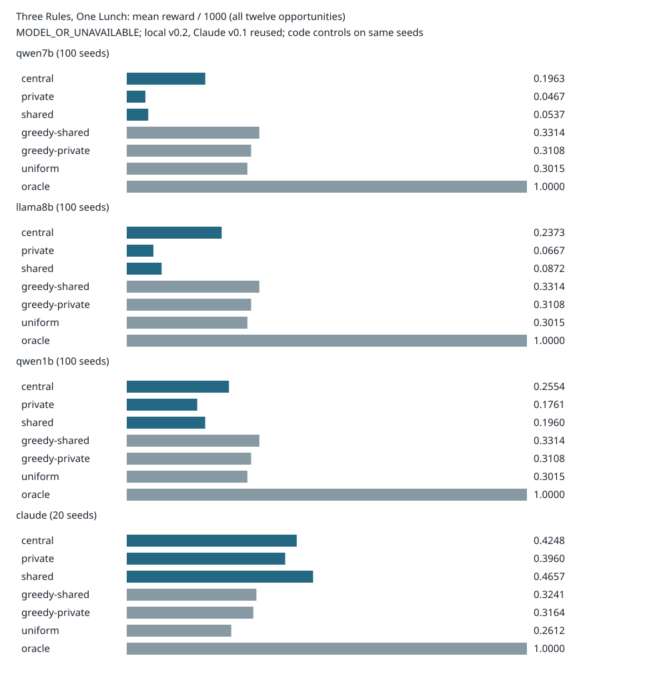

# Three Rules, One Lunch — v0.2 and v0.1

**Hypothesis:** Giving workers one another's faithful observations helps them earn more reward than keeping each worker's observations private.

**Result:** The Qwen 7B primary joint criterion was **not met**: reward improved, but productive-query yield remained inconclusive. All 900 schema-constrained local episodes completed validly; many valid actions were intentional nulls. Shared Qwen 7B earned Y=0.053749, just **16.2% of greedy-shared** and below random. Llama and Qwen 1.5B had positive secondary sharing results. The retained Claude cohort remains descriptive.

These v0.2 predictions were re-registered **after seeing v0.1**, not blind predictions. P6 is carried forward from observed Claude data; P7 was already known to fail because Claude central remains 17/20 valid. No collection was repeated during this analysis task.

| ID | Prediction | v0.1 | v0.2 combined | Evaluation |
| --- | --- | --- | --- | --- |
| P1 | Sharing benefits Qwen 7B under the entire joint rule | Failed | Failed | Y lower bound >0; H lower bound −0.001667, so the joint rule fails. |
| P2 | Llama sharing ΔY>0 and ΔH>0 | Failed | Held | ΔY=0.020562; ΔH=0.025000; secondary intervals are positive. |
| P3 | Central Y≥shared Y in Qwen 7B and Llama | Held | Held | +0.142503 and +0.150046 Y respectively; unequal calls/tokens. |
| P4 | Shared post-Y>private post-Y in Qwen 7B and Llama | Failed | Held | +0.006597 and +0.031283 respectively; fixed directional check. |
| P5 | Qwen 1.5B shared Y<Qwen 7B shared Y | Failed | Failed | 0.196021 > 0.053749; the small model earns more. |
| P6 | Claude shared Y>private Y, descriptive | Held | Held | +0.069713; interval crosses zero; already observed in v0.1. |
| P7 | Every model/regime has ≥95% valid episodes | Failed | Failed | Locals 900/900; retained Claude central 17/20 (85%). Already known to fail. |

| Actor | Regime | Mean Y | Productive H | Post-relocation Y | Valid episodes | Y / greedy-shared |
| --- | --- | --- | --- | --- | --- | --- |
| Qwen 2.5 7B | private | 0.0467 | 0.0500 | 0.0048 | 100/100 (100.0%) | 0.141 |
| Qwen 2.5 7B | shared | 0.0537 | 0.0558 | 0.0113 | 100/100 (100.0%) | 0.162 |
| Qwen 2.5 7B | central | 0.1963 | 0.2092 | 0.1612 | 100/100 (100.0%) | 0.592 |
| Llama 3.1 8B | private | 0.0667 | 0.0742 | 0.0719 | 100/100 (100.0%) | 0.201 |
| Llama 3.1 8B | shared | 0.0872 | 0.0992 | 0.1032 | 100/100 (100.0%) | 0.263 |
| Llama 3.1 8B | central | 0.2373 | 0.2442 | 0.2612 | 100/100 (100.0%) | 0.716 |
| Qwen 2.5 1.5B | private | 0.1761 | 0.1867 | 0.1723 | 100/100 (100.0%) | 0.532 |
| Qwen 2.5 1.5B | shared | 0.1960 | 0.2108 | 0.2287 | 100/100 (100.0%) | 0.592 |
| Qwen 2.5 1.5B | central | 0.2554 | 0.2742 | 0.2357 | 100/100 (100.0%) | 0.771 |
| Claude Opus 5.5 | private | 0.3960 | 0.4708 | 0.3774 | 20/20 (100.0%) | 1.222 |
| Claude Opus 5.5 | shared | 0.4657 | 0.5458 | 0.4445 | 20/20 (100.0%) | 1.437 |
| Claude Opus 5.5 | central | 0.4248 | 0.5167 | 0.3983 | 17/20 (85.0%) | 1.311 |

Y is reward / 12,000: mean reward per allowed query divided by 1,000. H is the fraction of twelve opportunities earning ≥500; nulls and technical/missing slots count as misses. Post-Y uses six round-3/4 opportunities and denominator 6,000. Multiply Y by 1,000 for raw mean reward. Whole-episode validity requires all scheduled replies to pass the strict validator; intentional nulls are valid. Local seeds are 0–99, Claude seeds 0–19. Every ratio uses greedy-shared on that actor's exact seed set. Claude's 60 episodes are reused once, never pooled as new independent frontier evidence.

| Same seeds | Code policy (secondary) | Y | H | Post-Y | Valid code episodes | Y / greedy-shared |
| --- | --- | --- | --- | --- | --- | --- |
| 0-99 | greedy-shared | 0.3314 | 0.3667 | 0.2389 | 100/100 (100%) | 1.000 |
| 0-99 | greedy-private | 0.3108 | 0.3333 | 0.3162 | 100/100 (100%) | 0.938 |
| 0-99 | random | 0.3015 | 0.3308 | 0.2957 | 100/100 (100%) | 0.910 |
| 0-99 | full-information oracle | 1.0000 | 1.0000 | 1.0000 | 100/100 (100%) | 3.018 |
| 0-19 | greedy-shared | 0.3241 | 0.3708 | 0.1833 | 20/20 (100%) | 1.000 |
| 0-19 | greedy-private | 0.3164 | 0.3667 | 0.3087 | 20/20 (100%) | 0.976 |
| 0-19 | random | 0.2612 | 0.2625 | 0.2277 | 20/20 (100%) | 0.806 |
| 0-19 | full-information oracle | 1.0000 | 1.0000 | 1.0000 | 20/20 (100%) | 3.086 |

These are secondary code controls on the same seeds; oracle uses privileged full information. All local arms remain below random reward. Local sharing gains are also obtained by a simple greedy script, so they establish no special reasoning mechanism.



The primary reward interval is positive: ΔY=0.007074 [0.001811, 0.012940]. Co-primary productive yield is inconclusive: ΔH=0.005833 [−0.001667, 0.013333]. All 100 complete worker pairs pass the technical gate. Llama and Qwen 1.5B pass their secondary joint calculations; Claude's descriptive reward interval includes zero. All 960 scheduled rows remain: 900 v0.2 locals and 60 v0.1 Claude, with 957 valid whole episodes.

**v0.1 remains visible:** its local primary had no valid Qwen 7B worker episodes; shared Y was 0 versus v0.2's 0.053749. v0.1 Llama shared Y was 0 versus 0.087218; Qwen 1.5B 0.003455 versus 0.196021. Original Claude scores are identical. These version comparisons are post hoc and do not prove a causal interface effect. [RESULTS.md](RESULTS.md) contains the full v0.1 table and intervals beside v0.2, all phases/rounds, stale exploitation, twenty Claude seed rows, deviations, resources and limits.

**Rebuild:** the frozen primary analysis ran once. A fresh copied source/evidence tree and fresh Python process reproduced seven v0.2 outputs byte for byte; both also reproduced five original v0.1 outputs byte for byte. All 10,056 original v0.1 files and 54 frozen v0.2 inputs remain unchanged. [Byte-identity evidence](build/rebuild-final/byte-identity.json).

**Spend:** USD0 new paid calls; historical settled project accounting USD7.089251, no open holds or unsettled calls. Cash billing UNKNOWN. Local hardware/time unpriced. 8,400 local calls, 1,032.609 active seconds in v0.2. No collection, network call, Git operation or publication occurred during this analysis/report task.

**Reproduce after delivery:** these two documents are requested post-freeze additions. The exact-inventory verifier rejects additions in the expanded folder; frozen scientific files and verifier remain unchanged. Run it through a fresh projection of the recorded inventory:

```sh
python3 -B v0.2/build/rebuild-frozen-results.py --out v0.2/build/rebuild-review-NEW
```

Run from the study root and choose a never-used output path. This invokes only the unchanged frozen analysis, never model collection. [Delivery integrity](build/report-final/delivery-integrity.json) identifies the two additions; [current state](build/report-final/PROJECT_STATE.md) supersedes the frozen build-only state operationally. See [report CSVs](build/report-final/) for unrounded presentation values and [frozen outputs](build/analysis-final/) for inferential source values. Carry excluded build artifacts explicitly into the review package.

New questions: [QUESTIONS-post-analysis.md](../QUESTIONS-post-analysis.md). Delegating reviewer Claude still owns independent acceptance. Work stops after v0.2; no later study, web change, push or publication is included here. Decisions follow [semi_autonomous.md](../../semi_autonomous.md).
