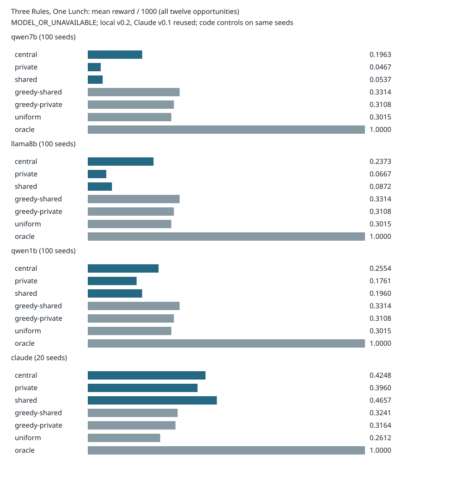

# Three Rules, One Lunch — v0.2 results with preserved v0.1

12 November 2026 HKT. Codex, builder for Claude’s delegated review.

**Hypothesis:** Giving workers one another's faithful observations helps them earn more reward than keeping each worker's observations private.

**Result:** The Qwen 7B primary joint criterion was **not met**: reward improved, but productive-query yield remained inconclusive. All 900 schema-constrained local episodes completed validly; many valid actions were intentional nulls. Shared Qwen 7B earned Y=0.053749, just **16.2% of greedy-shared** and below random. Llama and Qwen 1.5B had positive secondary sharing results. The retained Claude cohort remains descriptive.

These v0.2 predictions were re-registered **after seeing v0.1**, not blind predictions. P6 is carried forward from observed Claude data; P7 was already known to fail because Claude central remains 17/20 valid. No collection was repeated during this analysis task.

| ID | Prediction | v0.1 | v0.2 combined | Evaluation |
| --- | --- | --- | --- | --- |
| P1 | Sharing benefits Qwen 7B under the entire joint rule | Failed | Failed | Y lower bound >0; H lower bound −0.001667, so the joint rule fails. |
| P2 | Llama sharing ΔY>0 and ΔH>0 | Failed | Held | ΔY=0.020562; ΔH=0.025000; secondary intervals are positive. |
| P3 | Central Y≥shared Y in Qwen 7B and Llama | Held | Held | +0.142503 and +0.150046 Y respectively; unequal calls/tokens. |
| P4 | Shared post-Y>private post-Y in Qwen 7B and Llama | Failed | Held | +0.006597 and +0.031283 respectively; fixed directional check. |
| P5 | Qwen 1.5B shared Y<Qwen 7B shared Y | Failed | Failed | 0.196021 > 0.053749; the small model earns more. |
| P6 | Claude shared Y>private Y, descriptive | Held | Held | +0.069713; interval crosses zero; already observed in v0.1. |
| P7 | Every model/regime has ≥95% valid episodes | Failed | Failed | Locals 900/900; retained Claude central 17/20 (85%). Already known to fail. |

| Actor | Regime | Mean Y | Productive H | Post-relocation Y | Valid episodes | Y / greedy-shared |
| --- | --- | --- | --- | --- | --- | --- |
| Qwen 2.5 7B | private | 0.0467 | 0.0500 | 0.0048 | 100/100 (100.0%) | 0.141 |
| Qwen 2.5 7B | shared | 0.0537 | 0.0558 | 0.0113 | 100/100 (100.0%) | 0.162 |
| Qwen 2.5 7B | central | 0.1963 | 0.2092 | 0.1612 | 100/100 (100.0%) | 0.592 |
| Llama 3.1 8B | private | 0.0667 | 0.0742 | 0.0719 | 100/100 (100.0%) | 0.201 |
| Llama 3.1 8B | shared | 0.0872 | 0.0992 | 0.1032 | 100/100 (100.0%) | 0.263 |
| Llama 3.1 8B | central | 0.2373 | 0.2442 | 0.2612 | 100/100 (100.0%) | 0.716 |
| Qwen 2.5 1.5B | private | 0.1761 | 0.1867 | 0.1723 | 100/100 (100.0%) | 0.532 |
| Qwen 2.5 1.5B | shared | 0.1960 | 0.2108 | 0.2287 | 100/100 (100.0%) | 0.592 |
| Qwen 2.5 1.5B | central | 0.2554 | 0.2742 | 0.2357 | 100/100 (100.0%) | 0.771 |
| Claude Opus 5.5 | private | 0.3960 | 0.4708 | 0.3774 | 20/20 (100.0%) | 1.222 |
| Claude Opus 5.5 | shared | 0.4657 | 0.5458 | 0.4445 | 20/20 (100.0%) | 1.437 |
| Claude Opus 5.5 | central | 0.4248 | 0.5167 | 0.3983 | 17/20 (85.0%) | 1.311 |

Y is reward / 12,000: mean reward per allowed query divided by 1,000. H is the fraction of twelve opportunities earning ≥500; nulls and technical/missing slots count as misses. Post-Y uses six round-3/4 opportunities and denominator 6,000. Multiply Y by 1,000 for raw mean reward. Whole-episode validity requires all scheduled replies to pass the strict validator; intentional nulls are valid. Local seeds are 0–99, Claude seeds 0–19. Every ratio uses greedy-shared on that actor's exact seed set. Claude's 60 episodes are reused once, never pooled as new independent frontier evidence.

| Same seeds | Code policy (secondary) | Y | H | Post-Y | Valid code episodes | Y / greedy-shared |
| --- | --- | --- | --- | --- | --- | --- |
| 0-99 | greedy-shared | 0.3314 | 0.3667 | 0.2389 | 100/100 (100%) | 1.000 |
| 0-99 | greedy-private | 0.3108 | 0.3333 | 0.3162 | 100/100 (100%) | 0.938 |
| 0-99 | random | 0.3015 | 0.3308 | 0.2957 | 100/100 (100%) | 0.910 |
| 0-99 | full-information oracle | 1.0000 | 1.0000 | 1.0000 | 100/100 (100%) | 3.018 |
| 0-19 | greedy-shared | 0.3241 | 0.3708 | 0.1833 | 20/20 (100%) | 1.000 |
| 0-19 | greedy-private | 0.3164 | 0.3667 | 0.3087 | 20/20 (100%) | 0.976 |
| 0-19 | random | 0.2612 | 0.2625 | 0.2277 | 20/20 (100%) | 0.806 |
| 0-19 | full-information oracle | 1.0000 | 1.0000 | 1.0000 | 20/20 (100%) | 3.086 |

Code controls are secondary, use identical seed sets and scheduled observation quotas, and cost zero model calls. Their 100% validity is guaranteed by code, not measured model behavior. The oracle sees the whole current field and is a privileged ceiling. Random uses the frozen uniform policy. Greedies repeat the best visible receipt, without phase reset or decay. Additional greedy-central/all-null rows remain in [baselines.csv](build/analysis-final/baselines.csv).



Qwen 7B shared−private ΔY=**0.007074** [0.001811, 0.012940], while ΔH=**0.005833** [−0.001667, 0.013333]. Both regimes have 100/100 valid and attempted episodes, 100 complete pairs, and the complete-pair ΔY interval equals the primary interval. The productive-yield lower bound fails the strictly-positive requirement. This is **inconclusive joint evidence**, with a positive reward estimate; technical incompleteness no longer blocks the primary.

Llama ΔY=0.020562 [0.011116, 0.030490] and ΔH=0.025000 [0.010833, 0.040000]. Qwen 1.5B ΔY=0.019900 [0.006787, 0.033862] and ΔH=0.024167 [0.001667, 0.048333]. Their unchanged secondary joint calculations pass, but neither replaces the Qwen 7B primary. Claude ΔY=0.069713 [−0.000365, 0.137209] remains descriptive and crosses zero.

Valid formatting did not ensure useful action: Qwen 7B private/shared abstained on 83.9%/82.0% of slots; Llama on 77.8%/70.7%. Qwen 1.5B shared earns more than either larger local shared model. All local regimes, including central, earn less than same-seed random Y=0.301496. Central exceeds shared in each local model while using 400 rather than 1,200 calls per regime, but the comparison also changes quota, prompt history and token use; it does not isolate planning quality or equal compute.

The simple shared greedy also gains Y=0.020583 over private on 100 seeds: essentially the same point gain as Llama and Qwen 1.5B, and more than Qwen 7B. Local sharing benefit is therefore also obtained by a simple script; no extra benefit beyond that script or reasoning mechanism is established. The Claude point gain exceeds its 20-seed script gain of 0.007671, without a registered difference-of-gains test. Greedy keeps all old receipts and is deliberately simple, not an optimal adaptive algorithm.

| Actor | Model sharing ΔY | Script sharing ΔY | Private Y / greedy-private | Shared Y / greedy-shared |
| --- | --- | --- | --- | --- |
| Qwen 2.5 7B | 0.007074 | 0.020583 | 0.150 | 0.162 |
| Llama 3.1 8B | 0.020562 | 0.020583 | 0.214 | 0.263 |
| Qwen 2.5 1.5B | 0.019900 | 0.020583 | 0.567 | 0.592 |
| Claude Opus 5.5 | 0.069712 | 0.007671 | 1.252 | 1.437 |

## Frozen intervals and joint guardrails

| Actor | Contrast | Difference | 95% interval | Paired seeds | Role |
| --- | --- | --- | --- | --- | --- |
| Qwen 2.5 7B | Shared − private Y | 0.007074 | [0.001811, 0.012940] | 100 | Primary |
| Qwen 2.5 7B | Shared − private H | 0.005833 | [-0.001667, 0.013333] | 100 | Primary |
| Qwen 2.5 7B | Complete-pair Y | 0.007074 | [0.001811, 0.012940] | 100 | Primary |
| Qwen 2.5 7B | Central − shared Y | 0.142503 | [0.123514, 0.161520] | 100 | Secondary |
| Qwen 2.5 7B | Central − shared H | 0.153333 | [0.121667, 0.185000] | 100 | Secondary |
| Llama 3.1 8B | Shared − private Y | 0.020562 | [0.011116, 0.030490] | 100 | Secondary |
| Llama 3.1 8B | Shared − private H | 0.025000 | [0.010833, 0.040000] | 100 | Secondary |
| Llama 3.1 8B | Complete-pair Y | 0.020562 | [0.011116, 0.030490] | 100 | Secondary |
| Llama 3.1 8B | Central − shared Y | 0.150046 | [0.127856, 0.172625] | 100 | Secondary |
| Llama 3.1 8B | Central − shared H | 0.145000 | [0.112500, 0.178333] | 100 | Secondary |
| Qwen 2.5 1.5B | Shared − private Y | 0.019900 | [0.006787, 0.033862] | 100 | Secondary |
| Qwen 2.5 1.5B | Shared − private H | 0.024167 | [0.001667, 0.048333] | 100 | Secondary |
| Qwen 2.5 1.5B | Complete-pair Y | 0.019900 | [0.006787, 0.033862] | 100 | Secondary |
| Qwen 2.5 1.5B | Central − shared Y | 0.059380 | [0.031954, 0.086734] | 100 | Secondary |
| Qwen 2.5 1.5B | Central − shared H | 0.063333 | [0.018333, 0.109167] | 100 | Secondary |
| Claude Opus 5.5 | Shared − private Y | 0.069712 | [-0.000365, 0.137209] | 20 | Descriptive |
| Claude Opus 5.5 | Shared − private H | 0.075000 | [-0.045833, 0.191667] | 20 | Descriptive |
| Claude Opus 5.5 | Complete-pair Y | 0.069712 | [-0.000365, 0.137209] | 20 | Descriptive |
| Claude Opus 5.5 | Central − shared Y | -0.040904 | [-0.142577, 0.044316] | 20 | Descriptive |
| Claude Opus 5.5 | Central − shared H | -0.029167 | [-0.158437, 0.091667] | 20 | Descriptive |

The primary intersection rule requires strictly positive lower bounds for both all-slot ΔY and ΔH, ≥95 valid episodes per worker regime, ≥95 complete pairs, all 200 attempted, and a positive complete-pair ΔY lower bound. All technical gates pass in v0.2; only the Qwen 7B ΔH lower bound prevents joint success. Secondary local joint calculations use the same rule and pass; Claude remains descriptive.

## Phase, opportunities and round tables

| Actor | Regime | Pre-Y | Post-Y | Pre-H | Post-H | Executed | Explicit null | Technical/missing |
| --- | --- | --- | --- | --- | --- | --- | --- | --- |
| Qwen 2.5 7B | private | 0.0886 | 0.0048 | 0.0967 | 0.0033 | 16.1% | 83.9% | 0.0% |
| Qwen 2.5 7B | shared | 0.0962 | 0.0113 | 0.1050 | 0.0067 | 18.0% | 82.0% | 0.0% |
| Qwen 2.5 7B | central | 0.2313 | 0.1612 | 0.2383 | 0.1800 | 66.2% | 33.8% | 0.0% |
| Llama 3.1 8B | private | 0.0614 | 0.0719 | 0.0683 | 0.0800 | 22.3% | 77.8% | 0.0% |
| Llama 3.1 8B | shared | 0.0713 | 0.1032 | 0.0750 | 0.1233 | 29.3% | 70.7% | 0.0% |
| Llama 3.1 8B | central | 0.2133 | 0.2612 | 0.2100 | 0.2783 | 75.8% | 24.2% | 0.0% |
| Qwen 2.5 1.5B | private | 0.1799 | 0.1723 | 0.1917 | 0.1817 | 60.2% | 39.8% | 0.0% |
| Qwen 2.5 1.5B | shared | 0.1633 | 0.2287 | 0.1733 | 0.2483 | 61.9% | 38.1% | 0.0% |
| Qwen 2.5 1.5B | central | 0.2751 | 0.2357 | 0.3067 | 0.2417 | 83.0% | 17.0% | 0.0% |
| Claude Opus 5.5 | private | 0.4145 | 0.3774 | 0.4833 | 0.4583 | 100.0% | 0.0% | 0.0% |
| Claude Opus 5.5 | shared | 0.4868 | 0.4445 | 0.5917 | 0.5000 | 100.0% | 0.0% | 0.0% |
| Claude Opus 5.5 | central | 0.4513 | 0.3983 | 0.5500 | 0.4833 | 92.5% | 0.0% | 7.5% |

All 960 scheduled episodes have effective terminals; 957 are valid (900/900 new locals + 57/60 reused Claude). Across 11,520 scheduled opportunities there are 5,895 executed, 5,607 explicit null and 18 technical/missing slots. Every local technical/missing rate is zero. Seen-cell counts mean visible in that role's earlier receipts, not necessarily a good cell. Round Y/H/coverage rates use three scheduled slots; seen/new/repeat columns are mean query counts per episode.

| Actor | Regime | Round | Y | H | Coverage | Null | Technical/missing | Seen-cell queries | New-cell queries | Within-round repeats |
| --- | --- | --- | --- | --- | --- | --- | --- | --- | --- | --- |
| Qwen 2.5 7B | private | 1 | 0.1655 | 0.1767 | 56.0% | 44.0% | 0.0% | 0.00 | 1.68 | 0.21 |
| Qwen 2.5 7B | private | 2 | 0.0117 | 0.0167 | 4.0% | 96.0% | 0.0% | 0.00 | 0.12 | 0.00 |
| Qwen 2.5 7B | private | 3 | 0.0072 | 0.0033 | 3.7% | 96.3% | 0.0% | 0.04 | 0.07 | 0.00 |
| Qwen 2.5 7B | private | 4 | 0.0023 | 0.0033 | 0.7% | 99.3% | 0.0% | 0.00 | 0.02 | 0.00 |
| Qwen 2.5 7B | shared | 1 | 0.1655 | 0.1767 | 56.0% | 44.0% | 0.0% | 0.00 | 1.68 | 0.21 |
| Qwen 2.5 7B | shared | 2 | 0.0268 | 0.0333 | 7.7% | 92.3% | 0.0% | 0.23 | 0.00 | 0.05 |
| Qwen 2.5 7B | shared | 3 | 0.0226 | 0.0133 | 8.0% | 92.0% | 0.0% | 0.21 | 0.03 | 0.07 |
| Qwen 2.5 7B | shared | 4 | 0.0000 | 0.0000 | 0.3% | 99.7% | 0.0% | 0.01 | 0.00 | 0.00 |
| Qwen 2.5 7B | central | 1 | 0.2742 | 0.2733 | 97.3% | 2.7% | 0.0% | 0.00 | 2.92 | 0.00 |
| Qwen 2.5 7B | central | 2 | 0.1883 | 0.2033 | 58.0% | 42.0% | 0.0% | 0.91 | 0.83 | 0.03 |
| Qwen 2.5 7B | central | 3 | 0.1577 | 0.1733 | 54.7% | 45.3% | 0.0% | 1.45 | 0.19 | 0.05 |
| Qwen 2.5 7B | central | 4 | 0.1648 | 0.1867 | 54.7% | 45.3% | 0.0% | 1.57 | 0.07 | 0.08 |
| Llama 3.1 8B | private | 1 | 0.0805 | 0.0900 | 26.7% | 73.3% | 0.0% | 0.00 | 0.80 | 0.11 |
| Llama 3.1 8B | private | 2 | 0.0424 | 0.0467 | 17.0% | 83.0% | 0.0% | 0.14 | 0.37 | 0.01 |
| Llama 3.1 8B | private | 3 | 0.0730 | 0.0867 | 24.0% | 76.0% | 0.0% | 0.29 | 0.43 | 0.07 |
| Llama 3.1 8B | private | 4 | 0.0707 | 0.0733 | 21.3% | 78.7% | 0.0% | 0.31 | 0.33 | 0.03 |
| Llama 3.1 8B | shared | 1 | 0.0794 | 0.0867 | 26.7% | 73.3% | 0.0% | 0.00 | 0.80 | 0.11 |
| Llama 3.1 8B | shared | 2 | 0.0631 | 0.0633 | 27.0% | 73.0% | 0.0% | 0.48 | 0.33 | 0.13 |
| Llama 3.1 8B | shared | 3 | 0.1028 | 0.1267 | 31.0% | 69.0% | 0.0% | 0.60 | 0.33 | 0.16 |
| Llama 3.1 8B | shared | 4 | 0.1035 | 0.1200 | 32.7% | 67.3% | 0.0% | 0.65 | 0.33 | 0.18 |
| Llama 3.1 8B | central | 1 | 0.2161 | 0.2167 | 71.7% | 28.3% | 0.0% | 0.00 | 2.15 | 0.36 |
| Llama 3.1 8B | central | 2 | 0.2105 | 0.2033 | 74.7% | 25.3% | 0.0% | 1.12 | 1.12 | 0.21 |
| Llama 3.1 8B | central | 3 | 0.2410 | 0.2433 | 75.7% | 24.3% | 0.0% | 1.77 | 0.50 | 0.35 |
| Llama 3.1 8B | central | 4 | 0.2814 | 0.3133 | 81.3% | 18.7% | 0.0% | 1.96 | 0.48 | 0.40 |
| Qwen 2.5 1.5B | private | 1 | 0.1810 | 0.1967 | 68.3% | 31.7% | 0.0% | 0.00 | 2.05 | 0.77 |
| Qwen 2.5 1.5B | private | 2 | 0.1789 | 0.1867 | 65.7% | 34.3% | 0.0% | 1.18 | 0.79 | 0.56 |
| Qwen 2.5 1.5B | private | 3 | 0.1699 | 0.1833 | 52.0% | 48.0% | 0.0% | 1.19 | 0.37 | 0.34 |
| Qwen 2.5 1.5B | private | 4 | 0.1747 | 0.1800 | 54.7% | 45.3% | 0.0% | 1.54 | 0.10 | 0.37 |
| Qwen 2.5 1.5B | shared | 1 | 0.1810 | 0.1967 | 68.3% | 31.7% | 0.0% | 0.00 | 2.05 | 0.77 |
| Qwen 2.5 1.5B | shared | 2 | 0.1457 | 0.1500 | 55.7% | 44.3% | 0.0% | 1.50 | 0.17 | 0.59 |
| Qwen 2.5 1.5B | shared | 3 | 0.2283 | 0.2500 | 59.7% | 40.3% | 0.0% | 1.78 | 0.01 | 0.71 |
| Qwen 2.5 1.5B | shared | 4 | 0.2291 | 0.2467 | 64.0% | 36.0% | 0.0% | 1.92 | 0.00 | 0.81 |
| Qwen 2.5 1.5B | central | 1 | 0.2761 | 0.3100 | 86.0% | 14.0% | 0.0% | 0.00 | 2.58 | 0.36 |
| Qwen 2.5 1.5B | central | 2 | 0.2741 | 0.3033 | 81.0% | 19.0% | 0.0% | 1.53 | 0.90 | 0.22 |
| Qwen 2.5 1.5B | central | 3 | 0.2191 | 0.2300 | 81.3% | 18.7% | 0.0% | 2.05 | 0.39 | 0.20 |
| Qwen 2.5 1.5B | central | 4 | 0.2523 | 0.2533 | 83.7% | 16.3% | 0.0% | 2.36 | 0.15 | 0.18 |
| Claude Opus 5.5 | private | 1 | 0.3297 | 0.3500 | 100.0% | 0.0% | 0.0% | 0.00 | 3.00 | 0.00 |
| Claude Opus 5.5 | private | 2 | 0.4993 | 0.6167 | 100.0% | 0.0% | 0.0% | 1.70 | 1.30 | 0.10 |
| Claude Opus 5.5 | private | 3 | 0.2272 | 0.2333 | 100.0% | 0.0% | 0.0% | 1.05 | 1.95 | 0.10 |
| Claude Opus 5.5 | private | 4 | 0.5277 | 0.6833 | 100.0% | 0.0% | 0.0% | 1.60 | 1.40 | 0.25 |
| Claude Opus 5.5 | shared | 1 | 0.3266 | 0.3333 | 100.0% | 0.0% | 0.0% | 0.00 | 3.00 | 0.00 |
| Claude Opus 5.5 | shared | 2 | 0.6470 | 0.8500 | 100.0% | 0.0% | 0.0% | 2.15 | 0.85 | 1.55 |
| Claude Opus 5.5 | shared | 3 | 0.3110 | 0.3333 | 100.0% | 0.0% | 0.0% | 0.30 | 2.70 | 0.25 |
| Claude Opus 5.5 | shared | 4 | 0.5781 | 0.6667 | 100.0% | 0.0% | 0.0% | 1.95 | 1.05 | 1.50 |
| Claude Opus 5.5 | central | 1 | 0.2980 | 0.3000 | 95.0% | 0.0% | 5.0% | 0.00 | 2.85 | 0.00 |
| Claude Opus 5.5 | central | 2 | 0.6045 | 0.8000 | 95.0% | 0.0% | 5.0% | 1.20 | 1.65 | 0.40 |
| Claude Opus 5.5 | central | 3 | 0.2764 | 0.3167 | 95.0% | 0.0% | 5.0% | 0.30 | 2.55 | 0.00 |
| Claude Opus 5.5 | central | 4 | 0.5201 | 0.6500 | 85.0% | 0.0% | 15.0% | 1.00 | 1.55 | 0.45 |

## Stale exploitation after relocation

| Actor | Regime | True old peak r3/r4 (total) | Old-peak rounds/episode | Last round−2 (mean) | Observed-best denominator | Observed best r3/r4 (means) | Observed-best rounds/episode | Observed-best last−2 | Peak-overlap episodes |
| --- | --- | --- | --- | --- | --- | --- | --- | --- | --- |
| Qwen 2.5 7B | private | 0/0 | 0.000 | 0.000 | 100 | 0.030/0.000 | 0.030 | 0.030 | 2 |
| Qwen 2.5 7B | shared | 0/0 | 0.000 | 0.000 | 100 | 0.120/0.010 | 0.090 | 0.100 | 2 |
| Qwen 2.5 7B | central | 7/8 | 0.150 | 0.160 | 100 | 0.660/0.610 | 1.130 | 1.160 | 2 |
| Llama 3.1 8B | private | 2/5 | 0.060 | 0.090 | 73 | 0.397/0.342 | 0.630 | 0.836 | 2 |
| Llama 3.1 8B | shared | 5/6 | 0.090 | 0.110 | 73 | 0.658/0.671 | 0.973 | 1.151 | 2 |
| Llama 3.1 8B | central | 11/12 | 0.170 | 0.190 | 98 | 0.847/0.786 | 1.092 | 1.235 | 2 |
| Qwen 2.5 1.5B | private | 2/2 | 0.030 | 0.040 | 100 | 0.990/1.040 | 1.410 | 1.610 | 2 |
| Qwen 2.5 1.5B | shared | 0/1 | 0.010 | 0.020 | 100 | 1.430/1.540 | 1.660 | 1.770 | 2 |
| Qwen 2.5 1.5B | central | 11/8 | 0.170 | 0.170 | 100 | 0.840/0.900 | 1.330 | 1.480 | 2 |
| Claude Opus 5.5 | private | 3/1 | 0.200 | 0.200 | 20 | 0.750/0.050 | 0.750 | 0.750 | 0 |
| Claude Opus 5.5 | shared | 6/3 | 0.350 | 0.350 | 20 | 0.200/0.000 | 0.200 | 0.200 | 0 |
| Claude Opus 5.5 | central | 3/1 | 0.200 | 0.200 | 19 | 0.316/0.000 | 0.316 | 0.316 | 0 |

True old peaks include all tied global maxima of phase 1, including unobserved ones. Observed best means the best executed pre-relocation cell(s); its conditional denominator is shown and is UNKNOWN if no such observations exist. Counts concern rounds 3–4. Last−2 is 0 if absent, 1 if last used in round 3, 2 if round 4. CSV retains all per-round means and overlap-cell totals. Two of 100 local worlds have a peak shared by both phases, versus none in Claude's twenty; old-peak revisits are therefore not automatically harmful.

Qwen 7B workers make no true-old-peak queries after relocation, yet shared post-Y is only 0.011347 and private 0.004750. Avoiding old peaks alone does not show successful adaptation; the high null rate matters. Qwen 1.5B shared revisits its best observed old cells more than private (2.97 versus 2.03 queries/episode) while earning higher post-Y. Claude shared has 9 true-old-peak queries versus 4 private, but 4 observed-old-best queries versus 16 private. These are distinct descriptive targets, not identified causes of reward differences.

The frozen greedy-shared overall gain hides weaker post-relocation reward: 0.238880 versus greedy-private 0.316183 on 100 seeds, and 0.183300 versus 0.308650 on twenty seeds. This is consistent with a stale-memory weakness in that particular script; no new phase-aware policy was tested.

## Preserved v0.1 beside v0.2

| Actor | Regime | Mean Y | Productive H | Post-relocation Y | Valid episodes | Y / greedy-shared |
| --- | --- | --- | --- | --- | --- | --- |
| Qwen 2.5 7B | private | 0.0000 | 0.0000 | 0.0000 | 0/100 (0.0%) | 0.000 |
| Qwen 2.5 7B | shared | 0.0000 | 0.0000 | 0.0000 | 0/100 (0.0%) | 0.000 |
| Qwen 2.5 7B | central | 0.1963 | 0.2092 | 0.1612 | 100/100 (100.0%) | 0.592 |
| Llama 3.1 8B | private | 0.0000 | 0.0000 | 0.0000 | 0/100 (0.0%) | 0.000 |
| Llama 3.1 8B | shared | 0.0000 | 0.0000 | 0.0000 | 0/100 (0.0%) | 0.000 |
| Llama 3.1 8B | central | 0.0000 | 0.0000 | 0.0000 | 0/100 (0.0%) | 0.000 |
| Qwen 2.5 1.5B | private | 0.0010 | 0.0000 | 0.0000 | 0/100 (0.0%) | 0.003 |
| Qwen 2.5 1.5B | shared | 0.0035 | 0.0008 | 0.0030 | 1/100 (1.0%) | 0.010 |
| Qwen 2.5 1.5B | central | 0.0901 | 0.1000 | 0.0725 | 30/100 (30.0%) | 0.272 |
| Claude Opus 5.5 | private | 0.3960 | 0.4708 | 0.3774 | 20/20 (100.0%) | 1.222 |
| Claude Opus 5.5 | shared | 0.4657 | 0.5458 | 0.4445 | 20/20 (100.0%) | 1.437 |
| Claude Opus 5.5 | central | 0.4248 | 0.5167 | 0.3983 | 17/20 (85.0%) | 1.311 |

v0.1: 188/960 valid overall; 131/900 locals and 57/60 Claude. Qwen 7B and Llama shared/private had zero validity, so v0.1's primary was interface-limited and not informative about successful receipt use. Its exact original outputs remain in [reuse/](reuse/) (`v01-episodes.json`, `v01-summary.json`, `v01-tables.csv`, `v01-tables.md`, `v01-frontier-seeds.csv`); the earlier human write-up remains [../build/delivery/RESULTS.md](../build/delivery/RESULTS.md). v0.2 exports remain separately under [build/analysis-final/](build/analysis-final/). Claude's complete cohort summary is equal in both versions; it is never counted as 120 independent frontier episodes.

v0.1 frozen intervals (kept as operational outcomes, not repaired):

| Actor | Contrast | Difference | 95% interval | Paired seeds | Role |
| --- | --- | --- | --- | --- | --- |
| Qwen 2.5 7B | Shared − private Y | 0.000000 | [0.000000, 0.000000] | 100 | Primary |
| Qwen 2.5 7B | Shared − private H | 0.000000 | [0.000000, 0.000000] | 100 | Primary |
| Qwen 2.5 7B | Complete-pair Y | UNKNOWN | [UNKNOWN, UNKNOWN] | 0 | Primary |
| Qwen 2.5 7B | Central − shared Y | 0.196252 | [0.178446, 0.213918] | 100 | Secondary |
| Qwen 2.5 7B | Central − shared H | 0.209167 | [0.180000, 0.239167] | 100 | Secondary |
| Llama 3.1 8B | Shared − private Y | 0.000000 | [0.000000, 0.000000] | 100 | Secondary |
| Llama 3.1 8B | Shared − private H | 0.000000 | [0.000000, 0.000000] | 100 | Secondary |
| Llama 3.1 8B | Complete-pair Y | UNKNOWN | [UNKNOWN, UNKNOWN] | 0 | Secondary |
| Llama 3.1 8B | Central − shared Y | 0.000000 | [0.000000, 0.000000] | 100 | Secondary |
| Llama 3.1 8B | Central − shared H | 0.000000 | [0.000000, 0.000000] | 100 | Secondary |
| Qwen 2.5 1.5B | Shared − private Y | 0.002418 | [0.000315, 0.005403] | 100 | Secondary |
| Qwen 2.5 1.5B | Shared − private H | 0.000833 | [0.000000, 0.002500] | 100 | Secondary |
| Qwen 2.5 1.5B | Complete-pair Y | UNKNOWN | [UNKNOWN, UNKNOWN] | 0 | Secondary |
| Qwen 2.5 1.5B | Central − shared Y | 0.086663 | [0.062195, 0.112568] | 100 | Secondary |
| Qwen 2.5 1.5B | Central − shared H | 0.099167 | [0.070000, 0.131667] | 100 | Secondary |
| Claude Opus 5.5 | Shared − private Y | 0.069712 | [-0.000365, 0.137209] | 20 | Descriptive |
| Claude Opus 5.5 | Shared − private H | 0.075000 | [-0.045833, 0.191667] | 20 | Descriptive |
| Claude Opus 5.5 | Complete-pair Y | 0.069712 | [-0.000365, 0.137209] | 20 | Descriptive |
| Claude Opus 5.5 | Central − shared Y | -0.040904 | [-0.142577, 0.044316] | 20 | Descriptive |
| Claude Opus 5.5 | Central − shared H | -0.029167 | [-0.158437, 0.091667] | 20 | Descriptive |

## Deviations, failures and non-starts

v0.2 changes only local transport `format:"json"` to the exact quota JSON Schema object; prompts, seeds, order, world, strict validator, scoring, intervals and baselines remain frozen. There were no v0.2 local terminal failures or recorded definite non-starts. One **historical** zero-use usage-limit refusal is retained separately from 557 effective Claude calls (558 dispatch attempts). The combined frozen summary reports `definite_non_starts:0` alongside `usage_limit_refusals:1` because reused Claude rows retain the historical refusal field rather than v0.2's local non-start counter; neither means an extra v0.2 event.

The original v0.1 failed interface results remain beside v0.2. v0.1 used local JSON mode rather than exact-schema constrained decoding: Qwen 7B/Llama worker arms had zero valid episodes, Qwen 1.5B workers 0/100 private and 1/100 shared. Comparing versions is a **post hoc descriptive comparison**, not a randomized interface experiment or permission to discard v0.1.

| Historical disposition | Timing / retained consequence |
| --- | --- |
| D1 | Before first inference: push attestation and empirical CLI accounting; cost uses the larger of historical token rates and reported CLI cost, without a verified cash invoice. |
| D2 | After starts, before final analysis: local generated output-length failure ends only the episode, keeping prior observations and fixed denominators. |
| D3 | After starts: ledger-prefix and incomplete-envelope disposition; one original local usage record remains UNKNOWN. |
| D3b | After starts: three-transport-failure pause and two-turn schema envelope; schema tool is not actual external tool activity. |
| D3c | After starts: corrected all-zero nested subagent-statistics handling; Claude seed 0 central keeps its harness-caused loss, Y=H=0, with no regenerated reply or retroactive execution. |
| D3d | Bound operational continuation/attestation; no scientific change or generated replay. |
| D4 | Exact zero-use/zero-cost HTTP 429 is a non-start; one identical request continued later, preceding generated calls replayed only from bytes. |
| D5 | Generated Claude failures end episodes; seeds 7 and 17 central retain max-token failures and nine earlier observations each. |

Original sources: [DEVIATIONS.md](../DEVIATIONS.md), [ERRATA.md](../ERRATA.md), archived unchanged inside reuse/v01.tar.gz. D2–D5 were adopted after inference began and are not claimed as blind pre-inference registrations. The raw historical reason “unexpected real tool/subagent activity” is a known harness misclassification, not evidence of actual tool use. No threshold, failed episode or denominator was adjusted for this delivery.

The saved v0.2 offline suite passed 87/87, with fake-transport verification clearly separated from real results. The archived historical suite had **237/238** passing: its pre-collection D5 test expects zero new starts, whereas completed evidence has 276 legitimate D5 starts. This disclosed applicability failure is retained; the completed-data provenance check and both raw reconstructions pass. No test or archived byte was changed to obtain a pass. See frozen RUN.md and evidence/legacy-test-report.json.

| Actor | Regime | Preserved terminal reason | Episodes |
| --- | --- | --- | --- |
| Claude Opus 5.5 | central | unexpected real tool/subagent activity | 1 |
| Claude Opus 5.5 | central | MODEL-CAUSED: generated Claude error/refusal/truncation | 2 |

## Spend, usage and resource limits

**New v0.2 paid spend: USD0. Total historical project settled model accounting: USD7.089251**, reused once, not charged again. This is conservative saved CLI/token accounting; cash billing remains **UNKNOWN** (`null`). Open holds USD0, unsettled calls none, cost-stop false. Paid failed calls and the original Claude harness loss remain charged. Local hardware, energy, build/subscription effort and opportunity costs are unpriced.

| Actor | Regime | Calls | Input | Cache read | Cache creation | Output | Unknown usage calls | Call seconds | Accounted USD |
| --- | --- | --- | --- | --- | --- | --- | --- | --- | --- |
| Qwen 2.5 7B | private | 1200 | 296314 | 0 | 0 | 7394 | 0 | 142.84 | 0.000000 |
| Qwen 2.5 7B | shared | 1200 | 308601 | 0 | 0 | 7369 | 0 | 147.03 | 0.000000 |
| Qwen 2.5 7B | central | 400 | 111274 | 0 | 0 | 4391 | 0 | 65.81 | 0.000000 |
| Llama 3.1 8B | private | 1200 | 291646 | 0 | 0 | 7870 | 0 | 168.41 | 0.000000 |
| Llama 3.1 8B | shared | 1200 | 300558 | 0 | 0 | 7874 | 0 | 171.03 | 0.000000 |
| Llama 3.1 8B | central | 400 | 106911 | 0 | 0 | 4445 | 0 | 75.02 | 0.000000 |
| Qwen 2.5 1.5B | private | 1200 | 303597 | 0 | 0 | 8697 | 0 | 103.55 | 0.000000 |
| Qwen 2.5 1.5B | shared | 1200 | 327429 | 0 | 0 | 8646 | 0 | 107.26 | 0.000000 |
| Qwen 2.5 1.5B | central | 400 | 112898 | 0 | 0 | 5220 | 0 | 40.83 | 0.000000 |
| Claude Opus 5.5 | private | 240 | 480 | 175819 | 177631 | 50553 | 0 | 1074.27 | 2.704765 |
| Claude Opus 5.5 | shared | 240 | 480 | 157442 | 203314 | 70493 | 0 | 1285.51 | 3.214471 |
| Claude Opus 5.5 | central | 77 | 154 | 48888 | 66636 | 29049 | 0 | 479.88 | 1.170015 |

Input, cache read, cache creation and output are separate; charged output includes reasoning. Local uncached token totals are observed counters; Claude uncached counts alone are not full prompt size because cache use is substantial. No usage is missing in these v0.2 local or reused Claude rows. Original v0.1 local usage retains one unknown call and is not substituted into the v0.2 totals.

v0.2 collection used 8,400 local calls and **1,032.609 seconds (0.287 h)** of its 43,200-second ceiling. Reused historical v0.1 local active time was 569.595 seconds, frontier 2,864.674 seconds; these are reported separately, not new v0.2 consumption. Active sessions include collector overhead, so call-seconds differ. Historical frontier envelope USD25 includes a protected USD1 reserve; its operational stop is USD39 and absolute cap strictly below USD40. Historical available envelope after settlement/reserve is USD16.910749, but no additional call or version is scheduled. Stop after v0.2.

## Independent reconstruction and preservation

The primary frozen CLI ran **once**, as RUN.md specifies, into `build/analysis-final`; [invocation](build/analysis-invocation.json), [completion](build/analysis-completion.json), and [log](build/analysis-final.log) are retained. Freeze verification, saved activity-API attestation, journal/evidence admission, time prefixes, raw-response replay and original v0.1 reconstruction all passed. No model, network or Git call occurred in this task.

The saved push was `2026-11-11T19:21:47Z`, commit `f9954e14b91d4ce86ea74cfd2d2806f8333f68ba`, activity event `49905222869`; attestation was `19:22:21.000814Z` and the collection session began `19:22:56.779583Z`. Offline verification checks preserved server evidence and its hashes, not a new live query to GitHub. v0.2 freeze SHA-256: `7e0388dc5b9780b4abc016984c476173a49fd116bdedb77aef1a46a7ab14ac37`. Historical final D5 freeze SHA-256: `1cedc35349223938514fc2d821c45cb024f39b170d2d97f3409740ae3d4b93da`.

An independent source/evidence copy into `build/rebuild-final/source`, using a fresh Python process and the original gated CLI, reproduced **all seven v0.2 outputs byte for byte**. Both executions also extracted the immutable v0.1 archive and reproduced all five original outputs byte for byte. The direct preservation check additionally matched **10,056 original v0.1 files** in the current root and all 54 frozen v0.2 inputs. [Full rebuild evidence](build/rebuild-final/byte-identity.json) records hashes of 39,008 collection files, source hashes and output identity. This builder reproduction does not replace Claude's independent fresh-clone scientific review or establish acceptance.

| Output | Bytes | SHA-256 (original = rebuild) |
| --- | --- | --- |
| baselines.csv | 759 | cf505c7ea87478094828f5058d01089037e3d55ba2743095850b8ae751af2494 |
| episodes.json | 1564644 | 49c7ce4591abbfaa90c81e135326f02b2ac3920308ee769c3aade5d71a65a49d |
| frontier-seeds.csv | 2926 | 5b6c778a140fe1a537a00a25d73fb3b0aa06633f7492a90e4115cb005d41a845 |
| headline.svg | 4535 | a03564981148c22bfadfbf0af55380c3b978cb41a9fb7f53a28a962f3f220305 |
| summary.json | 315378 | e9bc0a867a3f9af206dd33e5a5f8be7f206fd173c8a698fb2e40aba3e17d61a9 |
| tables.csv | 1656 | 04de03376d57becfdb36a86d46934897c3289799547697e1f4dc672a455390fb |
| tables.md | 2809 | 28bfcbd675f0fb1e52bb64d84444b4ad5943af7a59d899cc968ccbd50f908c2a |

The explicitly requested `README.md` and `RESULTS.md` are **post-freeze additions**. No frozen file or hash is edited. The original verifier compares the entire non-build inventory, so running it directly in this delivery-expanded folder rejects these two added documents. Do not weaken it or rewrite the freeze. The reproduction utility projects exactly the recorded frozen inventory into a new tree and runs the unchanged verifier and CLI there; report additions remain outside scientific inputs. The [delivery integrity manifest](build/report-final/delivery-integrity.json) distinguishes frozen bytes from additive documents. Frozen RUN.md and PROJECT_STATE.md remain historical build handoffs; current task state is [build/report-final/PROJECT_STATE.md](build/report-final/PROJECT_STATE.md).

From the study root, reproduce into a never-used output directory:

```sh
python3 -B v0.2/build/rebuild-frozen-results.py --out v0.2/build/rebuild-review-NEW
```

This is reproduction of saved evidence, never new collection. The utility preserves source bytes, copies collection, runs the frozen CLI in a fresh process, and checks seven-file identity. Carry `build/analysis-final/`, `build/report-final/`, `build/rebuild-final/byte-identity.json`, both post-analysis utility scripts, and the original v0.1 delivery explicitly into the reviewer package; do not assume excluded build artifacts are published automatically.

## All twenty Claude seeds (descriptive)

| Seed | Private Y/H | Shared Y/H | Central Y/H | Valid private/shared/central |
| --- | --- | --- | --- | --- |
| 0 | 0.5048/0.6667 | 0.7222/0.8333 | 0.0000/0.0000 | yes/yes/no |
| 1 | 0.2747/0.4167 | 0.2730/0.3333 | 0.3061/0.3333 | yes/yes/yes |
| 2 | 0.2312/0.1667 | 0.3679/0.6667 | 0.4755/0.5833 | yes/yes/yes |
| 3 | 0.1644/0.0000 | 0.2137/0.1667 | 0.3810/0.4167 | yes/yes/yes |
| 4 | 0.5108/0.7500 | 0.6353/0.7500 | 0.5377/0.5833 | yes/yes/yes |
| 5 | 0.3620/0.4167 | 0.6834/0.6667 | 0.4335/0.5000 | yes/yes/yes |
| 6 | 0.2611/0.3333 | 0.4873/0.7500 | 0.4520/0.4167 | yes/yes/yes |
| 7 | 0.4902/0.6667 | 0.4600/0.6667 | 0.5294/0.5833 | yes/yes/no |
| 8 | 0.3905/0.5000 | 0.2092/0.1667 | 0.3357/0.4167 | yes/yes/yes |
| 9 | 0.3767/0.5000 | 0.1793/0.0000 | 0.4203/0.5000 | yes/yes/yes |
| 10 | 0.4110/0.4167 | 0.6907/0.6667 | 0.4626/0.6667 | yes/yes/yes |
| 11 | 0.4088/0.5833 | 0.6585/0.7500 | 0.5700/0.6667 | yes/yes/yes |
| 12 | 0.3471/0.4167 | 0.3573/0.3333 | 0.3297/0.3333 | yes/yes/yes |
| 13 | 0.7547/0.6667 | 0.8097/0.7500 | 0.5278/0.7500 | yes/yes/yes |
| 14 | 0.3652/0.4167 | 0.4687/0.4167 | 0.6076/0.7500 | yes/yes/yes |
| 15 | 0.4627/0.5833 | 0.4619/0.6667 | 0.5048/0.6667 | yes/yes/yes |
| 16 | 0.2947/0.1667 | 0.4110/0.6667 | 0.4001/0.5000 | yes/yes/yes |
| 17 | 0.2615/0.3333 | 0.4853/0.7500 | 0.2412/0.3333 | yes/yes/no |
| 18 | 0.4668/0.6667 | 0.2921/0.3333 | 0.4596/0.6667 | yes/yes/yes |
| 19 | 0.5805/0.7500 | 0.4468/0.5833 | 0.5208/0.6667 | yes/yes/yes |

## Limits and post hoc labels

The worlds are synthetic, deterministic, smooth and non-depleting: 48 cells, four rounds, twelve opportunities, announced relocation and no movement cost/collisions. Duplicate queries earn reward again. Workers are stateless calls of the same model, not independently trained agents. Shared/private manipulate receipt visibility; central also changes call count and output quota. Cross-model costs and compute are unequal. The three local families reuse the same worlds; Claude covers twenty worlds and is retained from an earlier collection, not contemporaneously recollected.

Intervals are the frozen 10,000-draw paired seed-block percentile bootstrap (RNG seed 20261112, multiplicity retained, linear percentile interpolation). They describe variation over this generator and saved first responses, not all model-sampling variance or real deployments. No pooled-family primary, equivalence claim, new inferential test or outcome-based extension is made. Llama/small-model successes cannot rescue the failed primary. Nulls have zero operational score while unobserved factual rewards remain null. Validity is an interface measure, not a success rate.

**Post hoc presentation:** version comparison, descriptive counts/ratios expanded from saved rows, narrative on abstention and stale-cell behavior, questions, report layout and selected headline contrasts. The baseline policies, baseline reward fractions and stale metrics themselves were registered; no new adaptive control was introduced. Mechanistic interpretations remain hypotheses. No acceptance, publication, website change or later study is claimed. Decisions follow Claude/Codex agreement under [semi_autonomous.md](../../semi_autonomous.md); Claude is the delegating reviewer.
