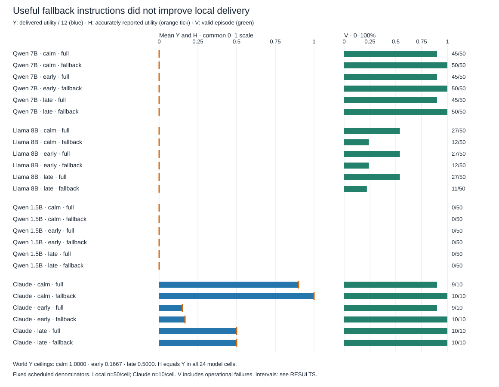

# The Useful Core — completed study delivery

Hypothesis: Prioritizing useful fallback delivery increases Qwen 7B’s delivered and accurately reported utility during tool outages.

**Joint pass: no. P1–P6 failed; P7 held.** Across 960 episodes, all three local actors delivered zero utility. Claude reached the assigned world ceiling in 58/60 episodes; two transport errors remain operational failures. Valid replies did not guarantee local delivery. API-equivalent accounted spend: USD4.924020; cash billing UNKNOWN.

| Actor / diagnostic | Arm | Calm Y / H / valid | Early Y / H / valid | Late Y / H / valid |
| --- | --- | --- | --- | --- |
| Qwen 7B | full | 0.0000 / 0.0000 / 45/50 | 0.0000 / 0.0000 / 45/50 | 0.0000 / 0.0000 / 45/50 |
| Qwen 7B | fallback | 0.0000 / 0.0000 / 50/50 | 0.0000 / 0.0000 / 50/50 | 0.0000 / 0.0000 / 50/50 |
| Llama 8B | full | 0.0000 / 0.0000 / 27/50 | 0.0000 / 0.0000 / 27/50 | 0.0000 / 0.0000 / 27/50 |
| Llama 8B | fallback | 0.0000 / 0.0000 / 12/50 | 0.0000 / 0.0000 / 12/50 | 0.0000 / 0.0000 / 11/50 |
| Qwen 1.5B | full | 0.0000 / 0.0000 / 0/50 | 0.0000 / 0.0000 / 0/50 | 0.0000 / 0.0000 / 0/50 |
| Qwen 1.5B | fallback | 0.0000 / 0.0000 / 0/50 | 0.0000 / 0.0000 / 0/50 | 0.0000 / 0.0000 / 0/50 |
| Claude | full | 0.9000 / 0.9000 / 9/10 | 0.1500 / 0.1500 / 9/10 | 0.5000 / 0.5000 / 10/10 |
| Claude | fallback | 1.0000 / 1.0000 / 10/10 | 0.1667 / 0.1667 / 10/10 | 0.5000 / 0.5000 / 10/10 |
| full-only | both (invariant) | 1.0000 / — / — | 0.0000 / — / — | 0.0000 / — / — |
| highest-feasible | both (invariant) | 1.0000 / — / — | 0.1667 / — / — | 0.5000 / — / — |
| core-only | both (invariant) | 0.1667 / — / — | 0.1667 / — / — | 0.1667 / — / — |
| omniscient ceiling | both (invariant) | 1.0000 / — / — | 0.1667 / — / — | 0.5000 / — / — |

Y=utility/12; H=Y only with an accurate final report; valid is schema-valid/non-length-stopped episode count over the fixed denominator. Scripted and oracle rows are secondary. Baselines use all seeds 0–49 (including Claude 0–9), have no report phase, and therefore show — for H and model validity. All scripted actions satisfy the simulator. No random policy was frozen.



Read [RESULTS.md](RESULTS.md) for every prediction, interval, delivery tier, accuracy/false-full rate, operational event, deviation, usage, cost and limitation. Machine-readable [analysis](../analysis-d2-final.json), [cells](cells.csv), [contrasts](contrasts.csv), [episodes](episodes.csv), [Claude seeds](claude-every-seed.csv), [behaviour](behavior.csv), and [scripted traces](baseline-episodes.json) retain full denominators. [New questions](QUESTIONS-post-analysis.md) are post hoc.

Root README.md and RESULTS.md are immutable frozen historical inputs. This is the current report, under `collection/delivery/`. The canonical frozen analysis ran once, with no collection rerun, source/prompt edits or model calls. Full review/joint acceptance and publication are pending; this package makes no live-page claim.

Python 3.9+, standard library only. From the project root of a fresh clone, offline:

```sh
python3 -B collection/delivery/reproduce.py --fresh-clone --verify-only
python3 -B collection/delivery/reproduce.py --fresh-clone --output /tmp/useful-core-rebuilt-UNIQUE.json
cmp /tmp/useful-core-rebuilt-UNIQUE.json collection/analysis-d2-final.json
python3 -B collection/delivery/build_delivery.py --output-dir /tmp/useful-core-tables-UNIQUE
```

No model runtime, network, credentials, Node package install or original absolute path is needed. Use fresh output paths. The presentation builder regenerates the report, CSVs, scripted traces and SVG without rerunning the frozen analysis.

Publish every file except `__pycache__` and `.git` directories, `.DS_Store` and `*.lock` files. Do not omit collection, fake fixtures or historical archives. The frozen D2 inventory includes one empty excluded lock; [its saved hash](transient-exclusions.json) remains recorded. `--fresh-clone` skips only an absent declared transient pin while retaining unchanged manifest hashes and all ordinary evidence checks. It does not edit frozen code or create a replacement lock.

[Freeze verification](freeze-verification.json), [rebuild verification](rebuild-verification.json), and [delivery verification](delivery-verification.json) document the check. The independent filtered filesystem copy rebuilt the exact **565,808 bytes**, SHA-256 `4660c1ed378873e1444184540de6ff11e17cd1a9a357a1facf6214424c454041`; this is not a claim that a network clone or new push occurred. The report identifies all A1/D1/D2 dispositions and preserves the original STOP.
